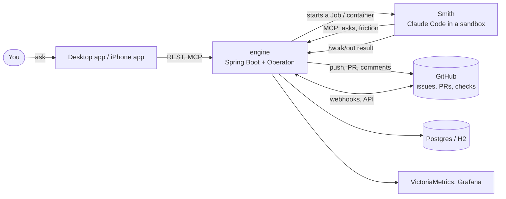

# frakworks

An autonomous bot fleet that works tickets held by its engine. You file an ask; the
engine refines it into a ticket, starts a sandboxed Claude Code agent ("a Smith") to
do the work on a branch, checks the result (build, tests, an AI review), and is
capable of merging with no intervention if allowed.

**Status:** a personal project, run daily against its own repo. Expect churn: APIs,
config and docs change often, and nothing is versioned yet.

Contributing: [`CONTRIBUTING.md`](CONTRIBUTING.md). Security reports, privately: [`SECURITY.md`](SECURITY.md). [`CODE_OF_CONDUCT.md`](CODE_OF_CONDUCT.md). Licenses of dependencies: [`THIRD_PARTY_NOTICES.md`](THIRD_PARTY_NOTICES.md).

## Why

Most agent tooling stops at one session on one laptop. frakworks treats agent work as
a process: every ticket runs through an explicit BPMN flow (refine, plan, work, review,
fix, merge) on a process engine, so runs are visible, resumable after a crash, cheap to
retry, and bounded by a budget and a sandbox. A human stays in the loop where it matters:
authorizing asks, answering questions, and merging.

## Architecture



- `engine/`: the process engine. It owns every flow (intake, chore, bug, feature,
  proposal, research), holds the AI account credentials sealed, and does every
  GitHub write. Docs: [`engine/README.md`](engine/README.md) and
  [`engine/docs/`](engine/docs/README.md).
- A **Smith** is one agent run on one ticket, in its own container (Kubernetes Job,
  or a sibling container in the local stack). It never writes to GitHub; it commits
  on a branch and hands back a result file.
- The **desktop app** (`observability/desktop/`, Electron) and the **iPhone app**
  (`ios/`) are the human's side: the issues board, decisions, and a chat ("First mate").

## Prerequisites

- Docker (with Compose), for the local stack and for building the engine.
- A GitHub token or GitHub App with access to the repos the engine works.
- Claude credentials (an Anthropic API key or a Claude subscription login) for the Smiths.
- Optionally Kubernetes, to run the engine the way the fleet does (`deploy/k8s/`).
- Node.js, to run the desktop app from source.

**Platforms:** linux/amd64 only today (the engine and Smith images are built for amd64).

## Quickstart

```sh
git clone <this repo> && cd frakworks
cp .env.example .env        # fill in the GitHub and Claude credentials
bash scripts/local-up.sh    # builds and starts the whole stack
```

The engine then listens on host port 8090 (`curl localhost:8090/health`). How the
local stack works: [`docs/local-stack.md`](docs/local-stack.md).
Engine build and tests alone: `docker compose build engine`.

### The desktop app, from source

```sh
cd observability/desktop
npm install
npm run build
npm start
```

Point it at your engine under Config > frakworks.

## Folders

| Folder | What it is |
|--------|-----------|
| `engine/` | The process engine (Kotlin, Spring Boot, Operaton): flows, REST API, MCP servers, Smith runs |
| `sdk/` | The plugin API a custom job's jar programs against (`engine/docs/custom-jobs-and-the-sdk.md`) |
| `bots/` | The agents' protocol: `smith.md` (how a Smith works), `model-choice.md` (tiers), `story-points.md`, `refactor-values.md` |
| `deploy/k8s/` | A Kustomize base for running the engine on Kubernetes |
| `observability/` | VictoriaMetrics/Logs and Grafana, and the Electron desktop app (`desktop/`) |
| `ios/` | The iPhone first mate (SwiftUI) |
| `shared/` | Prompts and data shared by the engine and the apps |
| `scripts/` | `local-up.sh` (the stack from a clean clone) and helper scripts |
| `docs/` | Proposals ([index](docs/proposals/README.md)), the [local stack how-to](docs/local-stack.md), research notes, and the [public-release checklist](docs/public-release.md) |
| `compose.yaml` | The whole stack on one machine |

## License

See [`LICENSE`](LICENSE).
