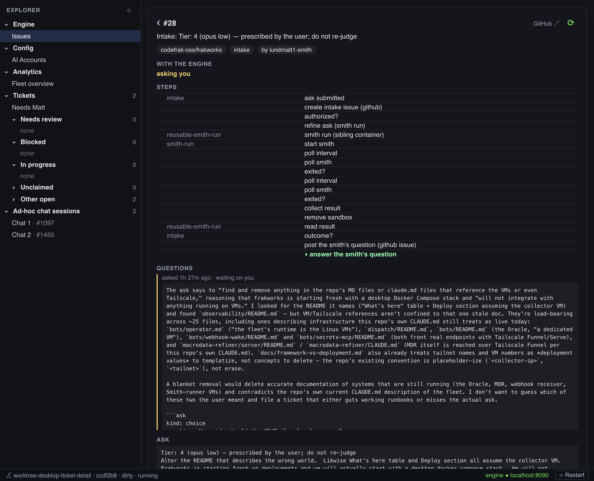
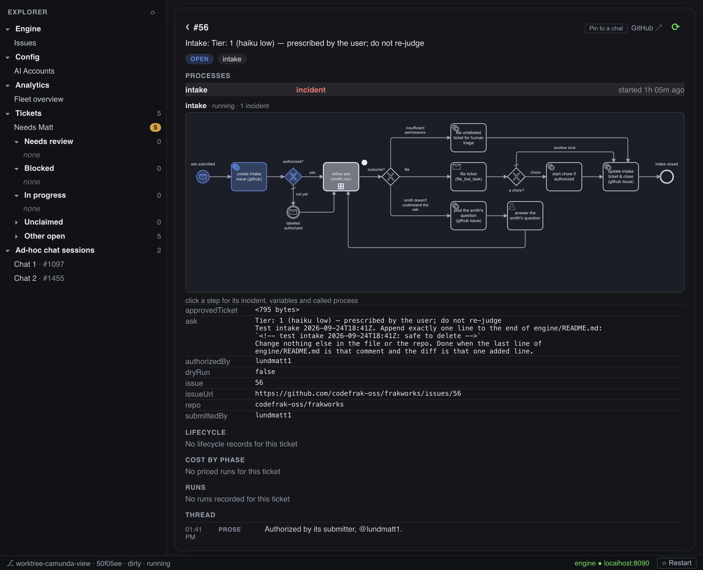
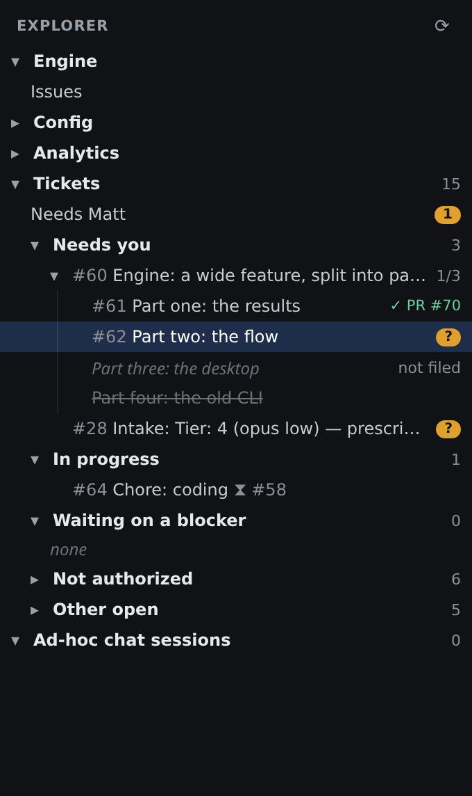
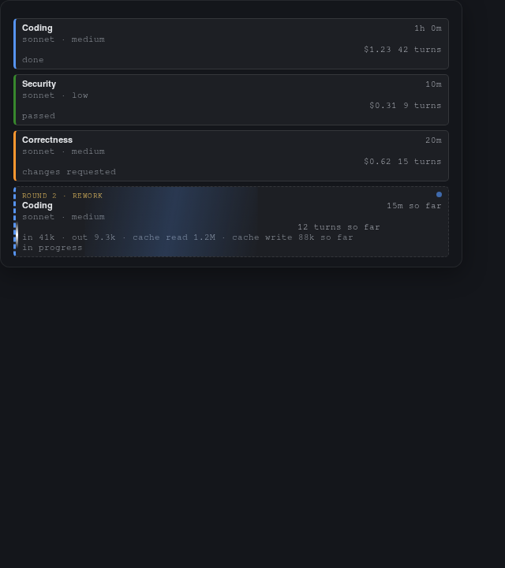
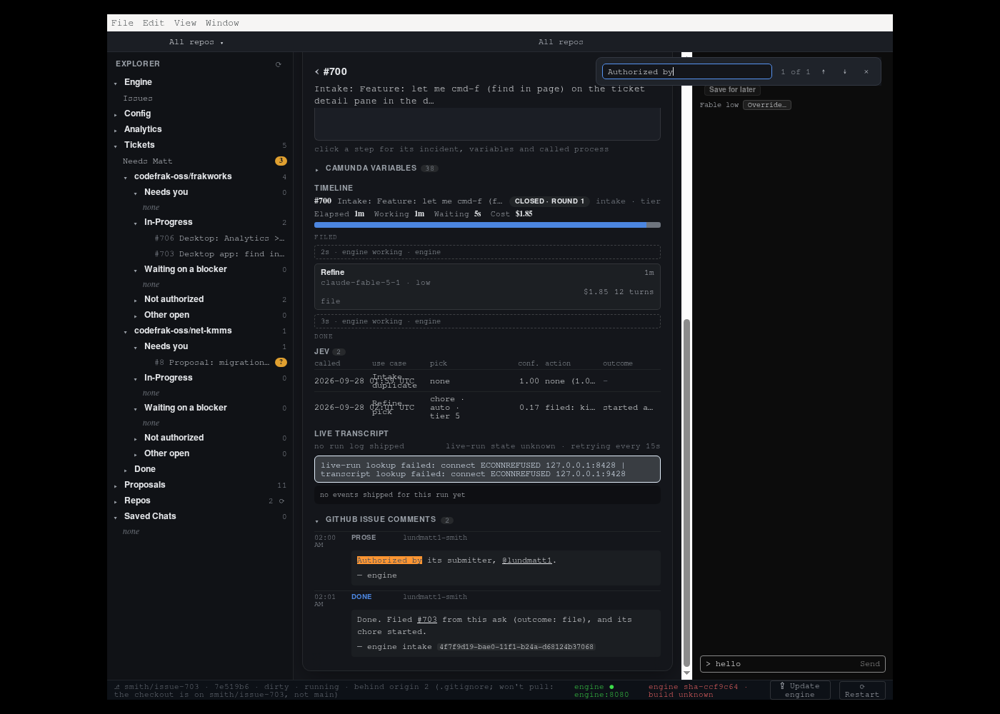

# frakworks desktop app — stages 1, 2, 3a and 4, plus First mate

The fleet's desktop app, built in stages. No host change anywhere, and no credential in this repository.

**Stage 1 (issue #1276)** — an Electron window showing the fleet dashboard,
a port of an Übersicht desktop widget. The dashboard (Analytics > Fleet
overview), the TypeScript data layer that built its document (stage 5, #1284)
and the app's TypeScript build were removed on 2026-10-05; git history has
them.

**Stage 2 (issue #1281)** — the [ticket detail view](#the-ticket-detail-view-stage-2):
pick a ticket and the window shows that one
ticket's segmented stage bar, cost by phase, runs and thread. Still no new
credential — `gh` and VictoriaLogs are what stage 1 already needed.

**Stage 3a (issue #1282)** — the third screen and second tab, **Needs you**:
a read-only, prioritized list of the tickets waiting on a human, described in
its own section below.

**Stage 4 (issue #1283)** — the [live transcript pane](#the-live-transcript-pane-stage-4):
when the ticket on screen has a Smith running, the detail view grows a pane
that shows that run's stream-json events as `dispatch/smith-tail` renders
them, followed live by a VictoriaLogs live tail (`/select/logsql/tail`, #1006).
Again no new credential and no host change — Alloy already ships those logs.

**The Chats tab** (two proxied `claude -p` chat panes with same-host peers,
a shared choice contract, read-only ticket pins and a Keycloak sign-in to
answer a pinned question; proxied-sessions stages 1–4, #1326, #1334, #1337,
#1339) was removed on 2026-09-27 in #634. [First
mate](#first-mate-a-persistent-chat-strip-on-every-screen-issue-100) and
[Saved chats](#saved-chats-issue-598) are what is left of chat in this app.

## What's here

| Path | Purpose |
|---|---|
| `src/main.js` | Electron main process: one `BrowserWindow` (`contextIsolation: true`, `nodeIntegration: false`, `sandbox: true`), the IPC handlers (the channels `test/navigation.test.js` lists, all but `fleet:rendered` and `log:error` an `invoke`) — `ticket:fetch`, `transcript:fetch`, `needs:fetch`, `tree:tickets`, `tree:done`, `repo:get`, `repo:set`, `app:initial-view`, `app:version`, `app:restart`, the seventy-seven `engine:*` reads and writes, the sixteen `firstMate:*` channels, the two `grafana:*` ones, the two `env:*` ones, `hitlp:call` (Utils > HITLP producer) the four `hitlp:surface-*` ones (the HITLP server, #2487) and `hitlp:tasks` (its task list, #100064) — external links opened in the browser |
| `src/engine-data.js` | The engine as a data source ("Tickets > Tickets", below): `fetchIssues()` reads `GET /issues` `fetchAccounts()` reads `GET /accounts` + `GET /accounts/usage`, and `fetchRepos()` and `repoAction()` read and write the target repos ("Config > Repos", below), at `ENGINE_URL` and resolves to `{ issues, failures }` or `{ error }`, never rejects. No `gh`, no metrics store, no credential: the engine holds each target repo's token |
| `src/fresh-code.js` | First mate's fresh clones ("First mate runs from fresh code", below): `createFreshCode`, one detached whole clone per target repo under `<userData>/first-mate/fresh/<owner>/<name>/`, fetched through the engine's git proxy on the stream's `push` frame and once per `hello`, `fresh.json`, `readRepoInstructions`, the one-time copy of the project directory. No timer |
| `src/engine-token.js` | Sign in to the engine (#2206, "Sign in to the engine" below): the one bearer token, verified with `GET /whoami`, kept safeStorage-encrypted in `<userData>/engine-token.bin`, handed out as the `Authorization` header to main and `src/engine-data.js` only; `signIn`, `signOut`, `status`, `load` answer the login and the token's name |
| `src/renderer/sign-in.jsx` | Config > frakworks > Sign in to the engine (`SignInPanel`): the token field (cleared after every submit), the signed-in line, Sign out, the engine's refusal; never holds a token prop |
| `src/engine-events.js` | The engine's event stream in main ("The event stream", below): `EngineEventStream`, one `GET /events` connection per repo in use, the SSE parser (`parseSse`), the `hello` → snapshot → `live` hand-off, the capped backoff and the 45 s dead-connection rule, pushed to every window as `engine:event` and `engine:stream` |
| `src/web/` | The web version ("Web version", below): `fleet-web.js` (`window.fleet`, `window.repo` and `window.app` in the page, from the same modules main calls; the HITLP server's surface API over `src/hitlp-surface.js` with a sessionStorage keeper, #2489), `first-mate-web.js` and `first-mate-web-store.js` (`window.firstMate` in the page, #100104: a conversation in a session pod with the page's bearer, kept in localStorage per login), `index.jsx` (the sign-in gate, then the shared renderer's `mount`), `index.html`, `web-overrides.css`, `build.js` (`npm run build:web` into `dist-web/`) and `node-shims/` (the `node:` built-ins in the bundle) |
| `test/web-fleet.test.js` | The web bridge: parity with preload's members, the desktop-only ones' error, sign-in and the bearer, the HITLP server set, read, decided and subscribed from the page with its own credential, the grep for the engine's removed HITLP paths, the repo selection, ticket links as `#/ticket/…`, the sha256 shim, the build |
| `src/app-version.js` | The status bar's facts ("The status bar", below): the checkout's `HEAD` and dirtiness, the commit the app started on and whether the commits between touch this app (local git only), and `rebuild()`, what the button runs before a relaunch |
| `src/renderer/status-bar.jsx` | The bar itself: the version phrase, the engine dot, the engine's build with the Update engine button, and the Restart button |
| `src/engine-update.js` | The Update engine button ("The status bar", "Update engine", below): the running engine's build (its container's RepoDigests, `/version`'s `commit`) against the registry's `frakworks-engine:main`, checked every 30 s; the live-run count from `/metrics`; and `update()`, the click's `docker compose pull engine` then `up -d --no-deps engine`, run by one detached runner (the app's binary as Node) with its log and status file in userData (`engine-update.log`, `engine-update.json`), resumed by a relaunched app; and the launch backstop that starts an engine container left in Created |
| `src/engine-update-progress.js` | The Update engine overlay's follower in main (#1053, "The progress overlay" below): the five steps, each ticked by its own event (the runner's log and status file, `docker events`, `docker logs -f`, one `/version` and one `/metrics` read), the view file a relaunch resumes from, and the quit prompt while an update is in flight |
| `src/renderer/update-overlay.jsx` | The overlay itself: the steps, the current step's raw lines, the end (updated, or the failed step) and its Close |
| `src/env-lines.js` | Config > frakworks > .env (#912, below): the key rule, `compareEnv` (the deployment's `.env` keys against `.env.example`, unused and missing), `projectDir` (the checkout, or the engine container's compose working directory from `src/engine-update.js`), and `removeEnv`, which rewrites `.env` in place without the confirmed lines. Key names only ever leave it |
| `src/renderer/env-lines.jsx` | The page's `.env` section (`EnvLines`, drawing only; `EnvLinesPanel`, its Remove) |
| `src/renderer/tiers.jsx` | Config > frakworks > Tiers (#1099, below): the engine's tier map, a model and an effort select per tier and the security tier's select (`Tiers`, drawing only; `TiersPanel`, its saves) |
| `test/tiers.test.js` | The tier map's reads and writes (`GET`/`PUT /tiers`, `/security/tier`), main's copy (`src/engine-tiers.js`), and the section's rows and actions |
| `test/env-lines.test.js` | The key rule and comparison (comments, blanks, `=` in a value, no value in a result), the removal on a mixed fixture byte for byte (inode and mode kept, no backup file), the refusals, and the section's states |
| `src/docker-bin.js` | Which `docker` the button runs: `AGENT_ARMY_DOCKER_BIN`, else PATH, the login shell's PATH, then the usual install dirs (`src/claude-bin.js`'s rules) |
| `src/app-update.js` | The packaged build's version and self-update: electron-updater on the release feed, the state `app:version` reports and Restart installs ("The packaged build") |
| `src/deployment-config.js` | The deployment values in `agent-army.config.json` ("Deployment values", below): `registry`, the image registry the Update engine button asks, `release_feed`, the packaged build's update feed, and `logs_url` / `metrics_url`, the collector's VictoriaLogs and VictoriaMetrics for the transcript pane. Unset: `localhost:5000`, the build's baked-in URL, and no transcript (an error naming the key) |
| `src/renderer/issues.jsx` | Tickets > Tickets (with `work-items.jsx`): the engine's board as a table, one row per open issue with its labels, a `<n> pts` chip when the engine has its story points (`points`), and `stateOf()`, the one phrase that says where the engine is with it; a split feature's row adds `childrenSummary()` ("3 parts: #61 merged, #62 open, 1 pending") and a child's row a `part of #n` label (engine/README.md "Split features"); there is no age column: each ticket's age sits under its number as a smaller, muted live clock counting up once a second from `createdAt` (`0:29`, `3:07:42`, `1d 2:03:04`; `fmtAgeClock()`, `TicketAge`); every repo group's table has the same fixed column widths, so the columns line up across groups |
| `src/renderer/stage-board.jsx` | Tickets > Tickets, Board view (#100094): `StageBoard`, the same rows as cards in stage columns; `stageColumnOf()` (a row's `flow.stage` to its column), `isSmithRunning()` and `groupByColumn()` are pure and tested in `test/stage-board.test.js` |
| `src/renderer/flow.jsx` (Parts) | The issue detail's "Parts" table for a split parent: each child's number, title, kind and state with its PR, and on a child the link to its parent |
| `src/renderer/main-build.jsx` | The ticket detail's main build strip (#100090, "One ticket detail"): `mergedSha`, `matchMainBuild`, `mainBuildLabel`, `MainBuildView` (drawing) and `MainBuildStrip` (polls `window.fleet.ciRuns` every 15 s) |
| `src/renderer/detail.jsx` | The one ticket detail (#802): `TicketDetail` (its `TicketDetailView` is the hookless body the tests walk), whichever list opens the ticket — Tickets > Tickets, Tickets > Needs you or a Tickets tree row ("One ticket detail", below) |
| `src/renderer/flow.jsx` | The detail's engine sections: the flow (`FlowBody`), the Doctor section, the `/needs` helpers that pick the row the inline HITLP task waits on, and the off-board read |
| `test/ticket-detail-entry.test.js` | The one detail from each entry point: the same inline HITLP task for a `question` `/needs` row, and the same authorize notice |
| `src/renderer/process.jsx` | The process view ("The process view", below): a ticket's process instances as Cockpit shows them — the list, the open one's BPMN diagram with completed / active / incident markers (bpmn-js), the clicked step's incident, variables and called process |
| `test/process.test.js` | The three `/camunda` reads against a stand-in fetch, and the view's pure parts against a tree shaped like the engine's answer for an intake that tripped an incident |
| `fixture-issues.json` | One real `GET /issues` answer from the local stack (2026-09-24), plus a hand-added split parent #60 and its child #62 (2026-09-25), `test/issues.test.js`'s input |
| `src/ticket-data.js` | `fetchTicketData(n)`: one ticket's detail document. Four independent lookups — lifecycle intervals, cost by phase, runs, the issue and its comments — each failing into its own `*_error` field. Never rejects |
| `src/transcript-data.js` | `fetchTranscript(n, { since })`: is there a live run for this ticket (`smith_run_active` on VictoriaMetrics), and what has its newest session logged since `since` (VictoriaLogs). Never rejects |
| `src/transcript-format.js` | The transcript pane's formatter: assistant prose, one `→ <Name>  <description>` line per tool call, and the `── result:` run-end lines; nothing else (#885). No time column, and every rendering puts a blank line between entries (#934) |
| `src/needs-you.js` | Main process: `fetchNeeds()` reads the engine's `GET /needs` (through `src/engine-data.js`) and `toRows()` turns that list into the rows, by kind then longest wait — a pure function, so the ordering is testable; `fetchHitlpTasks()` reads the HITLP server's `GET /tasks` once for the window (`hitlp:tasks`), `surfaceRows()` the open tasks and `closedRows()` the decided ones |
| `src/preload.js` | The whole bridge: `window.fleet.fetchTicket(repo, n)` (→ `ticket:fetch`), `window.fleet.fetchTranscript(n, since, run)` (→ `transcript:fetch`), `window.fleet.needsYou()` (→ `needs:fetch`), `window.fleet.initialView()` and `window.fleet.rendered(state)` (headless evidence, below), plus `window.repo`, `window.firstMate` and `window.app` |
| `src/renderer/ticket.jsx` | The detail's ticket-read sections (description, pull requests, comments; a work item's body and comments, which the engine sends with no HTML, are rendered here from markdown with `marked` and DOMPurify, inline SVG pitches included, not by GitHub's `POST /markdown`, which strips SVG) and stage 4's `TranscriptPane`; once the detail view: `StageBar` (one segment per interval, live elapsed on the open one), cost by phase, the runs table, the thread, and stage 4's `TranscriptPane` + `mergeTranscript` (the pure fold that makes the read and the live tail incremental) and `transcriptLoop` |
| `src/renderer/find.jsx`, `find.html` | The find-in-page bar (#703, below): its own `WebContentsView` over the window's top right, built to `dist/find.js`; `findStep` is its state, tested in `test/find.test.js` |
| `src/renderer/needs-you.jsx` | The "needs you" view: the engine's `GET /needs` rows only, one section per kind of Need, one row per Need, and `needsTicketCount` (the explorer badge); the helpers the task view shares (`buttonsFor`, `parseTyped`, `surfaceDecide`, `Countdown`) |
| `src/renderer/hitlp-requests.jsx` | HITLP Requests and its Closed child (#100064): the HITLP server's open tasks (Age, Kind, Priority, Requester, Question, with requester, priority and text filters; a click opens the task below the table in the one task view, `HitlpTask`) and its decided ones (outcome, decided by, channel, when; requester, outcome and time-window filters). Built to `dist/hitlp-requests.cjs` for the tests |
| `test/hitlp-requests.test.js` | HITLP Requests and Closed from `test/fixture-hitlp-tasks.json`: the rows, columns, filters, the live age and its interval, the opened task's decide card, not set and errors; and the explorer: HITLP Requests above Tickets with its badges, Needs you first under Tickets, the Tickets heading as the pane, the leaf rows' chevron gap |
| `src/hitlp-surface.js` | The HITLP server's surface API (#2487, #2489): `GET /tasks`, `GET /tasks/{id}`, `POST /tasks/{id}/decision`, and `GET /events` held open to refetch the shared task list, over `fetch` so main and the web page share it. The URL and surface credential live in a *keeper*: `safeStorageKeeper` (main; `hitlp-surface.bin`, safeStorage, 0600) or `storageKeeper` (the web page's sessionStorage) |
| `test/hitlp-surface.test.js` | The surface client's store, calls, `channel` on the decision and the `task` event refetch |
| `src/renderer/hitlp-task.jsx` | The one HITLP task view (#2648, #100070): `HitlpTask` (the question, its body and the requester's why rendered from markdown with `marked` and DOMPurify, inline SVG pitches included, through the renderer `src/renderer/markdown.js` shares with `ticket.jsx` and recommendation, the attestation, the decide buttons; the back link only with an `onBack`), used by the urgent popup, HITLP Requests and, through `TicketTask`, a waiting ticket's detail and a proposal's view; `TicketTask` finds the ticket's task (the hint's id, else the open-task list by `repo` and `ticket`), reads it with `window.fleet.hitlpSurfaceGet`, and draws `HitlpTask`, `DecidedTask` (outcome, who, when) or the surface's error in one line. Built to `dist/hitlp-task.cjs` for the tests (`test/ticket-task.test.js`) |
| `src/renderer/ask-card.jsx` | `hintTaskIdOf`: the HITLP task id from the engine's hint on a ticket's newest announcing comment ("HITLP task <id> on the engine's HITLP server"), for `TicketTask`. The read-only decision card it drew was removed (#100070) |
| `src/renderer/hitlp-popup.jsx` | The urgent HITLP popup over every view (#2196); `src/hitlp-popup.js` picks the row and keeps snooze and silence. Colours (#2199): a deep blue card (`#4c86e0` 60% with black, fixed under every palette), lighter-blue tiles with bold white labels, white text throughout, the same in dark and light; every text is at least 4.5:1 against its surface, checked by `test/styles.test.js` |
| `src/judge-teach.js`, `src/renderer/judge-teach.jsx` | The judge escalation's Allow and teach / Deny and teach (#2436): which card shows them, the click (decide, then `POST /judge/teach`), and the disabled tooltip without a first-mate token |
| `test/hitlp-popup.test.js` | The popup's choice of row, snooze and silence, keys, and the card for an ask and an approve |
| `src/renderer/index.jsx` | Mounts the views and the tab bar, owns each view's read and when it runs (on the event stream, `renderer/engine-events.js`), and both manual ⟳ refreshes. Also the router: one `ticket` state, `null` = the tabs. |
| `fixture-needs-you.json` | A `GET /needs` body covering every kind, including an incident with no issue — `test/needs-you.test.js`'s input |
| `src/renderer/pitch.jsx` | The issue detail's Pitch view (#563, below) and the ticket detail's Pitch section (#579, `TicketPitch`): a proposal's pitch page in a sandboxed `srcdoc` frame; the section's is always dark, with a full-window overlay. The section's parts are re-exported by `ticket.jsx`, so the tests (`test/pitch.test.js`) reach them through `dist/ticket.cjs` |
| `src/proposal-list.js` | The Proposals branch's rows (#660, below): `toProposalRows` merges the engine's proposal docs, the board's proposal tickets and the `decision` Needs, one row per proposal with its status and where that status comes from. Pure, so it is tested on a fixture |
| `src/renderer/proposals.jsx` | The explorer's Proposals branch (`ProposalsBranch`) and the proposal view (`ProposalView`, `ProposalFacts`): the facts above the Pitch view's decision controls and pitch |
| `src/repo-files.js` | The Repos branch's pure parts (#674, below): `buildTree` makes the engine's flat tree into folders, `fileView` sorts a file's bytes into markdown, text or binary and cuts text at 256 KiB |
| `src/renderer/repo-files.jsx` | The explorer's Repos branch (`ReposBranch`) and the file view (`RepoFileView`): a target repo's files at its default branch, markdown rendered locally, shown split over its highlighted source (`MarkdownSplit`, #675) |
| `src/highlight-languages.js` | The file view's extension → highlight.js language map (#675, below): `languageFor(path)`, plaintext when the extension is unknown. Pure, so it is tested |
| `src/renderer/highlight.js` | highlight.js core with only the map's languages registered; `highlightFile` / `highlightHtml` return its escaped HTML |
| `fixture-proposals.json` | Hand-built `GET /proposals` docs, board rows, Needs and doc pages: a proposal awaiting a decision, one accepted with a build ticket, a shelved doc, a doc from before pitches and a flow still drafting — `test/proposals.test.js`'s input |
| `src/renderer/jev.jsx` | Analytics > Jev decisions (#553): the top strip, one section per use case, the calls table and the call drawer. Re-exported by `ticket.jsx`, so the tests reach it through `dist/ticket.cjs` |
| `fixture-jev-summary.json`, `fixture-jev-calls.json`, `fixture-jev-call.json` | Hand-built `GET /jev/summary`, `/jev/calls` and `/jev/calls/{id}` bodies (every use case, a no-answer, a relabelled refine pick, a duplicate question with more options than the picks chart shows) — `test/jev.test.js`'s input |
| `src/renderer/hitlp-producer.jsx` | Utils > HITLP producer (#1947, below): the Server, Kind and form, Submit, Reset and Poll, and the Request and Response panes (`HitlpProducerView`, hookless; `HitlpProducer`, its state). Built to `dist/hitlp-producer.cjs` for the tests |
| `src/hitlp-request.js` | The producer's pure parts: each kind's fields and defaults (HITLP 0.2's envelope: `asserted.*` and `requiresHuman`, no `requester`), the digest (SHA-256 of the payload's canonical JSON), the tool arguments built from a form, and the `initialize`, `tools/call` and `tasks/get` bodies |
| `src/hitlp-client.js` | The producer's MCP client in main (`hitlp:call`): `initialize`, `notifications/initialized`, then the call, JSON-RPC over streamable HTTP to the server the user named; never rejects. The only header main adds is the requester token pasted on the page (#2489), never the app's own credentials |
| `test/engine-token.test.js`, `test/sign-in.test.js` | The sign-in: store, verify, show, sign out, the 401 after sign-in, and the scan that no renderer module names the token keeper, `bearer()` or `Authorization` |
| `test/hitlp-producer.test.js` | The producer's tests: the fields per kind, the defaults, the Ask and Approve arguments, the client against a stand-in server, and the panes after a stubbed call |
| `src/renderer/doctor.jsx` | Analytics > Doctor (#706, below): the success classification (`classifyDoctorRuns`, `doctorStats`, pure), the top strip, the runs table and a run's detail row. Built to `dist/doctor.cjs` for the tests |
| `fixture-doctor-runs.json` | A hand-built `GET /doctor/runs` body across four tickets: an `applied` run stuck again at the same position, an `applied` run stuck again at the same leaf under a new incident id (#751's case), `applied` runs with no later run there, a later run on the same flow at another position, a `failed`, a `none` and a `running` run — `test/doctor.test.js`'s input |
| `test/doctor.test.js` | The Doctor page's tests: each run's verdict, the strip's counts, the table, the detail row and the one-line error |
| `src/renderer/friction.jsx` | Analytics > Friction notes (#1046, #1098, below): the strip's counts (`frictionStats`), the per-day and by-kind bars (`perDayBars`, `kindBars`), a note row (`noteRow`), a group row (`groupRow`, `countLabel`), the joined-by label (`joinedBy`), the table's rows (`tableRows`) and the page's state (`pageState`), all pure; the charts, the filters, the groups table with its expanded members, Pull out and Merge into…. Built to `dist/friction.cjs` for the tests |
| `src/renderer/ssh-verdicts.jsx` | Analytics > SSH verdicts (#2439): the SSH judge's `ssh-judge` calls newest first over `GET /jev/ssh-verdicts` (`engine:ssh-verdicts`; the selected repo's, else every repo's), with when, host, command, verdict, confidence, cited passage, reasoning and the human decision of the HITLP task that carried the call's id, as the engine reports it (`engine/README.md`, "SSH verdicts"; the task is decided on the HITLP server since #2487). The weekly `judge rubric consolidation` job that folds the taught Decisions back into the rubric shows under Config > Jobs (`engine/README.md`, "Rubric consolidation"). Built to `dist/ssh-verdicts.cjs` for the tests |
| `src/renderer/refactor-runs.jsx` | Analytics > Refactoring (#1781, below): the refactoring job's run history, one section per repo; the run line (`runLine`), one repo's runs (`RefactorRuns`), the page (`RefactorRunsView`) and a repo's section read (`loadSection`). Built to `dist/refactor-runs.cjs` for the tests |
| `fixture-friction-summary.json`, `fixture-friction-notes.json`, `fixture-friction-groups.json` | Hand-built `GET /friction/summary`, `GET /friction/notes` and `GET /friction/groups` bodies over the same six notes (two days, every source, a First mate note with no repo; two groups whose members join in each of the six ways) — `test/friction.test.js`'s input |
| `test/friction.test.js` | The Friction notes page's tests: the counts and the groups stat, the bars, the group rows and their members with joined by, the grouping… row, Merge into…, the detail row, the filters, the empty and error lines, the wiring, and `fetchFrictionSummary` / `fetchFrictionNotes` / `fetchFrictionGroups` / `frictionPullOut` / `frictionMerge` |
| `src/answer-config.js` | `readConfigFile`: reads `agent-army.config.json` for Grafana and First mate's tier. Public values only — a file carrying a credential is refused. |
| `src/grafana-config.js` | Analytics' Grafana public dashboards (#332): `grafana_url` and `grafana_dashboards` from the same file, the frame URL, the page copy whose CSP allows that origin in `frame-src`, the down probe, and the http(s)-only rule for links leaving the app |
| `src/renderer/grafana.jsx` | One Grafana dashboard: the sandboxed iframe, or the error block when the probe failed |
| `test/github-reads.test.js` | The guard for "Reading GitHub: only through the engine", below: fails when any module under `src/` spawns `gh` or names `api.github.com` |
| `agent-army.config.example.json` | The checked-in, non-secret example of `agent-army.config.json` |
| `src/renderer/styles.css` | The views' styles, scoped to `.fleet-root`, with the palette's roles on `:root` (`--bg` … `--info`, the Current scheme; Config > Palettes, `src/renderer/palettes.jsx`, sets another on `<html>`, checked for 4.5:1 by `test/palettes.test.js`), plus the `.td*` rules the detail view adds and the tab / `.nm*` rules the needs view adds |
| `src/renderer/index.html` | Loads `dist/renderer.js` (the esbuild bundle) under a CSP that allows nothing remote |
| `fixture-ticket.json` | One ticket's detail document, hand-built so it exercises all eleven stages and all five recognised comment prefixes in one bar |
| `fixture-transcript.jsonl` | Real stream-json events lifted from `dispatch/logs` on smith-runner (thinking signatures redacted, long text clipped), plus the two shapes a healthy run never produces: a usage-limit `result` and a Codex `item.completed` |
| `fixture-transcript.expected.txt` | What the pane renders that fixture to — the formatter's contract |
| `test/` | `node --test` suites: every error input → error state; the fixtures → every panel; the LogsQL the detail view and the transcript pane send; the navigation contract; the formatter port against the real `observe.py`; and First mate against a fake stream-json child (`fake-claude-child.js`), which is why `npm test` needs no Claude login |
| `screenshots/` | Evidence from the headless Ubuntu launches — the detail view in its data and error state, plus the transcript pane following a live run |

Adding a view or an IPC channel means updating
`test/navigation.test.js`, `test/grafana.test.js` and
`test/chat-about-screen.test.js`: a ticket for such work lists all three,
named in full, in its Allowed scope.

`dist/` (renderer bundle), `release/` (electron-builder output) and
`node_modules/` are git-ignored.

## Dependencies

- The engine at `ENGINE_URL`: the app reads GitHub only through it
  ("Reading GitHub: only through the engine", below). The app needs no `gh`
  at all: its login is the signed-in engine token's (`GET /whoami`).
- Network reach to VictoriaMetrics and VictoriaLogs on the collector host
  (`metrics_url` / `logs_url` in `agent-army.config.json`, "Deployment
  values" below), for the transcript pane —
  from a laptop that usually means being on the tailnet.

## Environment variables

| Variable | Default | Meaning |
|---|---|---|
| `ENGINE_URL` | `http://localhost:8090` | The engine ("Tickets > Tickets"): the local stack's published port, or an engine elsewhere, e.g. `https://engine.k8s.example` on a cluster (any scheme and port; https with the system's trusted CAs). An engine not on this machine is not updated from the app ("Update engine", "An engine on a cluster"). Main-process only |
| `ENGINE_TIMEOUT_SECS` | `20` | Per-request timeout on engine reads |
| `AGENT_ARMY_DOCKER_BIN` | (lookup) | The `docker` the Update engine button runs (`src/docker-bin.js`) |
| `AGENT_ARMY_REPO_DIR` | unset | Packaged build only ("The packaged build"): the frakworks checkout First mate may read at its absolute path (the user's branch and uncommitted changes), named in its system prompt; unset, no checkout is named. First mate runs `claude` in the fresh clone of its repo under `userData`, not here ("First mate runs from fresh code"). In a checkout the app names the checkout it sits in |
| `AGENT_ARMY_ONCE=1` | unset | Headless proof mode: log what the first render drew, write `AGENT_ARMY_SCREENSHOT` (a PNG path) if set, then quit. For the user's own machine and the fleet VMs, not a Smith sandbox (no display, no `xvfb`) — see "Screenshot: skipped" |
| `TICKET_DATA_TIMEOUT_SECS` | `10` | Stage 2. Per-request timeout for the detail view's VictoriaLogs and `gh` calls (each of the four runs on its own) |
| `AGENT_ARMY_TICKET` | unset | Stage 2. Open straight onto this ticket's detail view — a deep link, and how `AGENT_ARMY_ONCE` photographs the view |
| `AGENT_ARMY_VIEW` | `issues` | Which view the window opens on, by its id (`VIEWS` in `src/renderer/index.jsx`): `issues`, `needs`, …. Only the opening view — the others load either way |
| `AGENT_ARMY_ONCE_DELAY_MS` | `0` | Stage 4. Wait this long before the `AGENT_ARMY_ONCE` screenshot, so the transcript pane's first read has landed in the picture |
| `AGENT_ARMY_ITERM_APP` | unset | First mate's "Open in Claude Code ⇗" (#820). The iTerm2 app bundle to drive; unset, `/Applications/iTerm.app` then `~/Applications/iTerm.app`. Main-process only |
| `AGENT_ARMY_CLAUDE_BIN` | *(resolved)* | First mate. The binary its child is spawned as. Unset, `src/claude-bin.js` takes the first `claude` on the process PATH, then the login shell's PATH (a Finder/Dock launch inherits launchd's PATH, which has no `~/.local/bin`), then `~/.local/bin`, `~/.claude/local`, Homebrew and `/usr/local/bin`; the login shell's PATH is merged into the app's so the child's `gh` and `git` resolve too. Main-process only — the renderer cannot choose it |

Otherwise stage 4 adds no variable of its own: the transcript pane reads
`metrics_url` (the liveness gauge) and `logs_url` (the events) from
`agent-army.config.json` ("Deployment values", below) and
`TICKET_DATA_TIMEOUT_SECS` (its per-request timeout). The Operator-era
`DISPATCH_VM_URL`, `DISPATCH_LOGS_URL` and `DISPATCH_REPO` are gone: an unset
key is not defaulted, the pane shows its `.err` block naming it. Since #577
no view reads a default repo: the repo every view shows is the repo
switcher's choice.

## Web version

The same app in a web browser: the Issues board, the ticket detail, Needs, the
explorer, Analytics and most of Config, against the engine that serves it, for a
machine without the desktop app. It is not a fork: the browser runs this
directory's renderer (`src/renderer/*.jsx`) as it is, and only the bridge under it
differs.

<svg xmlns="http://www.w3.org/2000/svg" width="600" height="180" font-family="sans-serif" font-size="12">
  <rect x="10" y="20" width="190" height="140" rx="8" fill="#eef" stroke="#447"/>
  <text x="20" y="40">src/renderer/*.jsx (shared)</text>
  <rect x="20" y="60" width="170" height="34" fill="#fff" stroke="#447"/>
  <text x="28" y="82">Electron: src/preload.js</text>
  <rect x="20" y="110" width="170" height="34" fill="#fff" stroke="#474"/>
  <text x="28" y="132">Browser: src/web/fleet-web.js</text>
  <line x1="190" y1="77" x2="400" y2="77" stroke="#447"/>
  <line x1="190" y1="127" x2="400" y2="127" stroke="#474"/>
  <text x="205" y="70">IPC → main → src/engine-data.js</text>
  <text x="205" y="120">src/engine-data.js in the page</text>
  <rect x="400" y="40" width="190" height="110" rx="8" fill="#efe" stroke="#474"/>
  <text x="410" y="65">engine</text>
  <text x="410" y="88">REST API + /events (bearer)</text>
  <text x="410" y="111">/web/: frakworks-web (nginx)</text>
</svg>

- **How it works.** `src/preload.js` gives the Electron renderer `window.fleet`,
  `window.repo` and `window.app`, each member an IPC call that main answers with
  `src/engine-data.js` (and `needs-you.js`, `ticket-tree.js`, `ticket-data.js`,
  `engine-tiers.js`, `engine-events.js`). `src/web/fleet-web.js` builds the same
  three objects in the page from the same modules, called directly, and
  `window.firstMate` beside them (**First mate**, below): every member
  preload has exists there (`test/web-fleet.test.js` holds the parity), and
  neither has an answer or choice member: the page's ticket detail answers a
  waiting ticket's HITLP task in place as the desktop does, through
  `hitlpSurfaceGet` and `hitlpSurfaceDecide` (#100070), and
  `window.fleet.platform` is `"web"`. `src/engine-data.js` takes the engine's
  address as the page's own origin when there is no `process` (relative URLs, so
  no CORS and no address the page could choose); `src/web/node-shims/` stands in
  for the `node:` built-ins those modules name. `src/web/index.jsx` mounts
  `src/renderer/index.jsx`'s `mount` once signed in.
- **Sign in.** The page shows only a sign-in screen until an engine token is
  pasted: the same bearer token the desktop's Config > frakworks > Sign in takes
  (`POST /tokens`, or First mate's `mint_token`; `engine/README.md`, "Tokens"). It
  is checked with `GET /whoami` and kept in the tab's `sessionStorage` (gone when
  the tab closes or on Sign out), sent as `Authorization: Bearer` on every
  request, and never put in a URL, a log or the repo. Writes go as the login the
  token proves, as on the desktop. Without a valid token every engine endpoint
  answers 401 and the page shows the sign-in screen again.
- **HITLP server** (#2489). Config > frakworks > HITLP server works in the page
  as on the desktop: the standalone HITLP server's surface URL (ending
  `/surface/v1`) and the person's surface credential, checked with `GET /tasks`
  and kept in the tab's `sessionStorage` (one JSON value under
  `frakworks.hitlpSurface`, gone on Clear, Sign out or when the tab closes).
  `src/web/fleet-web.js` builds `src/hitlp-surface.js` with its `storageKeeper`,
  so `window.fleet.hitlpSurfaceSet`, `hitlpSurfaceClear`, `hitlpSurfaceStatus`
  (the URL alone) and `hitlpSurfaceDecide` are the real calls, the Needs view's
  HITLP Requests and Closed come from `GET /tasks` (`window.fleet.hitlpTasks`),
  and `GET /events` is held open from the page (`fetch` streaming), each `task`
  frame refetching that list. The HITLP server is the page's second origin, called cross-origin
  with the surface credential (the engine token never goes there), so it must
  allow the page's origin: answer the preflight and send
  `Access-Control-Allow-Origin` for it, `Access-Control-Allow-Headers:
  authorization, content-type` and `Access-Control-Allow-Methods: GET, POST`.
  A server that does not is said in the panel's notice as unreachable or
  refusing the page's origin. No request goes to any `hitlp/…` engine path.
- **First mate** (#100104). With First mate hosting `kubernetes` (Config >
  frakworks > First mate hosting) the page draws the same First mate strip the
  desktop does, with History (past conversations, Resume, Back) and Save for
  later: `src/web/install.js` puts `src/web/first-mate-web.js` on
  `window.firstMate`, which is what makes `src/renderer/index.jsx` draw the
  strip, and that runtime answers every member `src/preload.js` exposes with
  the snapshot shape main's `FirstMateManager` answers, so the renderer is
  reused unchanged. A conversation runs in a session pod through the session
  API (`engine/docs/first-mate-sessions.md`: `POST /first-mate/sessions`, its
  `/messages`, `/transcript` and `DELETE`) with the page's own sign-in bearer,
  over the unchanged `src/first-mate-remote.js`; the page subscribes the chat's
  repo on its event stream and keeps only the `first-mate` frames whose
  `sessionId` is its session's. Conversations are kept in the browser's
  `localStorage` under the page's origin, one document per signed-in login
  (`frakworks.firstMate.<login>`, the desktop's `first-mate.json` shape, capped
  at 200 messages like its archive; the standing tier under
  `frakworks.firstMate.tier.<login>`), by `src/web/first-mate-web-store.js`;
  they survive a tab close and a home-screen relaunch, and Sign out leaves
  them for the next sign-in. Save for later `PUT`s the engine's
  `/saved-chats/<id>` as the desktop does and keeps the id on the
  conversation, so History shows it and a second save updates it. Cancel and
  New end the pod session (`DELETE`); Resume catches the archive up from the
  transcript route with the rows the pod wrote while the page was away. With
  hosting `local` the strip carries one notice (a local First mate runs a
  `claude` process on the desktop's machine, which a browser cannot start) and
  Send and New answer it; Continue in terminal, Open in iTerm2, Restore a saved
  chat and Saved chats > Claude Code answer the web error. Tests:
  `test/web-first-mate.test.js`.
- **Build.** `npm ci && npm run build:web` here writes `dist-web/` (`index.html`,
  `web.js`, `web.css`, `styles.css`, `web-overrides.css`; gitignored).
  `src/web/build.js` is one esbuild bundle of `src/web/index.jsx`.
- **Deploy.** Its own image, `frakworks-web`, not the engine's:
  `web-image/Dockerfile` (context this directory) builds `dist-web/` in a node
  stage and serves it with unprivileged nginx on port 8080 (`web-image/nginx.conf`:
  `/web` redirects to `/web/`, any name outside the bundle is 404). The desktop
  pipeline builds and pushes it on every push to main that touches this directory,
  so a change to the page never rebuilds the engine. On Kubernetes,
  `deploy/k8s/base/web.yaml` runs it (Deployment and Service `web` in `frakworks`)
  with an Ingress `web` that sends `<host>/web/` to it; the overlay gives that
  Ingress the engine Ingress's host, so the page and the API keep one origin and the
  URL is unchanged (`deploy/k8s/README.md`, "The overlay"). The files hold no data
  and need no token; every engine call the page makes needs one.
- **Open.** `<engine URL>/web/` (the URL the desktop's `ENGINE_URL` names), sign in
  with a token. A ticket opens at `<engine URL>/web/#/ticket/<owner>/<name>/<n>`, and
  a `frakworks://ticket/...` link inside the page opens there instead of asking
  the OS.
- **Run from source.** There is no dev server: build, and serve `dist-web/` at
  `/web/` under the same origin as an engine (a reverse proxy in front of both,
  as the Ingress does). A Compose engine alone no longer serves it.

### What the web version leaves out, and why

Each answers `{ error: "not in the web version: …" }` where the renderer asks for
it, or is not drawn at all.

| Left out | Why |
|---|---|
| First mate with hosting `local`, Continue in terminal, Open in iTerm2, Saved chats > Claude Code | With hosting `local` First mate is a `claude` process on the desktop's machine, with its clones and memory there, which a browser cannot start: the strip says so in one notice and sends nothing. Continue in terminal and Open in iTerm2 drive iTerm2 and a `claude` on the desktop's Mac, and Saved chats > Claude Code lists files under `~/.claude` there. With hosting `kubernetes` the strip itself, History and Save for later work in the page ("Web version", **First mate**). |
| Claude Code sessions (Saved chats > Claude Code) | They are files under `~/.claude` on the desktop's machine. |
| Open in iTerm and its font | iTerm2 and AppleScript are the desktop's Mac. |
| The live transcript pane and a doctor run's transcript | Main reads them from VictoriaLogs, a host the engine does not proxy; the page talks only to the engine. |
| Local `gh`, `claude` and `docker` (the `.env` check, a stdio MCP server's test, the HITLP producer's calls to any host) | They run programs or reach hosts on the desktop's machine; the engine and the configured HITLP server are the page's only servers. An http or sse MCP server's test still works (the engine runs it). Utils > HITLP producer stays desktop-only. |
| The judge teach token | Kept by main; the teach buttons stay disabled in the page. |
| App update, Restart, and Update engine | They replace the installed app or pull an engine image with the local Docker; a page is updated by reloading it after the engine's image changes. |
| Deployment config (`registry`, `release_feed`) and Analytics > Grafana dashboards | Both are read from config files on the desktop's machine. |
| `frakworks://` links from outside the browser | The scheme is claimed by the installed app (macOS `open-url`); a browser cannot. Inside the page they open the ticket in the page; outside, use the `#/ticket/...` URL. |
| Find in page | The desktop's find bar is Electron's `findInPage`; the browser has its own. |
| Push notifications (iPad and every browser) | Native push for Needs rows is the iOS app's (APNs through `PUT /first-mate/push/device`); the page, on the iPad or anywhere, gets none. A native WKWebView shell that lends push and the scheme (option B of #100084) would be its own ticket, needing Apple signing the fleet does not hold. |

### iPad

The iPad version is the web version: no app of its own and no views of its
own. Every screen is `src/renderer/*.jsx`, so a renderer change reaches the iPad
with the next web build. Only `src/web/manifest.webmanifest` and
`src/web/icons/` are there for it.

- **Install.** Open `<engine URL>/web/` in Safari, sign in with a token and tick
  **Keep me signed in on this device**, then Share > Add to Home Screen. The
  icon opens the page standalone (no Safari chrome), at `/web/`.
- **Signed in after a launch.** A home-screen launch is a new tab with an
  empty sessionStorage, so the plain sign-in would ask again. With Keep me
  signed in the token and the HITLP server pair (Config > frakworks > HITLP
  server) go to localStorage instead (`frakworks.keepSignedIn` marks it);
  Sign out clears both stores. Tests: `test/web-fleet.test.js`.
- **Touch and layout.** `src/web/web-overrides.css` adds rules under
  `(hover: none)` (hover-brightened controls shown outright, 44px hit
  targets, 16px inputs so Safari does not zoom, wider splitters) and
  `(max-width: 1100px)` (a narrower explorer, one-column forms and panes,
  tables and `pre` scroll in their own box, the safe-area insets). The
  Electron window never loads that file, and a desktop browser matches
  neither query. Tests: `test/web-ipad.test.js` (the manifest and icons, and
  that every such rule sits in one of those queries).
- **First mate** is there in `kubernetes` hosting (#100104): the strip, History
  and Save for later as on the desktop, the conversation in a session pod driven
  with the page's bearer and kept in the page's `localStorage` per login, so it
  survives a home-screen relaunch ("Web version", **First mate**). With hosting
  `local` the strip says in one notice that it needs the desktop app.
- **Leaves out** what the web version leaves out (the table above), notably
  push and `frakworks://` links from outside the browser.

### Pair a phone

`/web/#/pair` (the "Pair a phone" link at the page's bottom right, once signed
in) pairs the iPhone first mate (`ios/README.md`)
with no desktop app: `src/renderer/pair-phone.jsx`, over the bridge's
`pairing` (web only, so not on `window.fleet`). It reads `GET
/settings/public-url`; while that is unset it says so, with the engine's note,
and shows no QR and mints nothing. Otherwise "Mint a phone token" sends `POST
/tokens` `{login, name: "iPhone <date>", purpose: "first-mate"}` with the
page's own token, as the login it proves, and draws a QR (`src/qr.js`,
qrcode-generator, level M) of `{"url": <public URL>, "token": <token>}`,
the token shown once beside it. The page lists the live first-mate tokens
(`GET /tokens`) with Revoke (`DELETE /tokens/{id}`); they are ordinary tokens,
listed and revocable wherever tokens are. Tests: `test/pair-phone.test.js`.

## Links that open a ticket in the app

`frakworks://ticket/<owner>/<name>/<n>` opens that ticket's detail in the app from
anywhere outside it: a terminal (a Claude Code session can print one, or run
`open frakworks://ticket/acme/widgets/7`), a note, a chat. The app starts if it is
not running, and comes to the front if it is.

- The packaged app claims the scheme (`build.protocols` in `package.json`, which
  electron-builder writes into the `.app`'s `Info.plist`), so macOS knows it once the
  app has been installed and opened. A run from source (`npm start`) does not claim it.
- macOS hands main the URL as `open-url`. `src/app-link.js` reads the repo and the
  number from it and nothing else; any other URL is logged and ignored. The renderer
  never sees the URL: it takes `{ repo, number }` (`window.app.takeLink`) on its mount
  and whenever main says another link arrived (`window.app.onLink`).
- macOS only. GitHub strips the scheme from a comment's markdown, so a link there is
  plain text.

## The repo switcher (#577)

The window is
`titleBarStyle: "hiddenInset"` (macOS), so a thin title strip
(`src/renderer/title-bar.jsx`) sits right of the traffic lights on every
screen. The strip is a drag region; its leftmost item is the switcher
(`src/renderer/repo-switcher.jsx`, `no-drag`), which reads `owner/name ▾` behind a repo icon (the Octicon `repo` book, an
inline SVG)
or `All repos ▾`, and takes the strip's flexible space. The strip does not
repeat the repo name (#1600): the switcher already shows it. The native
window title (`win.setTitle`, the Window menu and app switcher) is still the
selected repo or All repos. The strip carries no badge.

The dropdown lists `GET /repos`, each with its count of `GET /needs` rows,
then **All repos**, then **Manage repos…** (Config > Repos). The list and the
counts are re-read each time it opens (`repo:get`).

**The choice** lives in main (`src/repo-selection.js`) and persists in
`repo-selection.json` under the app's userData. With no saved choice, the
first default is the only target repo, else All repos. A saved repo that `GET /repos` no longer lists falls back to All
repos, with a notice in the strip; while `/repos` cannot be read the saved
choice stands. `repo:set` takes a repo `GET /repos` lists, or null for All
repos, and anything else is refused. After a change, main tells the renderer
(`repo:changed`) and every view re-reads.

**What follows it:**

- **Issues**: `GET /issues?repo=`, or every repo in All repos.
- **The Tickets tree**: `GET /issues?repo=`. In All repos it draws a
  branch per repo.
- **Needs you**: `GET /needs?repo=`. A row is labelled `#n` in the selected
  repo and `owner/name#n` otherwise. The HITLP server's tasks are HITLP
  Requests', which the repo switcher does not filter.
- **Done**: the closed read with `&repo=`, or with no repo in All repos.
- **New intake** files in the selected repo (`POST /intake {repo}`), as the
  user's resolved login with `authorize: true` — like First mate's
  `submit_ask` — so the engine refuses the filing (and the composer shows its
  message) when no login resolves, or the login is not trusted. In All
  repos, the composer asks which repo and Start waits for a pick.
- **First mate** is told the selected repo in a line ahead of each message
  (`repoLine` in `src/first-mate.js`). Its file card files in that repo; in
  All repos it shows a repo picker and File waits for a pick.

Two things are not scoped by the switcher. A ticket's own detail carries the ticket's repo (`owner/name#n`), which main checks against
`GET /repos` (`targetRepo`) before it reads the ticket (`ticket:fetch`). Config > Repos is the list of target repos
itself.

## The status bar: which commit is running, and Restart

The strip along the bottom of the window, after VS Code's. The app runs
straight out of the checkout, so its version is the `HEAD` it was started
on (`src/app-version.js`, main process, `git` in the repo the app was
started from). Every 3 s it compares that with the checkout's `HEAD` now,
and with `origin/main` as of the last fetch.

**The app fetches `origin/main`** (decided with the user 2026-09-26,
replacing the 2026-09-24 rule "all local git, nothing fetched"): main runs
`git fetch origin main` every 60 s (`FETCH_MS`), with the user's own git
configuration and credentials, no prompt, a 30 s timeout. So a merge on
GitHub lights the button within a minute, without a pull by hand. That
fetch and Restart's fast-forward are the app's only direct git contact with
GitHub; reads of GitHub *data* still go only through the engine (below). A
failed fetch (offline, auth) costs only the remote part: the bar still
shows the local facts, and hovering the phrase names the fetch error.

**Worktrees for other sessions.** Restart can fast-forward the checkout the
app runs from, which changes files under anything else working in it. Run
an external Claude Code session in a worktree (`claude --worktree <name>`),
not in this checkout.

```
⎇ main · c4d787c · running                                                  engine ● localhost:8090   ⟳ Restart
⎇ main · 9f1e2ab · running c4d787c +1 (engine)                              engine ● localhost:8090   ⟳ Restart
⎇ main · 9f1e2ab · running c4d787c +2 (desktop changed)                     engine ● localhost:8090   ⟳ Restart   ← lit
⎇ main · 9f1e2ab · dirty · running c4d787c +2 (desktop changed)             engine ○ localhost:8090   ⟳ Restart   ← lit
⎇ main · c4d787c · running · behind origin 1 (engine)                       engine ● localhost:8090   ⟳ Restart
⎇ main · c4d787c · running · behind origin 3 (desktop changed)              engine ● localhost:8090   ⟳ Restart   ← lit
⎇ main · c4d787c · dirty · running · behind origin 3 (desktop changed; won't pull: the checkout has uncommitted changes)   ⟳ Restart   ← lit
```

Three facts, kept apart: **ahead** (the checkout has commits the running one
lacks, any of them), **behind origin** (`origin/main` has commits the
checkout lacks) and **stale** (some of either touched
`observability/desktop/`). Commits that only touch `engine/` show in grey;
they do not light the button, because the running app is not old. A desktop
change, local or on `origin/main`, turns the phrase yellow and lights the
button. Hover the phrase for the full SHAs (checkout, running, `origin/main`).

The button is the app's one write. **Restart**:

1. If the checkout is behind `origin/main`: a **pull** step,
   `git merge --ff-only origin/main` (the fetched ref, no second trip to
   GitHub). It is refused, touching nothing, when the checkout is not on
   `main`, has tracked uncommitted changes, or has local commits
   `origin/main` lacks (no fast-forward); the bar says which before the
   click ("won't pull: …"). It never resets, stashes, rebases or makes a
   merge commit. A refused or failed pull stops the restart ("pull failed",
   the reason on hover); clicking Restart again, while `origin/main` is
   unchanged, skips the pull and rebuilds what is on disk.
2. `npm ci` only if `package-lock.json` moved between the running commit
   and `HEAD` (after the pull, if there was one), then
   `npm run repair:electron`: `npm ci --ignore-scripts` skips Electron's
   postinstall, the download of its binary, so without the repair the
   relaunch throws "Electron failed to install correctly" (how the app
   crashed on 2026-09-26 when a merge added a dependency).
3. `npm run build:renderer`, then `app.relaunch()`.

When the checkout is not behind `origin/main` there is no pull step: it
rebuilds whatever is on disk, so it is also how a local edit is tried. A
failed step stops there, the old build keeps running, and the bar says
which step failed (hover for the output). The renderer sends no argument:
which directory is main's alone.

The engine dot is what the last issues poll learned: green when
`GET /issues` answered, red with the error on hover when it did not.

### Update engine: the running engine against the registry's `:main`

Since #469, next to Restart: the engine's build and an **⇪ Update engine**
button (`src/engine-update.js`, in the checkout and the packaged build
alike). It replaces the manual deploy, run in the stack's checkout:

```
docker compose pull engine && docker compose up -d engine
```

```
… engine ● localhost:8090   engine sha-c4d787c · main                    ⇪ Update engine   ⟳ Restart
… engine ● localhost:8090   engine sha-c4d787c · main sha-9f1e2ab        ⇪ Update engine   ⟳ Restart   ← lit
… engine ● localhost:8090   engine sha-c4d787c · main unknown: registry unreachable (…): ECONNREFUSED   ⇪ Update engine   ⟳ Restart   (red)
… engine ● localhost:8090   engine sha-c4d787c · updating: pull…         pull…             ⟳ Restart
… engine ● https://engine.k8s.example   engine sha-c4d787c · main sha-9f1e2ab · 3 commits behind   ⇪ Update engine   ⟳ Restart   ← lit
… engine ● https://engine.k8s.example   engine sha-c4d787c · updating: deploying…                  deploying…        ⟳ Restart
```

**An engine on a cluster: the same button deploys it** (#2416). When
`ENGINE_URL`'s host is not this machine, the app cannot docker-compose-update
the engine, and it does not need to know how the engine is hosted: the engine
owns how, the app owns when. The 30 s check reads `/version`, `/metrics` and
the engine's `GET /engine/update` (engine/README.md, "Deploying on
Kubernetes"), with the signed-in token: no `docker` command, no registry
request and no Kubernetes call from the app. The button is lit when the
engine says `selfUpdate` and `updateAvailable`, and the bar names `:main`'s
build and how many commits behind it is. When `:main` cannot be read (the
engine's `latest` is null), the bar names the lookup error itself (`main
unknown: <error>`, the first 80 characters, the whole error on hover), so a
failed lookup never reads as nothing to deploy, and a click reports `engine
check failed: <error>` rather than re-checking in silence. A click asks first, naming the live
Smith runs and the open first-mate sessions and the ~45 s gap; on yes the app
calls `POST /engine/update`, shows **deploying…** through the gap, and
reports success only once `GET /version` names `:main`'s commit (a 409, or
no new commit within 3 min, is a failure naming its step). An engine that
answers `mode: host` (a Compose engine reached over the network) shows "its
host updates it" and is not lit: only the machine running it can pull and
recreate. A local Compose engine keeps the pull and recreate path below; its
confirm names the open first-mate sessions too, from the same status.
An `https:`
`ENGINE_URL` is read like any other: at launch main adds the system's trusted
CAs (the macOS keychain) to Node's bundled list (`trustSystemCAs` in
`src/engine-data.js`), so a lab CA the machine trusts signs it.

**What lights it.** Every 30 s (`CHECK_MS`) main asks, and only asks:

- **available**: the registry's `Docker-Content-Digest` for
  `<registry>/frakworks-engine:main` (`GET /v2/…/manifests/main`; the
  registry is the `registry` key of `agent-army.config.json`, see
  "Deployment values" below, `localhost:5000` unset;
  plain HTTP, no auth, the manifest list's digest, which is what
  `docker pull` records), and the commit from its config's
  `org.opencontainers.image.revision` label (engine/Dockerfile, `GIT_SHA`);
- **running**: the one container with the compose label
  `com.docker.compose.service=engine` that publishes `ENGINE_URL`'s port
  (`docker ps`, `docker inspect`), its image's `RepoDigests` entry for the
  registry repo, and the engine's own `commit` on `GET /version`.

The button is lit only when both digests are known and differ. When they
match the phrase is grey. When either cannot be determined (the registry is
down, no such container, an engine built locally as `frakworks-engine:local`,
an `ENGINE_URL` that is not this machine) the phrase is red, with the
reason on hover, and the button is not lit: never a guess. Its hover names
both builds (commit and digest), the registry reference, the last check,
the live runs and any error. Clicking it while unlit only checks again.

**The click, and the confirm.** `engine:update-preview` and
`engine:update-run` take nothing from the renderer. Main checks once more;
still differing, the click opens the update preview modal ("The update
preview modal" below) naming both builds, what the update brings, and how
many Smith runs are live (the `smith_run_active` samples on the engine's `GET /metrics`),
with the reminder that live runs survive an engine restart
(`SmithTelemetryResume`, engine/README.md "Transcripts and the live-run
gauge"). Only on **Update engine** does it run, in the engine's compose
project:

1. `docker compose … pull engine`. A failure stops here and the running
   engine is untouched ("engine pull failed", the error on hover).
2. `docker compose … up -d --no-deps engine`: only the engine is recreated,
   never the services it depends on.
3. Wait (up to 3 minutes) for `GET /version` to answer, check again, and
   report "engine updated to sha-…" with the new commit and digest on hover.

**The update outlives the app** (#1040). On 2026-10-05 an app restart during
`up` took the compose children with it, and the new engine container was
left in state Created with nothing on port 8090. Steps 1 and 2 now run in
one detached process, the runner: the app's own binary run as Node
(`ELECTRON_RUN_AS_NODE`, its code passed with `-e`, so nothing ships beside
the asar), spawned `detached` and `unref()`ed, running `docker` as resolved
by `src/docker-bin.js`. Its stdout and stderr, and docker's, go to
`<userData>/engine-update.log` (next to `errors.log`), never to a pipe the
app holds. It writes `<userData>/engine-update.json` at each step and at its
end: its `pid`, the `step` (`pull`, `up`), the steps `done`, and at the end
the exit `code` and, for a failure, the `failedStep` and its last output line
(`detail`). Quitting the app (`before-quit` leaves it alone) does not stop it.

- **The app that clicked** hears the runner end from the child's `exit`
  event, then runs step 3 and reports as above.
- **A relaunched app** reads the status file on its first check. A live pid
  with no exit code is resumed: the bar shows "updating: <step>…", a click
  is refused with "an update is already running (<step>)", and `fs.watch` on
  userData says when the runner ends; the end is reported the same way,
  pushed to the window as `engine:update-result` since no click awaits it. A
  file with an exit code is reported. A dead pid with no exit code is a
  failed update ("engine <step> failed", the log's last line on hover),
  never one in flight. The file is removed once reported.
- **The backstop**, on launch and on every check with no update in flight:
  a container labelled `com.docker.compose.service=engine` in state Created
  (`docker ps -a --filter status=created`) that publishes `ENGINE_URL`'s
  port, and belongs to the engine's compose project when one is known
  (from the running container or the status file), is started with
  `docker start`, logged, and reported "engine started (left in Created)";
  the check that follows finds it running. More than one such container is
  logged and left alone. This covers what the runner cannot: it dies with a
  logout, a reboot or Docker stopping.

**The network check after `up`** (#1222). On 2026-10-06 the host's Docker
Desktop three times recreated the engine with no network at all
(`.NetworkSettings.Networks` `{}`); the JVM exited on
`UnknownHostException: engine-db` and, with no `restart:` policy, stayed
down while the update reported success. After its steps the runner now
finds the project's engine container (`docker ps -a -q` on the
`com.docker.compose.project` and `com.docker.compose.service=engine` labels)
and reads `docker inspect --format '{{json .NetworkSettings.Networks}}'`.

- **At least one network:** nothing changes; the status file is as before.
- **`{}`:** the log gets `== the engine container <id> came up with no
  network; recreating it`, the same `up -d --no-deps engine` runs again as
  step `reattach` (in `done` when it exits 0), and the check runs once more.
- **`{}` again:** the runner exits 1 with `failedStep` `reattach` and a
  `detail` saying the container came up with no network again; the app
  reports "engine reattach failed" the usual way.
- **No answer** (docker failing, no container, or several engine containers
  in the project, which it will not guess between): logged as `== network
  check skipped: <why>` and the update ends as it would have before.

**The progress overlay** (#1053). From the confirm's **Update engine** to its
Close, a modal over the main window lists the update's five steps
(`src/renderer/update-overlay.jsx`, drawn from `src/engine-update-progress.js`
in main). Each step is pending (○), running (◌), done (✓) or failed (✗), and
only an observed event moves it; under the current step are its last raw
lines. The running step's mark spins in place (CSS `animation` on `.uoMark`,
`styles.css`), so a step that waits several seconds on its event — the pull,
the engine starting — still visibly works; `prefers-reduced-motion: reduce`
draws it still, in the same running colour, instead. The overlay's backdrop is
a plain semi-opaque scrim, not a `backdrop-filter` blur: a blur over the
spinner and a running card behind it was re-blurred every frame (#1110).


| Step | Its source | Ticked by |
|---|---|---|
| Pulling the image | `engine-update.log` (`fs.watch` on userData) and the status file | `pull` in the status file's `done`, or the log's `== up:` header |
| Replacing the container | `docker events --filter type=container --filter label=com.docker.compose.service=engine --filter label=com.docker.compose.project=<project> --since <the update's start>`, a stream | the first `start` event: that is the new container |
| Engine starting | `docker logs -f <new container>` | Spring's `Started … in N seconds` line; Flyway's lines are kept above the tail |
| Engine answering | `GET /version` and the running container's digest, asked once on the Started line; the update's own check after its wait (step 3 above) also counts | the commit and digest of the build that was available when the update was confirmed |
| Live runs followed again | `GET /metrics` (`smith_run_active`), asked once Engine answering is ticked | the read itself: "N live runs before, M after" |

A source that never sends its event leaves the step running and the ones
after it pending; nothing is ticked on a timer or on a guess. The overlay
never closes on its own. It ends on **engine updated to sha-&lt;7&gt;** with a
Close button, or on the failed step with the runner's or the wait's last
line; a failed pull adds "The running engine was left as it is."

- **Pushed, not polled.** Main pushes each change on
  `engine:update-progress` through preload (`onEngineUpdateProgress`); a
  window reads the current one once with `engineUpdateProgress()`
  (`engine:update-progress-state`). `engine:update-progress-close` is refused
  while the update runs. `test/no-engine-poll.test.js` holds the channel to
  "no timer asks for it", and the follower to no timers at all.
- **Resumed on relaunch.** A relaunched app that resumes a live runner (above)
  opens the overlay at the status file's step: the earlier steps ticked, the
  log read from the start, and `docker events --since` the status file's
  `startedAt` replaying the container's `start`, so the container log is
  followed again. What the click saw (the available build, the live runs) is
  kept in `<userData>/engine-update-view.json` until the update ends.
- **The quit prompt.** While an update is in flight, Cmd+Q, closing the window
  and Restart each ask "The engine update is still running", **Quit anyway**
  or **Stay** (the default). The update continues either way; the prompt is
  only so the overlay is not lost by accident.
- **The restarting state.** While an update is in flight the status bar reads
  `engine ◌ restarting for update` and `stream ◌ restarting for update` in the
  muted colour, the stale line reads "engine restarting for update; the views
  catch up when it is back", and Issues and Needs you show "engine restarting
  for update; this view reloads when the engine is back" in place of their
  error block. None of these is drawn as a failure. With no update in flight
  an engine that is down stays red, as before.

The screenshot is the overlay component and the app's stylesheet in dark mode,
rendered by Electron with `--ozone-platform=headless`, from a state produced
by `createUpdateProgress` fed stand-in docker events and container log lines.
`test/engine-update-progress.test.js` runs the same follower against stand-in
`docker events`, `docker logs -f`, `/version` and `/metrics`, with no real
docker: each step ticked by its event alone, a never-sent event leaving its
step pending, the failed pull, an engine that never answers `/version`, the
resume, the quit prompt, the overlay's drawing and the restarting state.

**How it finds the compose project** without a checkout: from the running
container's own labels, `com.docker.compose.project`,
`.project.working_dir` and `.project.config_files`, passed as `-p`,
`--project-directory` and one `-f` each, so it is the project the engine was
started from, with its `.env`. So the button works only when the desktop and
the engine share a Docker host (a remote `ENGINE_URL` is an error state), and
the project directory must be on this machine. `docker` is found the way
`claude` is (`src/docker-bin.js`): a Finder launch has no shell PATH.

Nothing on a timer pulls, recreates or restarts the engine (the user,
2026-09-26: no restart while runs are being watched); only the click does,
after the confirm. `test/engine-update.test.js` holds the bar's
`engineText`/`engineTitle`/`engineReport` to `describeEngineUpdate`,
`engineUpdateTitle` and `reportUpdate`, and runs the check and the update
against stand-in docker, registry and engine calls: the real runner against
a shell-script docker, and a stand-in spawn and watcher for the app going
away mid-update, the resume, the stale status file and the backstop.

#### What the update brings (#1398)

While the button is lit, its hover and the update preview modal (below) list the PRs merged to
`main` between the running engine's commit (`/version`'s `commit`) and the
registry image's (its `org.opencontainers.image.revision` label), each with
the tickets it closes; the progress overlay shows the same list under its
steps as "What this update brings", each PR linked to GitHub and each ticket
as a `frakworks://ticket/codefrak-oss/frakworks/<n>` link that opens it in the
app, during the update and in its end state (it rides on the overlay's
`before`, so a relaunch's resume keeps it too).

`src/engine-update-changes.js` reads the range with git in the checkout the app runs
from, and the ticket titles from the engine (below): `git log --first-parent
<running>..<available>`, after a `rev-parse --verify` of both ends, and one
`git fetch origin main` (the user's own credentials, as for Restart) when one
is missing. A squash subject `Title (#ticket) (#pr)` gives the PR (the last
`(#n)`) and its tickets (the ones before); a commit with no `(#n)` is not a
PR and is left out. It is read once per commit pair, on a check where the
digests differ. When it cannot be read (no commit on `/version`, no revision
label, no checkout as in a packaged build, the commit not on origin main, git
or the network failing) the list says why in its place; the update itself
never depends on it. `test/engine-update-changes.test.js` covers the parsing
and every missing-list reason.

#### The update preview modal (#100091)

Before an update runs, one modal says what it brings: a click on the lit
**Update engine**, and **Restart** with a downloaded desktop update
(packaged builds; a checkout's Restart rebuilds with no modal). Mockups of
its four states (desktop update ready, engine update ready, list missing,
nothing merged), light and dark: `docs/mockups/update-preview/`.

- **Layout** (`src/renderer/update-preview.jsx`, through `ModalOverlay`):
  the title, the version pair (`v0.1.412 → v0.1.418`, or `sha-76600fb →
  sha-a1b2c3d (3 commits behind)`), for the engine the live-run and session
  lines, then one row per ticket, `#n` as a `frakworks://ticket/...` link
  and its title (*title unavailable* when the engine's store does not know
  it), a `PR #n <title>` row for a PR whose subject names no ticket, past 40
  rows "… and N more"; then Cancel and Update. Escape cancels; focus starts
  on Update, so Enter updates. Cancel changes nothing; Update runs
  `app:restart` (through the quit guard, then `quitAndInstall`) or
  `engine:update-run` (the update and its overlay as before).
- **The model** is `src/update-preview.js`'s `previewModel`, built in main
  (`app:update-preview`, `engine:update-preview`). The list is read within 4 s
  (`PREVIEW_MS`); a list that is missing (`{ error }`, an unstamped build,
  no answer in time) is one amber line saying why, and Update stays offered:
  the update never waits on it.
- **Where the list and titles come from:** the engine's `GET
  /repos/{owner}/{name}/changes?from=&to=` (engine/README.md), GitHub's
  compare with the repo's token and each ticket's title from the engine's
  work-item store, the only title source (no GitHub issue read). A packaged
  build takes the whole list from it; a checkout keeps `git log` for the
  range and takes only the titles (none, if the engine fails: the list
  stands). The incoming build is the registry's `:main` for the engine and
  the feed's downloaded build for the desktop.
- **The blur, without #1110's cost:** in Electron main captures the window
  once (`app:snapshot`, `capturePage()`), and the modal paints that bitmap
  under the scrim with `filter: blur(6px)`: a static image, blurred once,
  so a running card behind it costs nothing. The web version has no capture
  and blurs the scrim with `backdrop-filter`, as the HITLP popup does.

## The packaged build: the release feed, and Restart installs

Since 2026-09-26 (#441) the app
also ships as a signed macOS build from the release feed (the `release_feed`
key of `agent-army.config.json`, "Deployment values" below; this doc writes
it as `http://releases.example/`), built by
`.github/workflows/desktop-release.yml` on the self-hosted macOS runner on every push to
`main` that touches this directory. A packaged app (`app.isPackaged`) has
no checkout, so everything above about HEAD, `origin/main` and rebuilding
is replaced, in `src/app-update.js`, by electron-updater's generic
provider on the feed:

```
⬇ v0.1.42 · running                                                         engine ● localhost:8090   ⟳ Restart
⬇ v0.1.42 · downloading v0.1.43…                                            engine ● localhost:8090   ⟳ Restart
⬇ v0.1.42 · v0.1.43 ready                                                   engine ● localhost:8090   ⟳ Restart   ← lit
⬇ v0.1.42 · running · feed: ENOTFOUND releases.example                         engine ● localhost:8090   ⟳ Restart
```

Every 10 s (`CHECK_MS`) main asks the feed's `latest-mac.yml`; a newer
version downloads on its own and lights the button; nothing installs on
its own. **Restart** then installs it and relaunches (`quitAndInstall`).
With nothing downloaded, Restart asks the feed once more (installing
what that downloads) and, still nothing, relaunches the app as it is
(`app.relaunch()`, `app.exit(0)`): how an edited `agent-army.config.json`
is picked up. Hover the phrase for the feed, the last
check and the versions seen. `app:version` reports `{ packaged: true,
version, update: { feed, checking, checkedAt, available, downloaded,
error } }`; the renderer's `packagedText` mirrors `describeUpdate`, and
`test/app-update.test.js` holds them to each other.

**The commit stamp (#100091).** The electron-builder config is
`electron-builder.js` (no `build` key in `package.json`; electron-builder
finds the file by name, so the workflow's `npx electron-builder` is
unchanged). It reads CI's `GITHUB_SHA`, which Actions sets in every step,
into the packaged `package.json` as `commit` (`extraMetadata`) and into
`latest-mac.yml` as `releaseNotes` (`releaseInfo`). `app-update.js` reports
both in `state()`: `commit`, the running build's, and `downloaded.commit`,
from electron-updater's `update-downloaded` info, kept only when it is a
40-hex sha. A build made outside Actions has neither, and the update preview
says "this build was not stamped with its commit".

The build is signed with the user's Apple Development identity, which
Squirrel.Mac needs for a match with the running app and Gatekeeper does not
trust: the first launch of a build on a Mac is a right-click → Open, updates
after that are Squirrel's and not re-checked. The feed is plain HTTP on
purpose (the proposal says why). Versions are `0.2.<CI run number>` (0.1 was the private repo's; run numbers restarted at 1 with the public repo on 2026-10-17, so the minor went up to keep the feed newer than every installed 0.1.x), so the
checkout's `0.1.0` is always the oldest.

## Deployment values: `registry`, `release_feed`, `logs_url` and `metrics_url`

These names are one lab's, not the framework's,
so they are read from `agent-army.config.json` (`src/deployment-config.js`;
the template is `agent-army.config.example.json`) and never written in the
tree. A deployment's filled config is the deployment's own:

| Key | What | Unset |
|---|---|---|
| `registry` | `host[:port]` of the plain-HTTP image registry the Update engine button asks for `frakworks-engine:main` | `localhost:5000` |
| `release_feed` | The packaged build's update feed, an `http(s)` URL without credentials | the `build.publish` URL baked in at build time, a placeholder that resolves nowhere, so the status bar shows a feed error |
| `logs_url` | VictoriaLogs base URL on the collector, an `http(s)` URL without credentials (the local stack's is `http://localhost:9428/`) | not defaulted: the transcript pane, its live tail and the doctor transcript show an error naming `logs_url`; the rest of the ticket detail renders |
| `metrics_url` | VictoriaMetrics base URL on the collector, likewise (locally `http://localhost:8428/`), for the transcript pane's live-run gauge | not defaulted: the pane's error names `metrics_url` |

A malformed value is logged (`[config] …`) and ignored, so a typo costs the
button or the self-update, not the app. The same registry is the Actions
secret `REGISTRY` for `.github/workflows/images.yml` and `FRAKWORKS_REGISTRY`
in the stack's `.env`; the feed host is the Actions secret `RELEASE_HOST`
for `desktop-release.yml`.

## Reading GitHub: only through the engine

**The desktop reads GitHub only through the engine.** The engine holds each
target repo's token and proxies every GitHub read the app makes (`engine/README.md`,
"The issues board" and the endpoint table); the app carries no GitHub token
and spawns no `gh` for data. Every read goes through `src/engine-data.js`:

| Engine endpoint | What the app reads with it |
|---|---|
| `GET /issues` | Tickets > Tickets and the explorer's ticket tree |
| `GET /issues?state=closed` | Tickets > Done |
| `GET /needs` | the "Needs you" view (`src/needs-you.js` `fetchNeeds`): rows already classified by the engine, one per thing waiting on a person (`repo`, `number`, `title`, `kind`, `wanted`, `since`, `actionId`, and `question`, the full recorded question of a `question`, `acceptance` or `decision` row, carried through by `toRows` as `question`) |
| `GET /ticket/{owner}/{repo}/{n}` | the ticket detail (`src/ticket-data.js`) |
| `GET /repos/{owner}/{repo}/tree` and `/file` | the explorer's Repos branch (#674): a target repo's tree at its default branch, and one file's bytes at the tree's commit |
| `GET /ticket/{owner}/{repo}/{n}/pitch` | the issue detail's Pitch view and the ticket detail's Pitch section: a proposal's pitch page, or its doc rendered by GitHub (`fetchTicketPitch`); the engine reads the page from the proposal PR's branch, or the default branch once it is merged, and a 404 means the ticket has no pitch |

The app keeps no fleet login (`fleet_login` and `DISPATCH_FLEET_LOGIN` are
gone, #239), and `GET /version` reports none (`fleetLogin` went with the fleet
token on 2026-10-02): `GET /needs` rows arrive already classified by the
engine.

**The app spawns no `gh` at all.** The user's own login (for the Needs toggle
and the friction writes) is the signed-in engine token's, `signedInLogin` in
`src/main.js` from `GET /whoami`, null when unsigned ("Sign in to the engine",
under Config > frakworks). The engine writes (a retry, an answer, an
attachment, a cancel) send no `by`: the engine takes the actor from the token.
Unsigned, an engine view answers 401 and shows the Sign in prompt ("not signed
in to the engine: sign in under Config > frakworks > Sign in").

`test/github-reads.test.js` keeps it that way. It scans every module under
`src/` (`.js`, `.ts`, `.jsx`, `.tsx`, recursively), comments stripped, and
fails when any module spawns `gh` (`spawn`,
`execFile`, `exec`, their sync forms, or a helper given `"gh"` as the command)
or names `api.github.com`. Strings that only list `gh` commands, as Claude's
permission allowlists in `src/claude-session.js` do, are not calls. The test
proves the scan on in-memory samples, including a `spawn("gh", …)` added to
another module.

## The event stream (#955; parts 3 and 4: #971, #976)

The engine pushes its state changes to the app over Server-Sent Events
(the engine's half is `engine/README.md`,
"Events"). The connection lives in the main process, `src/engine-events.js`
(`EngineEventStream`), beside `src/engine-data.js`: main is where
`ENGINE_URL` is resolved, and the renderer never names a host or a query. The
views follow it through `src/renderer/engine-events.js`: `useEngineEvents(types,
handler, filter)` hands a view the frames it cares about (by `number`,
`instance`, `repo`, `issueUrl` or a predicate), `useRefetchOn(types, refetch,
filter)` runs the view's existing read once per burst of matching frames
(debounced 250 ms, coalesced per refetch function) and once on every connect's
catch-up, and an unmounted view costs nothing. No view polls the engine for
anything the stream carries.

**What is pushed.** Nine frame types, each `{ type, data, subscription }` in
the renderer: `flow` (a root flow started, stepped, waiting, ended or
cancelled, carrying the issue's whole board row, `issue`, or `null` when
GitHub could not be read), `ticket` (the webhook: opened, edited, labeled,
unlabeled, reopened, closed, commented, `pr`), `incident` (open, resolved,
deleted, and a fix run's state), `needs` (a `GET /needs` row added or removed),
`session` (a Smith sandbox started, with the `filename` and `host` the
transcript pane reads VictoriaLogs with, or ended), `intake` (each step of an
intake; `issue` carries `issueUrl`, `filed` carries the ticket), `repo`,
`setting` (`accounts`, `intake.tier`, `doctor`; fleet-wide, on the `*`
subscription only), `created` (the engine created an issue: an intake issue,
a ticket, a child, a build ticket) and `heartbeat`. The Issues board and the
Tickets tree apply the board row a `flow`, `ticket` or `created` frame carries
in `issue` in place (`applyBoardRow`: replace the row with that `number` in
that `repo`, insert when new; the tree re-runs
`src/ticket-tree.js`'s `treeOf` on its rows), through `useBoardRows` in
`src/renderer/engine-events.js`, and refetch `GET /issues` on `incident` and
on a frame whose `issue` is absent or `null`. So the Issues list inserts a new
issue from its frame (#1048): the engine reads the row by number, because
GitHub's list lags a just-created issue and a refetch on the frame would read
a list without it. A close is the frame too (#1065): a `ticket` `closed`
with no `prNumber` drops the row from the board and the tree (`dropBoardRow`,
guarded by the selection like a row), from Needs, and adds it to an opened
Tickets > Done (which also re-reads `GET /issues?state=closed` on it), with no
read of `GET /issues`. The same list lags a close by seconds, so
`useBoardRows` remembers the number per repo for `REMOVED_KEEP_MS` (2
minutes, an order of magnitude past the lag seen; checked when read, no
timer), and every read of the board, the tree and Needs is filtered against
it (`withoutRemoved`). A `reopened` frame, and any frame carrying the
issue's row, forgets the number (the row is applied, or a rowless reopen
refetches); a pull request's `ticket` frame (`pr`, or `prNumber` set) removes
nothing; every connect's catch-up empties its repo's set, so its reads stay
authoritative for what was missed. Every other view
refetches the endpoint it already reads.

**The second main-side consumer: First mate's fresh clones (#960).**
`src/fresh-code.js` ("First mate runs from fresh code", below) holds one
refcounted `subscribe("*")` on the same `EngineEventStream` for the app's
life, shared with the selection's own `*` connection in All repos, so no
second connection is opened for it. It takes, from the `*` connection's
frames only (a frame on a selected repo's own connection is skipped by its
`subscription`, so a push is never handled twice), `push` frames with
`default: true` (one `git fetch` and a detached checkout of `after`, frames
for one repo coalesced over 1 s), `repo` frames (`added` clones, `removed`
sweeps), and the `*` connection's `hello` as its snapshot: one `GET /repos`,
then one fetch per repo listed and a clone where one is missing. It arms no
timer: while the stream is down the clones stay as they were, and
`fresh.json`'s `fetched_at` says so. `test/engine-events.test.js` asserts
that no module under `src/` naming `/events` or the git proxy
(`/repos/<owner>/<name>/git`) arms a `setInterval`.

**The connection.** `GET /events?repo=<owner/name>` for the selected repo, or
`repo=*` in All repos, on the same base URL `engineUrl` resolves, with
`accept: text/event-stream` and no `Origin` header (the engine answers 403 to
one). The body is read as it streams (`res.body.getReader()`) and parsed by the
SSE grammar in `parseSse`, a pure function with its own tests: `event:` names
the type, `data:` lines are the one JSON object, a blank line ends the frame, a
line opening with `:` is a comment and is never delivered. No `id:` is expected
and none is kept: there is no `Last-Event-ID` and no replay request, and main
holds no state about the engine's memory of it, which is nothing.

**Hello, the snapshot, the queue.** Every connect takes one path, the first and
every one after a drop alike. Main waits for the engine's `hello` frame, pushes
`engine:stream` `{ state: "catching-up", since, lastFrameAt, repo }` to every
open window (`BrowserWindow.getAllWindows()`, not only the first) and queues
each frame that arrives after `hello`. The renderer's catch-up
(`renderer/engine-events.js`) runs every mounted view's refetch once, through
the same functions the events trigger (a view on another repo's connection
runs on that connection's `catching-up`; a `*` connection runs them all), and
when the last has returned answers `window.fleet.engineSnapshotted(repo)`; main
then pushes the queued frames in order, each as `engine:event` `{ type, data,
subscription }` (`data` the frame's object, `subscription` the `repo` of the
connection it came on), then `engine:stream` `{ state: "live", … }`, and
streams on. The engine put the subscriber on its bus before it wrote `hello`,
so a change after `hello` is in the queue and one before it is in the
snapshot; a change in both is applied twice, harmlessly, and a frame is never
applied before the snapshot it would be overwritten by. A window opened later
asks `window.fleet.engineStreamState()` for the current state. So does the
first view that mounts: main connects as the window is created, so at launch
the `hello` and its `catching-up` push can land before any view listens; the
renderer reads the state when its first `useRefetchOn` mounts (and again when
a view on its own connection, a detail's, mounts) and catches up every
connection it finds `catching-up` the same way, once per connect (by the
push's `since`), so a push heard after the read is not a second catch-up.
Every read the stream triggers is `coalesce`d (`renderer/engine-events.js`):
one in flight at a time, and a refetch asked for while one is out (a frame's
during the mount read or a slow `GET /issues`; the catch-up's during a frame's)
is not dropped but run once more when it settles, with every caller's promise
resolving after that re-read. A poll could drop a tick, the next re-read; with
no replay and no fallback poll a dropped refetch would stay dropped until some
unrelated frame, and a catch-up answering `engineSnapshotted` on a dropped read
would release the queue onto a state the snapshot never reached.

**Down, the backoff, the dead-connection rule.** A connection that ends (the
engine restarts, the socket drops, a non-2xx answer) pushes `engine:stream`
`{ state: "down", since, lastFrameAt, repo }` (`since` when it went down,
`lastFrameAt` the last frame or ping seen) and is reopened after a backoff of
1 s doubling to 30 s, reset on the next `hello`. 45 s without any frame or a
`: ping` (the engine sends one every 15 s when idle) is a dead connection:
main aborts it and reconnects the same way; a ping resets that clock and is
not an event. **What a down stream looks like:** the status bar shows the
stream beside the engine commit, `stream ● live`, `stream ● catching up` or
`stream ○ down · 2m` (the age of the last frame; `streamText`), and the work
area shows one line above whatever view it holds, "stale since 14:02,
reconnecting" (`StaleLine`), until the next `hello`. Nothing refetches on a
timer while down: the connect's snapshot is the one recovery.

**Why there is no fallback poll and no replay.** The user's reason: a backup
poll hides shortcomings. A publisher that forgets a case, a history handler
that misses an event type, a webhook not set up, would all be masked by a poll
that reads the truth every 30 s and would never be fixed; without it, every
such gap shows as a view that does not move or a `○ down` badge, which is the
finding that gets it fixed. `test/no-engine-poll.test.js` reads every file
under `src/` and fails when a `setInterval`, a self-re-arming `setTimeout` or
an awaited sleep in a loop sits in a function that reads an engine endpoint the
stream covers (`/issues`, `/needs`, `/intake/`, `/ticket/`, `/camunda/instances`,
`/camunda/incident-fixes`, `/accounts`, `/intake/tier`, `/repos` without
`/setup`, or the `window.fleet` methods that reach them). No replay for the
same reason the proposal gives: one catch-up path, run on every connect, with
no per-client state on the engine.

**The second subscription.** One connection follows the selection: on
`repo:set`, after the `repo:changed` push, main reopens it on the new repo
(`*` in All repos). A ticket detail open on another repo holds a second
connection for that repo while it is open (`TicketScreen` calls
`window.fleet.engineSubscribe(repo)` and `engineUnsubscribe(repo)` by
`owner/name`), refcounted in main so two details on one repo share a
connection and the last close ends it; a repo that is also the selected one
shares the selection's connection. The composer's intake wait holds one the
same way when the intake's repo is not the selected one.

**What remains: the poll table, as built.** Every recurring timer under
`src/`, from the proposal's inventory, with its fate as built. Paths are
relative to `src/`.

| # | Where | Interval | What it reads | Fate |
|---|---|---|---|---|
| 1, 2 | `renderer/index.jsx` `useVersion`, `useEngineUpdate` | 3 s (`VERSION_CHECK_MS`) | local git and the updater's memory | stays: not the engine |
| 3 | `TicketScreen`, the flow | — | `GET /intake/{id}` | refetch on `flow` and `intake` for its instance |
| 4 | `TicketScreen`, the ticket | — | `ticket:fetch` | refetch on `ticket` for its number |
| 15, 16, 18 | `TICK_MS`, `PROGRESS_TICK_MS`, `useNow` | 1–15 s | the clock | stays (6 removed in #1751) |
| 7 | the Issues board | — | `GET /issues` | the row on `flow`, `ticket` and `created` in place (a new issue inserted from it), dropped on `ticket` `closed` and kept out of reads for 2 min (#1065); refetch on `incident`, a null row |
| 8, 9 | AI Accounts, the refiner tier | — | `GET /accounts`, `GET /intake/tier` | refetch on `setting` `accounts` and `session` `ended`; on `setting` `intake.tier` |
| 10 | Config > Repos | — | `GET /repos` + `GET /issues`; the setup check on **Health check** | the rows refetch on `repo` and `ticket`; the setup check is `POST /repos/setup/check` only from the **Health check** button, its results `setup` frames drawn in the Health check overlay (#965, #1243; `REPOS_REFRESH_MS` deleted) |
| 11 | the Tickets tree | — | `tree:tickets` | the row on `flow`, `ticket` and `created` in place and `treeOf` re-run (an open's `ticket` frame carries the row, so a new issue lands in needs-you without a read), dropped on `ticket` `closed` as on the board; refetch on `incident`, a null row |
| 12 | the Proposals list | 5 min (`PROPOSALS_REFRESH_MS`) | `GET /proposals` (each repo's default branch) | stays, slowed; refetches on a proposal flow's `ended` and `ticket` `pr` |
| 13 | the Fleet overview | — | — | removed with the page (2026-10-05) |
| 14 | Needs you | — | `GET /needs` | refetch on `needs` and `ticket`; a `ticket` `closed` drops its rows at once and from reads for 2 min (#1065) |
| 17 | the composer's `runIntake` | — | — | `intake` `issue` carries `issueUrl`; the listener is on before the submit |
| 19, 20 | `renderer/process.jsx` | — | `GET /camunda/instances…` | refetch on `flow` for its root or issue |
| 21 | `renderer/timeline.jsx` | — | `GET /ticket/…/timeline` | refetch on `flow`, `session`, `incident` for its issue |
| — | `renderer/timeline.jsx`, the review prediction (#1746) | — | `POST /ticket/…/predict-review` | no timer: chained on each answer while a review step runs ("Review prediction") |
| 22 | `renderer/incident-actions.jsx` | — | `GET /camunda/incident-fixes` | refetch on `incident`, `flow` for its issue |
| 23, 24, 25, 27 | `main.js`: the app's update feed, `git fetch`, the engine-update check and its wait | 10–60 s | not the engine's state | stays |
| — | the explorer's Saved Chats list and the open saved chat (`renderer/index.jsx` `useSavedChats`) | — | `GET /saved-chats`, `GET /saved-chats/<id>` | refetch on the catch-up; on `savedChats:changed` (the open chat only when it shows an error, #1055) |
| 26 | `first-mate.js` "Filed as #N" | — | — | `intake` `filed` in main (part 3) |

`test/engine-events.test.js` runs the stream against a fake engine on
`ENGINE_URL` (`http.createServer` on port 0) with the clock faked: frames reach the
renderer in order after `hello`; a frame between `hello` and
`engine:snapshotted` is delivered after the snapshot, not before; a dropped
connection pushes `down`, `catching-up`, `live` and asks for no replay; the
backoff runs 1, 2, 4, 8, 16, 30, 30 s; 45 s of silence reconnects and a
`: ping` at 40 s keeps the connection; a second subscription opens a second
connection with its `repo` query. `test/engine-events-renderer.test.js` runs
the hooks with React's hooks hand-stubbed: the filter, the debounce and the
coalescing, the catch-up's order (every refetch, then `engineSnapshotted`),
`applyBoardRow`, the stale line and the badge.

## Tickets > Tickets (the engine, step 1; one view since #100029)

The **Tickets** heading itself (#100064: its label opens the pane, its
chevron alone folds the branch; no leaf repeats it), and what the window opens on. It was two views, Engine > Issues and Engine > Work items
(#2586); since #2567 every ticket is a work item, so they read one store, and
#100029 merged them and dropped the Engine branch. "Ticket" is the one word the
app uses; "work item" is the engine's, and "issue" names an actual GitHub issue
(an import's source). A selection or `AGENT_ARMY_VIEW` naming `issues` or
`work-items` opens `tickets` (`migrateSel`).

With **Show completed** off (the default) it lists every open ticket in any
state: an ask awaiting refinement, blocked, ready, running, in review, waiting
on you. `GET /issues` lists the open tickets; an open work item with no ticket
yet (an ask awaiting refinement, read from `GET /work-items?repo=`, once per
target repo under All repos) is added as an `ask` row with its state. **Show
completed** adds the done and cancelled ones: the closed tickets (`GET
/issues?state=closed`, through the bridge's `doneTickets`) and the done or
cancelled items with no ticket. Under All repos every target repo's tickets
show, one group per repo. **New intake** has an **Import from GitHub** mode
(below; under All repos it asks for the repo), and a ticket's detail carries its work item's
folded intake text and the **reply** box (`TicketWorkItem` in `work-items.jsx`).

The board part:

The app was written against the old fleet: VictoriaMetrics, VictoriaLogs,
the machine's `gh` and the tickets MCP. Since 2026-09-23 the fleet is the
engine (`engine/README.md`), which has none of those, so the app is moving
onto the engine one screen at a time (decided with the user, 2026-09-24).
The rule for the move: **the engine proxies GitHub reads for its target
repos and joins its own state onto them**; the app talks to one address and
carries no `gh`, no token and no metrics query of its own. This view is the
first screen on that footing, and what the window opens on.

It is `GET /issues` (`engine/README.md`, "The issues board") drawn as a
table, grouped by repo when there is more than one: every open issue of every
target repo, newest update first, with its labels (`authorized` highlighted)
and one **state** phrase from the fields the engine joins on, in the order
that matters to the reader:

With a login, radio buttons beside the
heading filter the list: **all**, or **asked by me**, the issues whose
`askedBy` (who asked for the ticket, on `GET /issues`) is that login, ignoring
case. The ticket detail shows an **Asked by <login>** chip beside the repo,
state, labels and author when its board row or `GET /ticket` names an
`askedBy`, and nothing when it is null.

| State | When |
|---|---|
| **asking you** | an intake question is waiting (`pendingQuestion`) |
| `chore: start smith` | a flow is running; the step is the innermost one it waits at |
| `chore done` | the flow ended; a PR / ticket link follows when the engine set one |
| `refused: …` | the scan refused the latest approval, and why |
| `authorized, chore not started` | the label is on, the scan has not acted yet |
| `chore, not authorized` | classified, waiting for an approval |

**Issues ⊇ Needs.** `GET /issues` lists open issues only, but a merged and
closed `feature:confirm` ticket still waits at the user's acceptance on
`GET /needs` (engine/README.md, "Split features"). So the view also lists
every issue a Needs you row names that the board does not (`withNeeds()` in
`issues.jsx`), labelled `closed` (or `not listed` when its repo could not be
listed) and with the need's wording as its state: "awaiting acceptance", or
"awaiting your answer", "awaiting your decision" and so on for the other kinds
(`NEED_PHRASES`). Clicking it opens the issue detail, which reads an
off-board issue from `GET /ticket`. A need tied to no issue (an incident on a
flow with no repo or number) is left out. The needs list is polled with the
view (on `needs` and `ticket` frames) and on ⟳; if it fails the board draws as
before.

Clicking a number opens the ticket detail ("One ticket detail", below); a
modifier click opens GitHub in the browser. **Read-only**: the bridge exposes `issues()` and the
main process's `ENGINE_URL`; nothing here writes.

**Which repo** (#577): the view shows the repo switcher's choice (`GET
/issues?repo=`), or every target repo in All repos. **New intake** files in
the selected repo, and the composer names it ("files in owner/name"). In All
repos the composer shows a required repo picker, and Start stays disabled until
a repo is picked. The picked repo goes to `POST /intake` as `repo`, alongside
the user's resolved GitHub login as `submittedBy` and `authorize: true` — the
same attribution First mate's `submit_ask` gives — so the engine refuses the
filing (400 with no login, 403 for an untrusted one) rather than filing an
intake that waits on a human's `authorized` label; the composer shows the
engine's refusal in its error slot and keeps the ask text.

**Progress bar.** A running chore, bug, feature, intake or proposal has a thin bar under its
state (`ProgressBar`, `progressOf()` in `issues.jsx`), driven by the engine's
`flow.stage` and not a guessed percent. Each stage owns a fixed segment of
the bar per kind (`STAGE_SEGMENTS`): a chore is starting 0–5%, coding
(`call-do-work`) 5–50%, PR and engine check 50–55%, security review 55–70%,
review 70–90%, merge and close 90–100%; a bug adds reproducing (5–15%) and
verifying after the merge, and a feature adds designing (5–15%) and the
acceptance check after the merge. An intake is starting and filing its issue
0–5%, awaiting authorization (`event-intake-authorized`) 5–10%, the duplicate
check 10–20%, refining (`call-refine-ask`, with its question) 20–90%, filing
and closing 90–100%. A proposal is starting 0–5%, drafting (`call-draft`, with
its question) 5–50%, reviewing the draft (`call-review`) 50–75%, opening the
PR 75–80%, the decision 80–88%, filing, rebasing and merging 88–96%, starting
the build and closing 96–100%. An intake started by `POST /intake` (no
approval row, so `flow.outcome` null) gets its bar all the same. `research`
and `incident` tickets have no flow in the engine, so no stage and no bar. Entering a segment is a fact from the
engine; only the fill inside it is an estimate: time since
`flow.stageStartedAt` over `flow.stageEstimateMs` (the median of past runs,
engine/README.md "The issues board"), capped at the segment's end, so a coding
step past its estimate holds at 50%. The bar ticks every second from its own
timer and makes no request; new stages arrive with the 30 s poll. It holds
(amber) at its segment's start while the flow waits on you (`user-task-*`, a
question being posted, an intake awaiting authorization), on an incident, a merge conflict or a rebase, in a
rework round (`flow.stageRound` > 1), or with no start or estimate from the
engine. A split parent's bar is its parts merged over its parts not dropped.
Its tooltip reads `coding · 12m elapsed · est. 30m (from 7 similar runs)`:
the note in brackets is where the engine's estimate came from
(`flow.stageEstimateBasis` and `flow.stageEstimateRuns`, `estimateSource()`):
`from N similar runs` for the median of runs on tickets of the same scope
size, `from N runs` for a coarser median, `role default`, or `this ticket's
first round` in a rework round; an engine that sends no basis gets no note. A
flow that has ended has no bar.

**Progress over a set of tickets.** One bar measures a set of tickets: a
split feature parent's, on its Issues row and (large, `isProgressLg`) in the
ticket detail. It fills by story points (`partsProgress()` in `issues.jsx`,
from each `children` row's `points`): done is the points of merged or
satisfied parts, total the points of every part not dropped, and the tooltip
reads e.g. `8 of 13 pts merged`. **Missing points:** a part with none (a
pending draft, or a ticket filed unpointed) weighs the mean of its pointed
siblings, rounded to one decimal; the tooltip then adds `(2 of 5 parts
estimated)` and the fill is striped (`.isProgress.estimated`). When no part has
points the bar counts parts (`3 of 5 parts merged`). The other bars (a flow's
stage bar, the timeline's step bar, the engine-update overlay) are time within
one flow, not a set of tickets, and stay as they are.

The Timeline's running step card (`timeline.jsx`, `StepCard`, `StepBar`;
the math is `flow.jsx`'s `stepProgress()`) draws a smaller bar of its own for
the open step of a running flow (`detail.jsx`'s `flowResult.flow`), in a
fixed-height row inside the card (`.tlCardBar`, `.isProgressStep`), whatever
the card's role (#1014). Its fill is the time since the step's
`startedAt` over the `estimateMs` the engine sends with that step (`GET
/intake/{id}`, engine/README.md "Stage estimates"); the desktop computes no
estimate. Past its estimate the bar holds at exactly 92 % (amber) until the
step ends: it is progress towards an estimated time, never full by time
alone. Its tooltip reads `do the work (smith run) · 12m elapsed · est. 30m
(from 7 similar runs)`, with the same source notes. An ended step, every step
of an ended flow, a step that waits on someone (`user-task-*`, `event-*`) and
one with no start or estimate have none. Its 1 s timer (`PROGRESS_TICK_MS`)
runs only while the card has a bar and only moves the clock: no request; new
steps arrive with the flow load, refetched on the stream's `flow` and `intake` frames.

**Cadence.** None: read when shown and on demand, then kept by the stream
("The event stream", above): the board row a `flow`, `ticket` or `created`
frame carries is applied in place, so a new issue is inserted from its frame,
a `ticket` `closed` frame removes its row and keeps it out of the reads that
follow while GitHub's list lags the close (#1065, above),
and `incident` and a frame with no row re-read `GET /issues`
(one listing call per target repo on GitHub, spent by the engine, so the
re-read runs only while the board or a detail is shown). A dead engine
draws the `.err` block with the address it tried; a repo GitHub could not
list is a warning line above the rows that did come back.

Headless, showing this view:

```bash
AGENT_ARMY_ONCE=1 AGENT_ARMY_VIEW=issues AGENT_ARMY_SCREENSHOT=/tmp/issues.png \
  xvfb-run -a npx electron --no-sandbox .
# [engine] issues (http://localhost:8090): 11 issue(s)
# [fleet] rendered: issues — 11 issue(s)
```

**What comes next**, in order: the ticket detail from the engine's view of a
flow; "Needs you" from `GET /questions`; the inline HITLP task ("The issue
detail" below); the live transcript
last, since the engine keeps a Smith's log only once the run ends.

### Work items, import and reply (#2586)

Work items are the engine's own records (engine/docs/work-items.md), read from
`GET /work-items?repo=` and `GET /work-items/{id}` through `src/work-items.js`.
There is no default repo: the client refuses a list or an import without a repo
before any request; under All repos the pane asks once per target repo, and a
repo that fails keeps its error to itself.

- **Source badge:** where the item came from: `ask`, `GitHub owner/name#n`
  (a link to the imported issue), `split child of #parent`, or `raised by run <id>`;
  a label on an `ask` row, and in the ticket detail's work item.
- **Detail:** the ticket detail draws its work item's description in a folded
  **Intake text** heading. Text the engine marked untrusted (an imported issue,
  and anything from outside frakworks) is drawn in a fenced block labelled with its
  source, never as markdown: it is data, never instructions.
- **Reply:** the box under the Intake text fold posts `POST /work-items/{id}/entries`
  `{ body }` as the signed-in login (the engine refuses a login that is not trusted).
- **Import from GitHub (under New intake):** the **New intake** composer opens
  on a **New ask** / **Import from GitHub** toggle; the import mode swaps the ask
  for a repo and issue number, and a trusted login brings that issue in (`POST
  /work-items/import` `{ repo, issue }`). Each list load probes the endpoint with an
  empty body, which writes nothing: while it answers 404 (an engine without the
  import API), or 403 (a login that is not trusted), the Import from GitHub option
  is disabled and its tooltip says why. An import's refusal (400, 409 for an issue
  already imported) is shown inside the composer; an imported ticket opens. There
  is no separate toolbar button.

The IPC channels are `engine:work-items`, `engine:work-item`, `engine:work-item-reply`
and `engine:work-item-import`; the web version answers the same calls from
`src/web/fleet-web.js`. Tests: `test/work-items.test.js` over `fixture-work-items.json`.

### Board view (#100094)

A **Table / Board** toggle beside all / asked by me in the Tickets pane's
header (remembered in `localStorage`, `tickets.view`) swaps the table for the
same rows laid out as cards in seven stage columns (`stage-board.jsx`;
internally the *stage board*, so it does not collide with the issues board's
`useBoardRows`). The repo switcher and the all / asked by me filter apply as
to the table, and the board moves with the same `flow`, `ticket` and
`created` frames: a card changes column when its `flow.stage` does, and a
closed ticket's card goes.

| Column | Stages (`STAGE_SEGMENTS` rows, per kind) |
|---|---|
| Intake | a start event; a bug's reproduce; every intake and research stage; a proposal's drafting |
| Designing | a feature's design and its question |
| Coding | coding, its question, a merge conflict; a split parent's own stages |
| Building | open PR, engine check (`CI`), security review |
| Reviewing | review, rebase; a proposal's review |
| Merging | merge acceptance, merge, acceptance, verify, close, post-deploy; a proposal's decision and build |
| Waiting | no flow, an ended flow, or a stage in no row |

A card shows its number (with the repo in All repos), age, title, labels,
points, `part of #n` or the parts summary, and the state phrase, with its
column's accent on the left edge and ⏸ (waiting on someone) or ! (incident).
A click opens the ticket detail; a modifier click opens GitHub.

**Width.** With room, all seven columns show (layout A). When the pane is
squished below about 900px the empty columns go (layout B), and below about
480px the columns stack as collapsible lanes. Both are container queries on
`.sbWrap`, so the pane's width decides, not the window's.

**Running card.** `isSmithRunning()`: the row's flow is live (not ended, has a
stage), has no incident and no pending question, and its stage is not in
`HOLDS`. Such a card has a 2px band in its column's accent sweeping along its
bottom edge (`.sbSweep`, the timeline's `tlSweep` keyframes: `transform`
only, #1110). Under `prefers-reduced-motion: reduce` the band stands still as
a full-width accent stripe.



## One ticket detail (#802)

A ticket opens in one component, `TicketDetail` (`src/renderer/detail.jsx`),
through one screen (`TicketScreen` in `index.jsx`), whichever list opened it:

- **Tickets > Tickets**: a row on the board;
- **Tickets > Needs you**: a row, on the board or off it (a closed
  confirm-mode ticket waiting on acceptance is off it);
- **Tickets tree**: a row of the tree, and a ticket number anywhere else in
  the app (`IssueLink`).

**Main build strip** (`src/renderer/main-build.jsx`, #100090): once the
ticket's PR has merged, a strip right after the progress bar shows the main
build that carries the merge: the `images` run triggered by `main` whose
`headSha` is the merged PR's merge commit (`mergeCommitSha` in the engine's
`GET /ticket` `prs`, `mergeSha` in the doc), read with `window.fleet.ciRuns`
(`GET /repos/{owner}/{name}/ci/runs`) on open and every 15 s. While the run is
queued or running it shows a live `m:ss` that ticks with the detail's 1 s
clock; once completed, its conclusion (`success`, `failure`, `cancelled`) and
total duration. Before the run appears it reads "not started"; it links to the
run on GitHub; a failed read shows an inline error. A ticket with no PR or an
unmerged one has no strip.

Each draws the same sections in the same place: the head (back, number,
GitHub, then Chat about this, Cancel flow, refresh), the state chips, the progress bar, the main
build strip, the ask card, the authorize notice, the blocked banner, the proposal facts, the Pitch
section, the description and pull requests (the ticket read), "With the
engine" and Parts (the board row), Incident actions, the Doctor section, the
process view, the timeline, the flow's steps and questions, the live
transcript and its summary, and the Comments section — the engine work
  item's thread entries (its conversation and history entries: authorized,
  refined, a Smith's question, an answer, an amendment), not GitHub issue
  comments. A section whose read
has nothing (an issue off the board has no board row) is left out, not drawn
as an error.

**Where the live transcript goes (#867).** While a timeline step is running,
whatever its role (its `tlCard <role> running tlActive` card, `runningSmith`
in `timeline.jsx`; every step is one Smith run, #918), the live
transcript pane and its summary panel sit directly under that card, inside the timeline,
before the flow body, with no "Live transcript" heading of their
own. The card carries two controls for it, in this order:

- **▾/▸ Transcript** expands or collapses the pane (and the summary panel with
  it), and is the transcript loop's on/off in `index.jsx` as well (#883): expand
  is scraping on, collapse is scraping off, so the pane is never open and
  paused nor collapsed and tailing. Expanding reads once at once from the saved
  cursor, onto the lines already fetched, and opens the live tail; collapsing
  closes the tail. It starts collapsed (scraping off, #878) on every
  ticket, and nothing remembers it open: the first fetch still runs, so the
  lines so far are there the moment the reader expands it. Once the timeline
  shows no step running, scraping is turned on (the control goes with
  the card).
- **From one step's run to the next (#947).** When the running step's Smith
  run ends and the flow goes on to its next step (`work` then `review`), the
  running card moves to the new step and the pane goes with it: on the run's
  `session` `ended` frame the loop lets the tail drain its last lines and
  closes it (byline `run ended · waiting for the next step`), no tail is open
  between runs, and the next step's `session` `started` frame brings its
  log file (`filename` and `host` from the frame), which replaces the old
  lines; the byline is `● live · tailing` again.
- **Summarize** (#881) asks the engine for the session in at most 20 words
  and what the Smith is doing now; the answer shows above the pane as
  **Session** and **Now** ("Summarize: what the running Smith is up to").
  Clicking it when the pane is collapsed expands it first, through the same
  callback the fold uses (scraping on, #883), so the answer is visible as
  soon as it arrives (#940); already open, the fold's state is untouched.

The pane has three places, by what the Timeline draws (#1941):

- **A step is running:** directly under that step's card, as above; when
  the next step starts, under the new card, with that run's lines.
- **No step running, but cards drawn** (between two runs of one flow, or
  after the last): it stays in the Timeline, directly under the most recent
  card by start (`transcriptAnchor` in `timeline.jsx`), behind its own ▾/▸
  fold, with the loop's byline (`run ended · waiting for the next step`
  while the flow runs). No "Live transcript" heading is drawn.
- **No cards** (no timeline, an error, a 404, or no Smith steps): the pane
  is **Live transcript** after the flow body.

Under a card the pane (`.tlTranscript`) is indented 18px from the card's
left edge, with its left rule, so it reads as nested under that card.

Every Smith-invoking step is one of these `call-*` activities in
`engine/bpmn/*.bpmn` (`calledElement="reusable-smith-run"`), and each one's
running card carries the Transcript fold and Summarize; no list of roles in
the desktop decides it (`test/smith-steps-audit.test.js` fails when a new one
is missing here):

- `call-refine-ask` (intake): `refine`
- `call-reproduce` (bug): `reproduce`
- `call-do-work` (feature, bug, chore): `work` (role `coding`)
- `call-security-review` (feature, bug, chore): `security`
- `call-review-pr` (feature, bug, chore): `review` (role `correctness`)
- `call-review` (proposal): `review`
- `call-verify` (bug): `verify`
- `call-design` (feature): `design`
- `call-replan` (feature): `replan`
- `call-parent` (feature, `childMode` `live`): `parent`
- `call-accept` (feature): `accept`
- `call-draft` (proposal): `propose`
- `call-answer` (research): `research`
- `call-diagnose` (incident-fix): `fixMode` (`fix` or `diagnose`)
- `call-check` (post-deploy-check): `check` (a post-deployment check)
- `call-health-check` (doctor): `doctor`
- `call-run-prompt` (callable-smith): `job` (a plugin job's prompt, no ticket)

**The inline task** is the same `TicketTask` from every entry point: for a
`question`, `acceptance` or `decision` `/needs` row (or the board row's
`pendingQuestion`), it draws the live HITLP task the flow waits on, answered in
place (#100070, "The inline HITLP task" below). Nothing goes to the engine for
the decision.

**Authorize.** An `authorize` or `reauthorize` row draws a "Waiting to be
authorized" (or re-authorized) notice in the inline task's place, from every
entry point. The app has no authorize action (it would need a GitHub write),
so the notice says so and links the issue: add the `authorized` label there.

`test/ticket-detail-entry.test.js` draws the detail for one issue with a
`question` row as each entry point hands it over and checks the buttons match.

### Review prediction (#1746)

While a review Smith runs on the ticket (the timeline's running step has role
`correctness`, `runningReview` in `timeline.jsx`), its card draws a bar from
-100 (deny) to +100 (approve), centred at 0 (`PredictionBar`): Jev's call on
what the reviewer will decide, its sign the verdict and its length Jev's
confidence. The fill grows right for approve and left for deny, labelled with
the number and the word (`+72 approve`, `-35 deny`). Before the first answer,
or when Jev answered nothing (`value` null), the bar is empty and labelled "no
prediction yet". The bar is removed when the review step ends (the timeline
loads it as finished, or another step runs): a finished review card, of this
round or an earlier one, and a review card the app never predicted for draw no
bar.

It updates by the desktop's own chained calls, not a timer and not a pushed
frame (`predictionChain`): while the step runs, `window.fleet.predictReview`
(`engine:predict-review`, `predictReview` in `src/engine-data.js`) asks the
engine, and as soon as one answers the next goes out. The chain stops when the
view closes, when the step stops running, or on an error answer (a 409 with no
review running, a network error); it starts again when the timeline next shows
the review running. The engine answers a transcript that has not grown from
what it kept (`fresh: false`), with no Jev call, so the chain costs one Jev call
per reviewer line (engine/README.md, "Predict a review: Jev on the live review
run"). Tests: `test/review-prediction.test.js`.

| What | Data source |
|---|---|
| The prediction bar on the review card | `POST /ticket/{owner}/{repo}/{n}/predict-review`: `{runId, callId, verdict, confidence, value, lines, fresh}` |

## The issue detail (the engine, step 3)

The detail's engine reads (`src/renderer/flow.jsx`):

- the board's row for the issue, re-found in every `GET /issues` poll, which
  keeps running underneath: labels, `stateOf()`, the PR or filed ticket;
- its flow, `GET /intake/<instance>` through `engine:flow`
  (`engine-data.js` `fetchFlow`): the approval's instance, or for an intake
  started by `POST /intake` the one its waiting question names. Every named
  step across the called processes, with its start time and the open one
  marked; every question asked, and what was answered; the ask. The
  detail draws the questions and the ask; the **Steps** fold is gone
  (#1941): the Processes section is the list of a flow's steps. Re-read on the
  stream's `flow` and `intake` frames for its instance, never on a timer. The open step of a running flow carries a live
  bar on its Timeline card when the engine sent an estimate with it (`stepProgress()`, `StepBar`;
  see "Progress bar").

The main process drops any variable over 4000 characters (the base64 run log)
before it crosses to the renderer, and lists only its name. The instance id is
checked before it goes into a URL.

**Doctor.** A "Doctor" section, right after the incident actions (so a
ticket whose incident started a doctor run shows the incident, the run and
its outcome together; #705 moved it there from between the steps and the
variables), folds behind its heading (`h2.tdFold` with a
`tdFoldArrow` chevron, collapsed by default and remembered per viewer in
`localStorage` under `ticket.doctorOpen`, #897). Opened, it lists the
ticket's doctor runs newest first, on the board or off it: when each started
and ended (or "running"), the position it was stuck at (one leaf per line)
and since when, and its outcome, remedy, target, diagnosis and detail, with
"—" for a null. It reads `GET /doctor/history?issueUrl=` through
`engine:doctor-history` (`window.fleet.doctorHistory`, `engine-data.js`
`fetchDoctorHistory`, which refuses a non-GitHub-issue URL before any
request) when the detail opens, and again on each flow poll and on Refresh,
whether or not the fold is open, so opening it shows the current runs
without a Refresh. An error shows as one line; none shows "No doctor runs".
What the doctor is and the answer's shape: engine/README.md, "Doctor".

**A doctor run's transcript (#705).** Each run has a "▸ Transcript" fold
(`DoctorTranscript`). A doctor run's Smith ships its stream-json like any
other run, to its own log file, `issue-<n>-doctor-<smithRunId>.log`, where
`smithRunId` is the `smith-run` instance GET /doctor/history now answers for
each run (engine/README.md, "Doctor"). Opening the fold reads that one file
through `transcript:doctor` (`window.fleet.doctorTranscript(ticket,
smithRunId)`, `fetchDoctorTranscript` in `src/transcript-data.js`):

```
_time:30d issue:="<n>" AND phase:="doctor" AND filename:="issue-<n>-doctor-<smithRunId>.log"
  | sort by (_time) desc | limit 500 | fields _time, _msg, filename
```

the exact-match form the live pane uses, rendered through
`transcript-format.js` as the pane renders it. No liveness gauge and no
newest-session pick: a run that ended reads the same as one still going, for
as long as VictoriaLogs and the engine's history keep it (30 days). An open
fold reads again on each flow poll and Refresh, so a running doctor's
transcript grows. The ticket number and the run id are checked for shape in
main before they reach the query. A run with no `smithRunId` (its Smith has
not started, or the engine's history of an older run is gone) says it has no
transcript. Unlike the live transcript pane, which only ever shows the
ticket's newest log file, this reads a named run's.

**Off the board.** `GET /issues` lists open issues only, so an issue Needs
you still lists after it closed (a confirm-mode feature waiting on
acceptance) has no board row. The detail then reads it from
`GET /ticket/{owner}/{repo}/{n}` through `engine:ticket` (`engine-data.js`
`fetchTicketDetail`) and draws its title, state, labels and GitHub link, its
`/needs` rows, and for an `acceptance` or `question` row the inline HITLP
task; a board row with no `pendingQuestion` but a waiting `/needs` row mounts
the same task from that row (#689, `test/need-question.test.js`). An issue on the board makes no such read. Only when that read
fails too does the detail say the issue "is not on the engine's board now",
with the read's error. `test/issue-off-board.test.js` covers it (#548).

**The inline HITLP task.** While the row carries a `pendingQuestion` (or the
issue has a waiting `question`, `acceptance` or `decision` `/needs` row), the
detail answers the HITLP task it waits on in place, above the ticket read
(`src/renderer/hitlp-task.jsx` `TicketTask`, #100070). The task is the one
the engine's hint names on the newest comment announcing the wait
(`IntakeQuestions.answerHint`: "HITLP task <id> on the engine's HITLP server",
read by `ask-card.jsx` `hintTaskIdOf`); with no id there (a "Decide it on
<url>" hint, or no ticket read yet), it is the open task in the shared list
(`window.fleet.hitlpTasks()`) whose `repo` and `ticket` (the task's
`context.data`) are the ticket's. It is read live by id,
`window.fleet.hitlpSurfaceGet(taskId)` → `hitlp:surface-get` →
`src/needs-you.js` `fetchHitlpTask` → `GET /tasks/{id}` (the row back, never
the credential), and drawn by the one task view the urgent popup and HITLP
Requests draw (`HitlpTask`): the question, the requester's why and
recommendation, the attestation and the decide buttons, with no back link. A
press sends `window.fleet.hitlpSurfaceDecide(taskId, outcome, answer, reason,
payloadDigest)`, as the other two places do; after `{ ok }` the task is read
again, and a decided task (its `result` decision record) shows the outcome,
who decided it (`decidedBy`) and when (`decidedAt`) instead of the buttons
(`DecidedTask`). A refused decision's error is drawn under the buttons. With
no HITLP server set (Config > frakworks > HITLP server), or a task that cannot
be read or found, the detail says so in one line in the task's place, the
surface's own error, with no buttons. A ticket that is not waiting shows
nothing. A proposal's decision (the Pitch view's and the proposal view's
`DecisionControls`) mounts the same `TicketTask`; `ChoiceBar` still lists the
pitch's options. There is no answer box and no attachment upload on the
engine's side, and the IPC channels `engine:answer-question` and
`engine:choose-option` stay gone (the engine's `POST /intake/{id}/attachments`
stays, with `engine:upload-attachment`). `test/ticket-task.test.js`,
`test/ask-card.test.js` and `test/accept-card.test.js` cover the lookup, the
read, the decide buttons, the decided state, the error line and the placement.

**Cancel.** While the issue has a root process instance running or stuck on
an incident (read with `processInstances`, the process view's list), the
header carries **Cancel…** (`src/renderer/cancel-flow.jsx`). It sends nothing
by itself: it opens a confirm with a required reason, a line saying what a
cancel does (stops its Smith, closes the issue as not planned and any open PR
unmerged; the branch and its commits stay, a merged PR stays merged), **Cancel
this flow** and **Keep it**. The send goes through `engine:cancel-flow` →
`DELETE /intake/<id>` with `{by, reason}` (`engine-data.js` `cancelFlow`, as
the retry's login; refused before any request without a login or with a
blank reason). A refusal (403, 404, 400) is said under the reason, which
stays typed; a cancel that went through refreshes the detail, and any GitHub
write the engine could not make is listed. What the engine does:
engine/README.md, "Cancel and the sweep". `test/cancel-flow.test.js` covers
when it shows, that nothing is sent before the confirm or with a blank
reason, the reason sent, and a refusal.

Next: the "Needs you" view from `GET /questions`.

`AGENT_ARMY_ISSUE=<owner/repo>#<n>` opens straight onto it, so a headless run
can photograph it:

```
AGENT_ARMY_ONCE=1 AGENT_ARMY_ISSUE='codefrak-oss/frakworks#28' \
  AGENT_ARMY_SCREENSHOT=/tmp/issue.png npm start
```



## The Answer section (#1262)

A `research` ticket's page is the engine-kept answer, not a committed pitch:
`GET /ticket/{owner}/{repo}/{n}/pitch` serves it with its `round`, and the
Pitch view (`isResearch`, `pitch.jsx`) and the ticket detail's section head it
`Answer, round N` (`pitchHeading`). While the ticket waits for its ack (its
`decision` need) the view draws "Your ack" and the link to the HITLP server
where the ack (accept, save, drop or a follow-up) is decided, with no Chat
about this (#2471). A closed research ticket shows its page with no controls.
Fixtures: `test/fixture-research.json`; tests: `test/research.test.js`.

## The Pitch view (#563)

**Options** (#1720, #2209). When the pitch response carries `options`, the
view lists them above the page in the app's own chrome (`ChoiceBar`): the page
itself only has disabled placeholders, and its frame keeps its empty `sandbox`
and CSP. Nothing there is selectable or sent: while `awaitingChoice` is true
the bar links to the HITLP server, where the option is picked (#2471); the
engine's choice endpoint is no longer called by the app.

A proposal ticket's issue detail shows its pitch first class, with the
decision controls beside it. It shows for a board row whose flow is a
`proposal` with a PR (`flow.flow`, `flow.prUrl`), and reads the pitch through
the engine: `engine:ticket-pitch` → `GET /ticket/{owner}/{repo}/{n}/pitch`
(`src/engine-data.js` `fetchTicketPitch`, `window.fleet.ticketPitch`), which
answers `{kind, path, prUrl, content}` (engine/README.md).

The pitch folds behind its "Pitch" heading (#1091), as Doctor and the Comments
section do (`h2.tdFold`, a `▾`/`▸` arrow): click the heading to hide the
pitch frame and again to show it, with no new read. It is open by default on
every ticket, and on every proposal in the Proposals branch's view: opening or
switching to another draws it open again, and the state is not remembered
(nothing goes to `localStorage`). The decision controls and Chat about this stay
drawn while it is collapsed.

- **`kind: html`**, the pitch page (`docs/proposals/<slug>.html`) as the
  propose Smith committed it, is untrusted and drawn that way
  (`src/pitch-frame.js`). It goes in an `<iframe sandbox="">` through
  `srcdoc`: no `allow-scripts`, so nothing in it runs, and no
  `allow-same-origin`, so it is an opaque origin with no storage and no reach
  into the app. `pitchSrcdoc` puts a CSP meta tag first in the page (after its
  doctype, so the parser opens `<head>` for it even for a page with no head):
  `default-src 'none'; style-src 'unsafe-inline'; img-src data:`, so the page
  reaches nothing on the network. The renderer around it keeps `sandbox: true`
  and `nodeIntegration: false`, and `index.html`'s CSP is not loosened: a
  srcdoc frame is `about:srcdoc`, which `frame-src` does not govern, and it
  inherits the app's policy on top of its own. The theme is the page's own
  `prefers-color-scheme` rules (smith/pitch-guide.md): the frame has
  `color-scheme: light dark` and the page a `color-scheme` meta, so it follows
  the OS. Diagrams are the page's inline SVG, kept as they are.
- **`kind: markdown`**, for a proposal from before pitches, is the doc as
  GitHub's `POST /markdown` renders it, drawn through DOMPurify like the
  ticket body (`ticket.jsx` `sanitizeBody`). Where DOMPurify cannot run it is
  not drawn at all; the PR link is there instead.

The decision controls are "Your decision" and the link to the HITLP server
where the decision (accept, accept and build, accept and build auto, revise,
shelve or reject) is made (#2471), from the same comment hint as the decision
card. They are drawn only while a `decision` need waits on the flow (#953):
with none waiting only Chat about this stays. While one waits the decision
card is not drawn, so there is one link. Any other question on a proposal (the
propose Smith asking) keeps its own card.

**Chat about this** (#590), under the decision controls whether or not a
decision waits, starts a new First mate conversation about the proposal. It
goes through the same `firstMate:new` as the strip's **Start new
conversation** (`FirstMateManager.startNewConversation`), so a conversation in
progress is archived into History, and it posts nothing to the engine or to
First mate. The new conversation shows a kick-starter row, `Discuss proposal
#<n> - <title>`, drawn as the user's sent message, with `#<n>` as a pill
(`.fmKickRef`) that opens the ticket in the app. It is not sent: it waits in
the renderer (App's `kickStarter` state, `chatAbout` in `index.jsx`), and the
user's first message goes out as one message, the kick-starter with the repo
named (`Discuss proposal <owner>/<repo>#<n> - <title>`), a blank line, and what
they typed (`withKickStarter` in `first-mate.jsx`). That one message is what
main stores, live and in History; nothing changed in `src/first-mate.js` or
its store. Start new conversation before sending drops a waiting kick-starter,
and Chat about this on another proposal replaces it. `test/chat-about.test.js`
covers it.

The kick-starter names either a proposal or, since #683, a file: the repo
file view has its own Chat about this (see "The Repos branch" below), which
goes through the same `chatAbout` with `{ repo, path, commit }`. Its row is
`Discuss file <path>`, the path a `.fmKickRef` pill that opens the file in the
app (the same `repo-file` selection as clicking it under Repos); what is sent
is `Discuss file <owner>/<repo>:<path> @ <commit>`, the commit of the tree the
file was picked from, so First mate can fetch the file itself. The file is not
attached. So the two lines are:

| About | Shown | Sent |
|---|---|---|
| a proposal | `Discuss proposal #<n> - <title>` | `Discuss proposal <owner>/<repo>#<n> - <title>` |
| a file | `Discuss file <path>` | `Discuss file <owner>/<repo>:<path> @ <commit>` |
| a ticket | `Discuss ticket #<n> - <title>` | `Discuss ticket <owner>/<repo>#<n> - <title>` |

A new conversation drops a waiting file kick-starter, and Chat about this on
another file or on a proposal replaces it, as for a proposal.

Since #699 every ticket detail that is not a proposal has its own **Chat about
this**, in the head's meta row next to the GitHub link and the refresh button.
It calls `chatAbout` with `{ kind: "ticket", repo, number, title }` (the
`kind` tells it from a proposal); its row's `#<n>` is a `.fmKickRef` pill that
opens the ticket in the app. An off-board ticket shows it too, titled from
`offBoard.ticket` when there is one, else the row is just `Discuss ticket #<n>`.
A proposal keeps only its Pitch view's button, so a detail draws one. A new
conversation drops a waiting ticket kick-starter, and Chat about this anywhere
else replaces it.

### "<-- chat about this" in the First mate header (#733)

The live strip's header reads **First mate**, then, on its own row directly
below the heading, **<-- chat about this** (#1752), then Start new
conversation, History, Save (the History panels do not have it). It starts a
new conversation about whatever the middle pane shows, through the same
`chatAbout` as the buttons above, so it too archives the conversation in
progress, sends nothing on the click, and the first message goes out as the
kick-starter's `sent`, a blank line and what was typed. What it hands
`chatAbout` is `screenChatOf` in `index.jsx`:

- **A screen with its own Chat about this** gets that button's very `about`,
  so the row and the first send are the same as clicking it: an issue detail
  gets `issueAboutOf` (a proposal's Pitch view's `{ repo, number, title }`,
  else the detail's `{ kind: "ticket", repo, number, title }`), reported up
  by `IssueScreen` through an optional `onChatTarget`; a proposal under
  Proposals gets its row's `{ repo, number, title }`; a repo file the view
  drew (`isChattable`) gets `{ repo, path, commit }`. App learns whether the
  file view drew the file by handing `RepoFileView` a `fleet` whose
  `repoFile` read is also reported to it (`tapRepoFile`), so the view's own
  state and props are unchanged. A ticket opened from the explorer
  (`TicketScreen`, no button of its own) gets a ticket `about`, titled once
  its read has the issue.
- **Every other screen** gets `{ kind: "screen", label, repo }`, a fourth
  kick-starter kind (`screenKickStarterOf` in `first-mate.jsx`), drawn
  without a pill since there is nothing to open.
- **A ticket with no repo** (All repos selected) turns the button off, its
  title saying to pick a repo in the switcher. It is otherwise always on,
  like Start new conversation.

The label is `screenLabel(sel)`, from App's `sel` (what the explorer
highlights): a `VIEWS` row is named under the explorer branch it sits in,
`VIEWS[].branch` (`Tickets > Tickets`, `Config > Repos`, `Config > frakworks`,
`Analytics > Doctor`, `Tickets > Needs you`, ...); a Grafana dashboard is
`Analytics > <label> (Grafana)`, a saved chat `Saved Chats > <title>`, a
proposal with no ticket `Proposals > <title>` and a file the view did not draw
`Repos > <owner>/<repo>:<path>`.

| About | Shown | Sent |
|---|---|---|
| a screen | `Discuss screen <label>` | `Discuss screen <label> (the frakworks desktop app's work area, repo <owner>/<repo> selected)` |

With All repos selected the sent line ends at `work area)`. Main stores it as
it does the other kinds; nothing in `src/first-mate*` changed.
`test/chat-about-screen.test.js` covers the button, each `about` against the
view's own button, the label of every `VIEWS` id and the screen row.

Tickets > Tickets marks a row whose `flow.pitch` is set with a **pitch** label,
and the Tickets tree marks its entry the same way (`src/ticket-tree.js`
carries `pitch` on each ticket). `flow.pitch` comes with the board, so the
marks cost no GitHub call.

`test/pitch.test.js` covers the frame's attributes and CSP, the CSP's place in
the srcdoc, the page's SVG and dark rules kept, main.js's webPreferences, the
markdown fallback (sanitized, never raw), the decision link and the option
list, and the data path; `test/issues.test.js` and
`test/ticket-tree.test.js` the marks. The look in light and dark is checked by
eye: the build that added it had no display to photograph it with.

## The Proposals branch and view (#660)

The explorer has a top-level **Proposals** branch after Tickets, closed
unless the page restored at launch is a proposal. It lists one row per
proposal, with its title and a status chip; in All repos it has a sub-branch
per repo, in the switcher's order. A row opens the **proposal view** in the
work area, and the view is remembered like any other selection
(`{ kind: "proposal", id }`: a ticket's id, `owner/name#n`, or
`owner/name:<slug>` for a doc with no ticket).

Where each piece comes from (`src/proposal-list.js` `toProposalRows`):

- **The docs** under `docs/proposals/` on each target repo's default branch:
  `engine:proposals` → `GET /proposals` (`fetchProposals`), read with the
  tree, on its 5-minute timer (`PROPOSALS_REFRESH_MS`: the default branch is
  GitHub's, not the engine's), on a proposal flow's `flow` `ended` and a
  `ticket` `pr` frame, on ⟳ and when the repo switcher moves.
  The engine parses each doc's title, `Status:`, `Decision log:`, `Ticket:`
  and the build ticket its log says was filed. GitHub cost: one GraphQL tree
  listing per repo per refresh, and a doc's text read again only when its
  blob changed (engine/README.md, the endpoint rows).
- **The open proposal tickets** from the board the Tickets tree already
  reads (`src/ticket-tree.js` hands them on as `proposals`), so the branch
  costs no board read of its own. A doc and the ticket its `Ticket:` names
  are one row.
- **The `decision` Needs** from the Needs you read.

The status is, in order: `awaiting decision` while a `decision` Need waits;
else the running proposal flow's step (`drafting`, `in review`, `deciding`);
else the doc's `Status:` (`proposed`, `accepted`, `shelved`, `rejected`,
`built`, or `unknown` when it says none of them); else `not started`. The
view says which of these it read.

The view shows the proposal's facts: the status and its source, the ticket
(its issue detail and its ticket view), the PR, the doc's path, the build
ticket (which opens that ticket's view), and the decision log. Below them
are the Pitch view's parts, unchanged: the decision controls, drawn only
while a `decision` Need waits (otherwise nothing but Chat about this, #953) and linking to the HITLP server
from the proposal ticket's comment hint (read through `fleet.ticketDetail`, `useDecisionHint`), and the pitch in its sandboxed srcdoc frame. A proposal
with a ticket reads its pitch through `engine:ticket-pitch`. A doc with no
ticket, or whose ticket's pitch read fails, reads its page from the default
branch through `engine:proposal-page` → `GET
/proposals/{owner}/{repo}/{slug}/page`: the `.html` pitch page, else the
doc rendered as `markdown`. Chat about this is there for a proposal with a
ticket.

A Needs you row for a proposal that waits on a decision opens the proposal
view; every other row opens the issue detail as before. The Pitch view in
the issue detail (#563) and the Pitch section in the ticket detail (#579)
are kept, and a proposal the branch lists leads to the same view from both:
the issue detail (reached from Tickets > Tickets) shows a **Proposal view**
link with the status chip and the proposal's facts (`ProposalFacts`) above
its Pitch view, and the ticket detail (reached from the Tickets tree) shows
the same link above its Pitch section. A ticket the branch does not list
shows neither.

`test/proposals.test.js` covers the merge on `fixture-proposals.json`, the
two reads and their argument checks, the tree handing on the proposal
tickets, the branch (closed by default, restored open, per-repo in All
repos, loading, errors, none), and the view: its facts, the build ticket's
link, a decision posting with the Need's action id, the controls off with no
Need, a doc with no ticket read through its page, and the way in from the
issue detail and the ticket detail. The engine side is
`ProposalDocsTest` and `ProposalsControllerTest`.

To check by hand, run the app against an engine, open **Proposals** in the
explorer, and pick a row. The chip should match the doc's `Status:` on the
default branch, or the flow's step. For a proposal waiting on the user, the
row says `awaiting decision` and the controls are on. The branch was built
with no display, so its look was not photographed.

## The Repos branch: a repo's files (#674)

The explorer has a top-level **Repos** branch after Proposals, closed unless
the page restored at launch is one of its files. It has one node per repo,
following the repo switcher: the selected repo, or every target repo under
All repos. (Config > Repos, the target repos' setup, is a different page.)
The files are the repo's default branch as GitHub has it, read through the
engine; nothing is read from a local checkout.

- **Opening a repo node** reads its whole tree once: `fleet.repoTree` →
  `engine:repo-tree` → `GET /repos/{owner}/{repo}/tree` (`fetchRepoTree`),
  `{ commit, truncated, entries: [{ path, type, sha }] }`. The folders are
  built in the renderer from the paths (`src/repo-files.js` `buildTree`,
  folders first, then by name), so opening and closing them makes no IPC
  call. A submodule is listed and not clickable. When GitHub sent only part
  of the tree (`truncated`, past 100,000 entries or 7 MB) the repo says
  **tree truncated** above its files.
- **Clicking a file** opens the file view in the work area, remembered like
  any other selection (`{ kind: "repo-file", id: "owner/name:path", ref }`),
  and makes one call: `fleet.repoFile` → `engine:repo-file` → `GET
  /repos/{owner}/{repo}/file?path=&ref=` (`fetchRepoFile`), at the commit of
  the tree the file was picked from. The engine answers the raw bytes; the
  view decides what to draw (`fileView`):
  - **binary** (a NUL in the first 8 KiB, or a known binary extension such
    as `.png`, `.pdf`, `.zip`, `.jar`): "binary file, not shown" with its size;
  - **markdown** (`.md`, `.markdown`): rendered here, not by GitHub, with
    [`marked`](https://marked.js.org) (the one dependency this added),
    then sanitized with DOMPurify, dark-mode styled (`.repoDoc` in
    `styles.css`). Nothing it draws fetches anything: an image is drawn as
    its alt text, DOMPurify drops every tag that could load or run
    something (`img`, `iframe`, `script`, `link`, `style`, `video`, `object`,
    `form`, …) and `style` attributes, and the page's CSP allows no remote
    image anyway;
  - **other text**: monospace, as it is.
  - A text file over **256 KiB** shows its first 256 KiB and a
    "truncated at 256 KiB of N" line. The engine sends the file whole; the
    cap is the view's.
- **Chat about this** (#683) sits over the file view's top-right corner,
  on the path line's row, for a file drawn as text or markdown (not while it
  loads, on an error, or for a binary). It is drawn after the path line and
  the body and positioned absolutely (`.repoChat` in `styles.css`), and the
  path line keeps room for it whether or not it is there, so neither moves.
  It starts a new First mate conversation with a file kick-starter, as a
  proposal's Chat about this does (see "Chat about this (#590)" above).
- **⟳ on the Repos row** drops every kept tree and re-reads the repos that
  are open; a closed repo is read again when it is next opened. Nothing
  re-reads on a timer.

A non-target repo, a ref GitHub cannot resolve or a path that is no file is
the engine's 404 `{error}` (the view says "not found: …"); GitHub failing is
its 502. The engine keeps trees by commit SHA and file bytes by blob SHA, so
opening the same repo again costs one commit lookup and no tree read
(engine/README.md, the two endpoint rows; `RepoFilesTest`,
`RepoFilesControllerTest`).

`test/repo-files.test.js` covers `buildTree` on `test/fixture-repo-tree.json`;
the branch in a hook harness: one `repoTree` call when a repo is opened and
none as its folders open and close, the truncated notice, ⟳ re-reading only
the open repos, errors, a file row selecting the file at the tree's commit;
one `repoFile` call per file; `fileView`'s binary and 256 KiB cases; the
view's four drawings; images drawn as alt text; both reads against a stub
fetch, and their argument checks; Chat about this drawn only for a text or
markdown file, handing `{ repo, path, commit }` over, and the view drawing
the same with and without it.

To check by hand, run the app against an engine, open **Repos** and a repo,
and click `README.md`. The branch was built with no display, so its look was
not photographed.

### The file viewer: highlighting and the Markdown split (#675)

The file view draws every text file highlighted by its extension, and a
Markdown file as two panels. It stays a viewer.

- **Highlighting** is [highlight.js](https://highlightjs.org) (the one
  dependency this added), its core with a hand-picked language set, not the
  whole library: `src/renderer/highlight.js` registers javascript,
  typescript, python, kotlin, java, bash, yaml, ini (for TOML), json, css,
  xml, markdown, dockerfile, sql and plaintext. Which one a file gets is one
  pure map, `src/highlight-languages.js`: `.js .mjs .cjs .jsx` javascript,
  `.ts .mts .cts .tsx` typescript, `.py` python, `.kt .kts` kotlin, `.java`
  java, `.sh .bash .zsh` bash, `.yaml .yml` yaml, `.toml .ini` ini, `.json`
  json, `.css` css, `.html .htm .xml .svg .bpmn` xml, `.md .markdown`
  markdown, `.dockerfile` (and a file named `Dockerfile` or `Containerfile`)
  dockerfile, `.sql` sql, `.txt` plaintext. Any other extension is
  plaintext, still monospace. It runs on the text `fileView` already cut to
  256 KiB, never the whole file. The output is highlight.js's own escaped
  HTML (the file's `<`, `&` and quotes are entities; its only tags are
  `<span class="hljs-…">`), so a file containing `<script>` shows it as text.
  **To add a language**: import it from `highlight.js/lib/languages/<name>`
  in `highlight.js` and add it to `REGISTERED`, map its extensions in
  `LANGUAGE_BY_EXTENSION`, and add them to the map test in
  `test/highlight.test.js` (which also fails if the map names a language that
  is not registered).
- **Themes** are GitHub's two stock highlight.js themes, `github-dark` and
  `github`, ported as `.repoCode` rules in `styles.css` (no stylesheet
  import, so the CSP and the build are as they were) and switched on
  `prefers-color-scheme`, the signal the rest of the app uses, so the theme
  follows the OS without a reload. Each draws on its own solid background.
  Three stock colours missed AA and are overridden (marked in the CSS):
  dark `hljs-section` `#1f6feb` (4.1:1) → `#58a6ff`, light `hljs-built_in`
  `#e36209` (3.5:1) → `#bc4c00`, light `hljs-addition` `#22863a` on
  `#f0fff4` (4.48:1) → `#1a7f37`. Contrast (WCAG): dark, on `#0d1117`: text
  `#c9d1d9` 12.3:1, keywords `#ff7b72` 7.5:1, titles `#d2a8ff` 9.7:1,
  attributes/numbers/literals `#79c0ff` 9.7:1, strings `#a5d6ff` 12.3:1,
  built-ins `#ffa657` 9.8:1, comments `#8b949e` 6.2:1, tags/names `#7ee787`
  12.3:1, sections `#58a6ff` 7.5:1, bullets `#f2cc60` 12.2:1, additions
  `#aff5b4` on `#033a16` 10.2:1, deletions `#ffdcd7` on `#67060c` 10.2:1;
  light, on `#ffffff`: text `#24292e` 14.7:1, keywords `#d73a49` 4.6:1,
  titles `#6f42c1` 6.5:1, attributes/numbers `#005cc5` 6.3:1, strings
  `#032f62` 13.2:1, built-ins `#bc4c00` 5.0:1, comments `#6a737d` 4.8:1,
  tags/names `#22863a` 4.6:1, bullets `#735c0f` 6.4:1, additions `#1a7f37`
  on `#f0fff4` 4.9:1, deletions `#b31d28` on `#ffeef0` 6.0:1.
  `test/highlight.test.js` recomputes every one from `styles.css` and fails
  under 4.5:1.
- **The Markdown split**: a `.md` or `.markdown` file is two stacked
  panels, `MarkdownSplit` in `repo-files.jsx`: the rendered HTML on top
  (#674's `marked` + DOMPurify, unchanged) and the raw source below,
  highlighted as markdown, each scrolling on its own. Both come from the one
  file the engine sent. Between them a horizontal bar (`HSplitter` in
  `splitter.jsx`, the vertical bars' clamp/drag/persist logic turned to
  heights: `clampHeight`, `dragHeight`, `parseHeight`, `readHeight`,
  `saveHeight`, beside the width functions, which are unchanged). Dragging
  resizes both; neither panel goes under 80 px (`MIN_PANEL_HEIGHT`); the top
  panel's height persists per viewer in `localStorage` under
  `repoFile.markdownSplitHeight`, and none stored (or a double-click on the
  bar, which forgets it) is an even split. The bar has the vertical bars'
  4 px hit area and hover highlight. Any other file is one panel and no bar.
  Where DOMPurify cannot run, the source alone is shown, never unsanitized
  HTML.
- **Not in it, on purpose**: editing (either panel; that would be an editor
  with saves, dirty state and commits), scroll sync between the rendered and
  raw panels, line numbers or go-to-line, and inline images for repo-relative
  paths in Markdown (each would be another engine read; an image stays its
  alt text, as #674 draws it).

`test/highlight.test.js` covers the map (every extension and the unknown
case), the registered set, escaped output and the theme ratios;
`test/splitter.test.js` the height maths beside the width tests;
`test/repo-files.test.js` the one- and two-panel drawings, `<script>` as
text, and that nothing is editable. Nothing here talks to GitHub:
`test/github-reads.test.js` is unchanged. Built with no display, so no
screenshot was taken.

## The process view (the engine, /camunda)

Both details — the fleet's ticket detail (`ticket.jsx`) and the engine's
issue detail (`flow.jsx`) — carry a **Processes** section
(`src/renderer/process.jsx`): the issue's process instances the way Cockpit
would show them, read from the engine's three `/camunda` endpoints
(`engine/README.md`) through `engine:process-instances`, `engine:process-tree`
and `engine:process-xml` (`engine-data.js` `fetchProcessInstances`,
`fetchProcessTree`, `fetchProcessXml`).

- The list: every root instance the engine tied to the issue's URL — the
  approval's flow, the intake that filed it, a chore started from an intake —
  newest first, each with its state (running · at *step*, incident, ended).
  Re-read on the issue's `flow` frames.
- Opening one draws its diagram with [bpmn-js](https://github.com/bpmn-io/bpmn-js)'s
  `NavigatedViewer` (pan and zoom, no palette) on the XML of the definition
  version it runs, with the completed steps in green, the active ones in
  amber and an incident's step in red with a `!` badge. The markers move on
  the instance's `flow` frames (and on a connect's catch-up) without
  redrawing. A step waiting on an active timer (`reusable-smith-run`'s
  `event-wait-reset`) keeps its amber marker and carries an overlay reading
  `waits until <dueAt>`, the due instant as the engine sends it in the
  node's `timers`; its step panel shows the same line above its variables.
- A call activity's called process is a crumb: the breadcrumb above the
  diagram walks the call tree (`intake › reusable smith run › smith run`).
- Clicking a step opens what the engine knows about it: its state, its
  incident (type and message), the variables set in that step's scope, and
  the process it called. The process's own variables are listed underneath.
- An incident there has a **Retry** that asks for confirmation first. It
  calls `POST /camunda/incidents/{id}/retry` (engine/README.md,
  "Incidents"), which retries the failed job or runs a failed Smith again,
  and then reloads the tree. The retry is made as the signed-in token's login,
  with no `by`. The engine checks that login is a trusted login; unsigned, the
  view shows the Sign in prompt.

Retry is the view's only write (a flow's Cancel is the issue detail's, in
its header, not the process view's): it has no variable edits and no other
modifications (those are Cockpit's operator actions and are not built). The
issue URL, instance id and definition id the renderer sends are each checked
in the main process before they go into a URL; the engine cuts variable
values over 4000 characters and names a blob by its size.

`npm run build:renderer` emits `dist/renderer.css` beside the bundle — the
diagram-js stylesheet the viewer needs, which `index.html` links — and the
dark-theme overrides for it live in `styles.css` under `.pvCanvas`. The
marker colours are the palette's severity colours (`--sev-good`,
`--sev-crit`), so under the default mono-cobalt palette a completed step is
blue and an incident is the palette's crit tone with the `!` badge, not red.

The section is folded closed by default, behind its "Processes" heading
like the Doctor section, and the viewer's choice is remembered
(`localStorage` `ticket.processesOpen`). It asks the engine for the
instances whether or not it is open. Once open, the newest instance still
running opens on its own, so a headless run photographs the diagram as long
as the fold was left open in the app (the headless run uses the same
profile, so open it once in a normal run first):

```
AGENT_ARMY_ONCE=1 AGENT_ARMY_TICKET=56 AGENT_ARMY_ONCE_DELAY_MS=6000 \
  AGENT_ARMY_SCREENSHOT=/tmp/ticket.png npm start
```



## Tickets stuck on an incident: Fix and Propose a fix (issue #380)

A ticket whose flow, or a process it called, is stuck on an open Operaton
incident is grouped under **Needs you** in the explorer's Tickets branch
(`src/ticket-tree.js` `groupOf`, from the board's `flow.incident`; an ended
flow's does not count). Its ticket view has two buttons inside the
collapsible Doctor section (`src/renderer/flow.jsx` `DoctorSection`), between
its heading and the runs list (`src/renderer/incident-actions.jsx`):

- **Fix** starts a sandboxed Smith run that diagnoses the incident and
  applies a remedy through the engine's retry path. When that did not fix it
  (the run failed, found it unfixable, or the flow tripped again after the
  retry), **fix failed** shows next to the button, with why on hover.
- **Propose a fix** starts a diagnose-only run. Its proposal, which the engine
  cuts to 40 characters, shows in a read-only text area next to the button.

A going run disables its own button (`fixing…` / `proposing…`). The view reads
`GET /camunda/incident-fixes?issueUrl=` and re-reads it on the issue's
`incident` and `flow` frames; the buttons call
`POST /camunda/incidents/{id}/fix` and `/propose` as the signed-in token's login. The engine's 404 (no open incident), 403 (not a
trusted login) and 409 (a run already going) are shown under the buttons. The IPC
channels are `engine:incident-fixes`, `engine:incident-fix` and
`engine:incident-propose` (`window.fleet.incidentFixes`, `fixIncident`,
`proposeIncidentFix`). How the engine runs them: engine/README.md, "Fix and
Propose a fix".

## Tickets > Done

The explorer's **Tickets** branch ends with **Done**, which lists closed
tickets (`src/ticket-tree.js` `fetchDoneTickets`, drawn by `DoneBranch` in
`src/renderer/explorer.jsx`). It starts collapsed and costs nothing until it
is opened. The first open reads the newest 50 closed issues with one
`gh issue list --state closed`.

- Tickets are grouped by when they closed: Today (open by default),
  Yesterday, This week and Earlier.
- Each row says what closed it: `✓ PR #n` for the pull request that closed
  it, `✓` for a ticket closed as completed without one, and `not planned`
  (greyed and struck through) for a cancel or a duplicate.
- **load 50 more** at the bottom asks for a longer list. `gh` has no offset,
  so it re-reads a longer list rather than fetching the next page, and it
  stops at 1000. The ⟳ refresh re-reads the list only once Done has been
  opened.
- A row opens the usual ticket detail, including its process view.
- It follows the repo switcher: the closed read carries `&repo=` for the
  selected repo. In All repos it reads every repo, and each row names its
  repo.
- Done stays in the order tickets closed, not a tree. A closed part of a
  split feature ends with `part of #n` (the parent's number, from the closed
  board's `parent`; `doneTicket` in `src/ticket-tree.js`).

## Tickets: a tree of related work (#571)

The open groups of the Tickets branch nest related tickets instead of
listing them flat
(`buildForest` in `src/ticket-tree.js`, drawn by `TicketNode` in
`src/renderer/explorer.jsx`). The edges come from the engine's issues board;
the desktop derives nothing from issue text.

- **Parts nest under the feature, not the intake.** A split feature's children
  (the board's `parent` on each part) sit under it, in the split's order.
  Parts are what the feature's design produced; the intake only filed the
  feature, so it is provenance, not a tree level: the feature's tooltip says
  `(via #n)` and its ticket view shows `Intake #n` under the title, from the
  board's `intake` (engine/README.md, "The issues board"). A ticket that is
  its own intake shows neither.
- **A family sits in the group of its most urgent open member.** If part 2
  asks a question, the whole feature moves to **Needs you**. Group counts
  still count tickets, not families.
- **Expansion.** A family in Needs you starts open down to the member that
  needs the user; other families start collapsed. The chevron toggles a node
  without selecting it; the state is kept per ticket (`t:<repo>#<n>`). A
  collapsed parent shows an urgency dot (amber: a member needs the user; red:
  one is on an incident) and `done/total` for its parts.
- **Draft rows.** A split part not filed yet is shown italic and muted with
  `not filed`; a part the split dropped is struck through. Neither opens
  anything.
- **Suffixes.** A merged part shows `✓ PR #n`; a member that needs the user
  shows `?` (a question) or a red `!` (an incident). "Blocked by" is a
  `⧗ #n` marker after the title, never nesting: a blocker is not a parent.
  A part whose parent is closed (so not on the open board) stays a root and
  says `part of #n`.
- A parent cycle, which the engine should never produce, is cut at its
  newest member so every ticket still shows exactly once.
- The Explorer is dark in both colour schemes, so the tree has no light
  variant.



## Config > AI Accounts (the engine, step 2)

The explorer's **Config** and **Analytics** branches start collapsed each
time the app opens, unless the page restored on launch is under one of them.
The explorer's **Config** branch holds settings the engine keeps; the first
is **AI Accounts** (`src/renderer/accounts.jsx`, or `AGENT_ARMY_VIEW=accounts`).
It lists the accounts managed by the engine, `GET /accounts` (`engine/README.md`,
"AI accounts"), with each one's plan meter from `GET /accounts/usage` joined
on by name in `src/engine-data.js`: provider, a state (ready / disabled / no
credential / rate-limited) and when the meter last saw it. A tile shows the
account's email under its name when one is set (nothing when not): a note of
whose login it is, typed in the add form or on the Edit… modal's Details tab.
Both say "For your reference only: the engine never uses this address."
The window usage (5h, 7d, Fable) moved to Analytics > AI Accounts (#640);
this page still reads the meter, for the rate-limited state. The engine never
returns a credential, only `hasCredential`. If the meter
fails the accounts still draw, with the failure said above them.

A tile shows status only, plus one button, **Edit…** (#1955). It opens a
modal for that account (`EditAccountDialog`, on `ModalOverlay` with the
`erTabs` tabs of Config > Repos' Edit…), titled with its name and provider,
with three tabs: **Details** (an **Enabled** checkbox as its first row, styled like Config > Repos' switches, with the state sentence as its hint; Rename; email), **Credential**
(Set / Replace credential, or Codex's `auth.json` import, and Verify when a
credential is stored) and **Remove** (asks first). Each control sends only its
own request; the engine's refusal is shown in the open tab and the modal stays
open. A success refreshes the list and says so above it; Rename and Remove
close the modal, the others keep it open on its tab. Verify's verdict is shown
in the Credential tab and refreshes nothing. Escape and the scrim close it
without sending anything.

Read when shown over `engine:accounts`, and again on `setting` `accounts` and
`session` `ended` (a run's usage lands at collect). The view also writes,
through one more channel, `engine:account-action`, which takes a plain
`{ op, name, … }` that `accountAction()` in `src/engine-data.js` checks
against the engine's own rules before sending:

| Control | Request |
|---|---|
| **+ Add account** (name, provider, optional email, optional credential) | `POST /accounts`, then the credential `PUT` if one was typed |
| Edit… > Details: **Save** email (empty clears it) | `PUT /accounts/{name}/email` |
| Edit… > Details: **Rename** (prefilled with the name; the engine's refusal, such as a live run on it, is shown in the tab) | `PUT /accounts/{name}/name` |
| Edit… > Credential: **Save** / **Import auth.json** | `PUT /accounts/{name}/credential` |
| Edit… > Details: **Enabled** checkbox (first row; sends at once, no Save) | `PUT /accounts/{name}/enabled` |
| Edit… > Credential: **Verify** (only with a stored credential) | `POST /accounts/{name}/verify` |
| Edit… > Remove: **Remove** (asks first) | `DELETE /accounts/{name}` |

The provider list includes **codex (ChatGPT sign-in)**. Import or replace its
Codex CLI `auth.json` on the Edit… modal's Credential tab; the engine validates its shape
and stores the original file encrypted, never returning or logging contents.
This is not a live login check, and Smith execution is still not connected.

A credential is typed into a password field, sent once, and cleared from the
form; main logs only the op and the account name, and an error never quotes
the request body. Setting one needs `ENGINE_SECRETS_KEY` on the engine
(`engine/README.md`, "AI accounts"); without it the engine answers 503 and
the view says why.

The **FAQ** button in the header (on this page and on Analytics > AI
Accounts, and also when the view shows an error) opens a panel, "How the
picker chooses an account", that explains how `AiAccounts.pick` chooses the
account a Smith bills to: the candidates, the skipped accounts and until
when, the order, the weekly-reset budget squeeze (an expiring 7-day budget
first), pinned accounts, the Fable gate and what happens when nothing is
usable. Its text restates `engine/README.md` "AI accounts"; where they
differ, the README wins. Opening it sends nothing to the engine.

The intake refiner's tier is not on this page: it is on Config > frakworks,
below First mate model (below).

## Analytics > AI Accounts (#640, #1934)

The **Analytics** branch's **AI Accounts** is a branch of two pages (#1934),
before Jev decisions: **Account balances** (below) and **Account
consumption** (the next section). Chat about this names them
`Analytics > AI Accounts > Account balances` and
`Analytics > AI Accounts > Account consumption`.

### Account balances

**Account balances** (`AGENT_ARMY_VIEW=account-usage`) is the same `Accounts` component
read-only: each tile's state and its 5-hour, 7-day and (when read)
Fable window rows with bars and countdowns, the Fable limit row, and
"no usage data" for a jev account. It has no toggle, no `+ Add account` and
no Enable / Disable, Set credential, Verify or Remove: **Refresh usage** is
its one control and its one write, sent over the same `engine:account-action`
channel as Config's controls. It reads the same `engine:accounts` channel,
re-read on the same frames, with ⟳.
A window whose reset is more than 5 minutes past (its countdown reads
"awaiting new reading") reads as unknown, `–` and no bar, until the next reading.

**Which account would be used?** (#1260) is a lookup panel above the account
tiles, framed apart from them (`tier-accounts-tile`, dashed border, no
controls, no meters): one row per tier of the tier map with its model, effort
and the account a Smith run at it would get right now, or `none` and until
when (local time). It asks `engine:tier-accounts` (`GET /tiers/accounts`, the
engine's peek, which never moves the rotation) once when the view opens and
again on its **Refresh**; it follows no stream event and no timer.
Config > AI Accounts does not draw it.
Its heading folds the table behind it, open by default, and remembers the
viewer's last choice across view changes and app restarts in `localStorage`
under `accounts.tierAccountsOpen`, the way the detail view's Doctor
fold does (#1377); the fold does not change when it asks the engine.

**Refresh usage** is on each `anthropic` tile (disabled until the account has
a credential); `jev` and `openai` tiles have none, as they have no meter. It
asks the engine to re-read the account's meter from Anthropic now, with one
one-token Haiku request on the stored credential (`engine/README.md`, "The
usage meter"), which is what an idle account needs: otherwise its reading
only moves when a Smith runs on it. The header's ⟳ only re-reads the engine.
On success the view re-fetches and says `<name>: usage refreshed`; on a
failure (no credential, Anthropic unreachable) the notice is the engine's
error and nothing else changes. Like every tile action it is disabled while
one is in flight. A Haiku reply carries no Fable (`7d_oi`) pair, so the `F`
meter keeps its last reading.

A rate-limited account's header shows no state word on this page: the red
(`hot`) 5h bar at 100% or over, with its reset countdown, already says it,
so "rate-limited" here would be redundant. Config > AI Accounts, which draws
no window rows, keeps "rate-limited" as its only sign of the state.

A tile with Smith runs live on its account carries a badge in its header
such as `running 2 opus · 1 sonnet`: a dimmer "running" word, then the
engine's `running` on that `GET /accounts` row (engine/README.md, "AI
accounts"), per model, the model's short name (`opus`, `sonnet`, `fable`,
`haiku`; any other id as it is), by count descending then name — so a new
user can tell at a glance that the counts are sessions in progress, not just
from the badge's "running now: …" hover title. It comes with the same poll
and ⟳, no extra request. With nothing live, or from an engine that sends no
`running`, the tile has no badge at all. Config > AI Accounts draws the same
badge (the same component).

### Account consumption (#1934)

**Account consumption** (`AGENT_ARMY_VIEW=account-consumption`,
`src/renderer/consumption.jsx`) shows what the fleet consumed from the AI
accounts over a timeframe: **1h**, **4h**, **1d** (the default), **1w** or
**30d**, re-read from the engine on every switch and on ⟳. It reads the
engine's `GET /accounts/consumption?window=` (engine/README.md, "Consumption
ledger") through main (`engine:consumption`, `fetchConsumption` in
`src/engine-data.js`); an engine older than the endpoint shows one line
saying so.

One row per ticket-round role that ran in the window (`coding`,
`correctness`, `security`, `refine`, `reproduce`, `verify`, … as the ticket
timeline names them), then one per other Claude caller the engine recorded
(**doctor runs**, **refactor-scan runs**, **custom job runs**, **session
summarizer**, **usage refresh probe**, **credential check**), then **total**.
Columns: calls, **USD**, **wall clock** (the sum of the runs' or calls'
durations, in ms, s, m or h), and the token kinds **input**, **output**,
**cache read** and **cache write**. A figure the engine does not know is
`—`, never 0: the engine's own calls have no cost (it keeps no price
table), and a sum over only some of a row's calls carries a `*` with the
count in its tooltip.

## Config > frakworks (#616, #617)

The last row under **Config**, after Repos, is **frakworks**
(`AGENT_ARMY_VIEW=frakworks`): a page of the app's settings, one section
each, **Sign in to the engine**, **First mate model**, **Intake refiner tier**, **Judge teach token**, **HITLP server**, **Smith hosting**, **First mate hosting**, **Repo names**, **Tiers** and **.env**, drawn alike
(#636): a name, a one-line hint, any error or notice, then the content (a
drop-down that saves on change for the first four). The page has no ⟳: it polls the refiner tier while shown. There is no
separate Intake refiner tier row any more; a launch remembering the old
`refiner-tier` (or `first-mate-model`) row, or `AGENT_ARMY_VIEW=refiner-tier`,
opens this page. First mate model is described under "First mate's model"
below.

**Repo names** (#2429; `src/renderer/repo-name-form.jsx`, `RepoNamePanel`):
a drop-down, **Long (owner/name)** (the default) or **Short (name only)**,
saved on change in this desktop's `localStorage` (`repo-names`), never in the
engine. Short draws a repo by its name alone, except that two listed repos
sharing a name (case-insensitively) stay `owner/name` (`displayRepoName` in
`src/repo-names.js`). **Follow it:** the title strip's repo switcher (button
and repo rows; All repos and Manage repos… unchanged), the Issues board's
new-intake repo select and First mate's repo select (option text only; the
value stays `owner/name`), the explorer's per-repo Tickets branches, the
Proposals repo groups and the Refactoring page's repo headings. **Always
long:** the Config > Repos cards (heading and GitHub link), every ticket
reference (`owner/name#n`), the Friction notes table, tooltips, links, the
web view, and everything stored or sent (the selection, the intake's `repo`).

**Sign in to the engine** (#2206; `src/renderer/sign-in.jsx`,
`SignInPanel`, the first section on the page; `src/engine-token.js` in main):
a bearer token the engine minted (`POST /tokens`, or First mate's
`mint_token`; engine/README.md "Tokens"), pasted once into a password field.
Main takes it over `engine:sign-in`, refuses anything that does not start
with `frk_` before any request, verifies it with `GET /whoami`, and on a 200
encrypts it with Electron's `safeStorage` into `<userData>/engine-token.bin`
(mode 0600) and keeps it in memory; the section then shows `Signed in as
@<login> with token <name>` and a **Sign out** button (`engine:sign-out`
removes the file). A 401 or 403 is the engine's text in the section and
nothing is stored. The token is refused, not stored, when
`safeStorage.isEncryptionAvailable()` is false, or on Linux when the selected
backend is `basic_text`: it is never kept in clear. **The token never
reaches the renderer**: `engine:sign-in-status` answers `{ signedIn, login,
name, error }` and the two others `{ login, name }` or `{ error }`, the field is
cleared after every submit, and `test/engine-token.test.js` scans
`src/renderer/` for any mention of the keeper, `bearer()` or `Authorization`.
No log line carries it either: logs name the login and the token's name.

While signed in, every engine call from main carries `Authorization: Bearer
<token>`: `src/engine-data.js` reads it per request through `setBearer` and
spreads `authHeaders()` into every read and write (`getJson`, `sendJson`,
`submitIntake`, `fetchProcessXml`, `fetchRepoFile`), the event stream's
`GET /events` carries it too. The login the token resolved to (`signedInLogin`, null when unsigned) is
what `login:get` answers (the Needs toggle and "asked by me") and the only
login the app has; the engine's writes send no `by`.
First mate's `--mcp-config` gets `Authorization: Bearer <token>` in each of
the three engine servers' `headers`, and nothing else names a login, from the
next child start after a sign-in or sign-out (`invalidateMcpConfig` in
`src/first-mate.js`); the file stays mode 0600, and the token is in it and
nowhere else, never in the child's environment. The status is re-read with
`GET /whoami` each time the page is shown: a token revoked since sign-in
shows the engine's 401 text under the signed-in line, and the engine views show
the Sign in prompt.

**frakpanel tiles** (#1338; `src/renderer/frakpanel-tiles.jsx`) is the engine's
`frakpanel.tiles` switch (engine/README.md, "frakpanel tiles"). While it is on,
the section shows both tiles' URLs: the AI accounts tile
(`/frakpanel/tiles/ai-accounts`) and the frakworks issues tile
(`/frakpanel/tiles/frakworks-issues`, every target repo's open issues grouped
by repo, as Tickets > Tickets in All repos mode).

**Intake refiner tier** (#594; `src/renderer/refiner-tier.jsx`,
`RefinerTierPanel`, drawn inside the page): the tier every intake's refining
Smith runs at, a setting the engine keeps in its database
(`engine/README.md`, "Intake"), read with `GET /intake/tier` and shown as the
tier with its model and effort (`5 · claude-opus-5-5 medium`). Main reads it
over its own channel, `engine:refiner-tier` (`fetchRefinerTier()` in
`src/engine-data.js`), when the frakworks page is shown, on `setting`
`intake.tier` while it is shown and after each save, and not while any other page is;
a failed read is said in the section's place, and First mate model still
draws. Its picker lists the engine's tier map
(`engine:tiers`, below); picking one sends `{ op: "refiner-tier", tier }` over
`engine:account-action`, which `setRefinerTier()` checks (an integer 1-10)
and sends as `PUT /intake/tier` `{ "tier": n }`; the section shows the
engine's answer at once. The engine refuses a tier outside 1-10
with a 400, said back in the notice, and keeps the tier it had. The next
refine run takes the new tier; no redeploy.

**Smith hosting** (#1348; `src/renderer/smith-hosting.jsx`,
`SmithHostingPanel`, drawn inside the page): where new Smith runs start,
`docker` or `kubernetes` (`engine/README.md`, "Hosting models"), read with
`GET /settings/smith-hosting` over main's `engine:smith-hosting`
(`fetchSmithHosting()`) when the page is shown, on `setting` `smith.hosting`
while it is shown and after each save. Picking the other value sends
`{ op: "smith-hosting", hosting }` over `engine:account-action`, which
`setSmithHosting()` checks and sends as `PUT /settings/smith-hosting`
`{ "hosting": … }` (the Kubernetes namespace, image and engine URL keep their
values; set them with the API). The section shows the engine's answer at
once. A refusal (`kubernetes` while a Kubernetes setting is blank is a 400) or
an unreachable engine is said in the notice and the shown value stays; a failed
read is said in the section's place.

**First mate hosting** (#2521; `FirstMateHostingPanel` in
`src/renderer/smith-hosting.jsx`, under Smith hosting and in its shape): where
a new First mate conversation runs, `local` or `kubernetes` ("Where First mate
runs", below), read with `GET /settings/first-mate-hosting` over main's
`engine:first-mate-hosting` (`fetchFirstMateHosting()`) when the page is shown,
on `setting` `firstmate.hosting` while it is shown and after each save. Picking
the other value sends `{ op: "first-mate-hosting", hosting }` over
`engine:account-action` (`setFirstMateHosting()`, `PUT
/settings/first-mate-hosting`). The engine refuses `kubernetes` (a 400) until
Smith hosting is `kubernetes` with its settings filled; the refusal is the
notice and the shown value stays.

**HITLP** and **Approvals** are gone (#2482): the caps and retention panel and
the standing-approval list, with the Needs card's and the popup's "Always
allow…", went with the engine endpoints they read (`/settings/hitlp`,
`/hitlp/rules`). Standing approvals become the HITLP proxy's layer-1 rules
(#2443); the surface API has no rule CRUD.

**HITLP server** (#2487; a third `SignInPanel`, beside the Judge teach token):
the standalone HITLP server's surface base URL (ending `/surface/v1`) and the
signed-in person's surface credential, which HITLP Requests, Closed and the
urgent popup read and decide with ("HITLP Requests and Closed").
**Save** sends both over `hitlp:surface-set`; main (`src/hitlp-surface.js`)
checks them with `GET /tasks` (a 401 or any other refusal stores nothing and
is said in the notice) and keeps them encrypted with `safeStorage` in
`<userData>/hitlp-surface.bin` (mode 0600). The section then reads "Deciding
on <url>" with **Clear** (`hitlp:surface-clear`, which removes the file);
`hitlp:surface-status` answers `{ signedIn, url, error }`. The renderer never
sees the credential. The web version has the same section, kept in the tab's
`sessionStorage` ("Web version", above).

**Tiers** (#1099; `src/renderer/tiers.jsx`, `TiersPanel`, drawn inside the
page): the engine's tier map, what each of the ten tiers runs (a model and an
effort), and the tier every security review runs at. The engine keeps both in
its database (`engine/README.md`, "Tier resolution"); they were
`bots/tiers.toml` until #1099, and nothing in the app reads a file for them
any more. One line per tier, `Tier <n>` then a model select (haiku, sonnet,
opus, fable) and an effort select listing only the efforts that model takes
(haiku: low; the others low to max, the engine's `TierTable.EFFORTS`); a model
switch keeps the effort when the new model takes it, else sends its first.
Below them, **Security reviews run at** picks the security tier. A change is
one action over `engine:account-action`: `{ op: "tier", tier, model, effort }`
is `PUT /tiers/<n>` (`setTier()` in `src/engine-data.js`), and
`{ op: "security-tier", tier }` is `PUT /security/tier` (`setSecurityTier()`).
The engine's 400 (an unknown model, an effort the model does not take) is the
notice, and the row stays as it was. The rows are read with `engine:tiers`
(`fetchTiers()`, `GET /tiers`, each model shortened to its name:
`claude-opus-5-5` is `opus`) at launch and on each `setting` frame named
`tiers`; the security tier with `engine:security-tier` (`GET /security/tier`)
when the page is shown and on `setting` `security.tier`. The next run at a
tier takes the change; no redeploy, no app rebuild. Always ten rows: a tier is
edited, never added or removed.

Main keeps its own copy of the map (`src/engine-tiers.js`) for what resolves a
tier without a request: First mate's model and effort each turn, its
hand-off line and the File button's `Tier:` line. It loads it on each
`engine:tiers` read, on the fleet stream's `hello`, on a `setting` frame named
`tiers` and after a tier write. Before the first load answers (the engine was
down at launch) a tier resolves to nothing: a First mate turn reads the map
once more first, and the File button and the tier pickers refuse with "the
engine's tier map is not loaded (is the engine up?)".

**.env** (#912; `src/env-lines.js`, `src/renderer/env-lines.jsx`): the
deployment's root `.env` lines nothing reads. The engine cannot see that file
(its container gets only what compose passes), so main checks it on the host:
every key in `.env` must be declared in `.env.example`, the tracked list of
what a deployment sets. A key in `.env` that `.env.example` lacks is
**unused**; a key `.env.example` declares that `.env` lacks is **missing**. A
key is the text before the first `=` on a line matching
`^[A-Za-z_][A-Za-z0-9_]*=`; blank and `#` lines are ignored.
`scripts/local-up.sh` prints the same two lists, by the same rule, and deletes
nothing.

- **Where the `.env` is.** In a checkout run, the checkout's own root `.env`.
  In a packaged build, the `.env` in the compose project directory the engine
  runs from: the `com.docker.compose.project.working_dir` label the Update
  engine button already reads off the running engine container ("How it finds
  the compose project", above). `.env.example` is read from the same
  directory. A directory, `.env` or `.env.example` that cannot be read is said
  in the section's place.
- **Only key names cross IPC.** `env:check` answers `{ unused, missing, file }`
  (`file` is the path) or `{ error }`; main reads the values only to copy the
  lines it keeps, and never logs, returns or sends one, to the renderer, the
  engine or anywhere else.
- **What the section shows.** With unused keys: "N unused lines in .env", the
  file, the keys, a **Remove** button and the note "Removing a line does not
  revoke a token or password it held; revoke the credential where it was
  issued." With missing keys: the keys under "Missing from .env", with no
  action. With neither: only the name and "Every line in .env is declared in
  .env.example." It is checked each time the page is shown, never polled.
- **The confirm.** Remove sends the unused keys over `env:remove` (key names;
  main takes no path). Main refuses a key the last check did not report unused,
  then asks in a native confirm naming the file and the exact keys; nothing is
  deleted before the user says Remove. On yes it reads `.env.example` again,
  refuses a key it now declares, and rewrites `.env` in place (same path, same
  inode, its mode set back, no backup file) without the lines whose key was
  confirmed; every other byte, comments, blank lines and line endings
  included, stays. It re-runs the check, the section redraws from it and says
  "Removed N lines".
- **Revoke as well.** A removed line held a credential until now: revoke it
  where it was issued; deleting it from `.env` does not.

### Let First mate screenshot this app (#100105)

A checkbox in Config > frakworks, off on a fresh install and kept in
`<userData>/screenshot-setting.json` (`src/screenshot.js`), never in
`agent-army.config.json`. While signed in, main holds its own connection to the
engine, `GET /desktop/channel` (`src/desktop-channel.js`,
[`engine/docs/desktop-channel.md`](../../engine/docs/desktop-channel.md)): when
First mate calls `screenshot_desktop` the engine sends a `capture` frame, and
main captures the focused window (`webContents.capturePage`), whole or one
pane's rect (`left` the Explorer, `middle` the work area, `right` First mate,
from each pane's bounds in the renderer), and posts the PNG back (a JPEG only
when the PNG is over 5 MiB). With the setting off it posts a refusal and
captures nothing; turning it on or off, and focusing the window, is reported
to the engine at once. IPC: `screenshot:setting` and `screenshot:set-setting`
(a boolean). The web version has no such setting.

## Config > Repos (#567)

The second row under **Config**, right after AI Accounts, is **Repos**
(`src/renderer/repos.jsx`, or `AGENT_ARMY_VIEW=repos`): the target repos the
engine works on, configured from the app.
It lists `GET /repos` (`engine/README.md`, the endpoint table), one tile per
repo, joined in `fetchRepos()` in `src/engine-data.js`:

Each tile shows status only, no setting value (#1255): the setting values
(`securityReview`, `doctorBugs`, `engineDefects`, `frictionBugs`,
`scanIntervalMinutes`, `scanCallsPerScan`, `ciCheck`, `ciPaths`) live on the
pages of the **Edit…** modal, below. A tile has:

- the repo's name and its GitHub URL, `https://github.com/<owner>/<name>`,
  shown in full; a click opens it in the browser;
- how many flows are running in it, counted from the issues board
  (`GET /issues`: an open issue whose flow has a process instance that has
  not ended, an intake `POST /intake` started included, the same flows
  `DELETE /repos/{o}/{n}` refuses on; a deferred, refused or ignored approval
  has no instance and is not counted). When the
  board fails the tiles still draw, with the counts as "–" and the failure
  said above them;
- its GitHub token (`hasToken`, `tokenSetAt`; `engine/README.md` "Each repo's
  token"): "set <date>" when the row holds one, sealed by the
  engine, else "none: nothing can run here until one is set". The token itself never
  reaches the app: it goes in through **Set token** / **Replace token** (with
  **Remove token**), which stay on the tile: they are not settings, and the
  token is not read back;
- its webhook secret (`hasWebhookSecret`, `webhookSecretSetAt`; `engine/README.md`
  "When it scans"), "secret set <date>"; the secret itself is set on the
  Edit… modal's **Scanning and webhook** tab;
- a **webhook warning** in amber (`#ffd166`, `.acWarn`) in place of that status when the repo
  is seen only by its scan: the last Health check's report says `webhook.status` is `missing`
  (with no report since the app started, only a missing secret is warned)
  ("no webhook on GitHub"), or the repo has no webhook secret ("no webhook
  secret on the engine"), or both (joined with "and"), followed by ": it runs on
  its scan interval (every <n> min) instead". A webhook GitHub would
  not show the token (`unknown`) is not warned: the checklist's "check it by
  hand" stands (`webhookWarning` in `repos.jsx`);
- **Edit…**, **Replace token** and **Remove**:

  <svg viewBox="0 0 520 132" role="img" aria-label="A dark repo tile, acme/widgets: its GitHub link, running 2 flows, token set 2026-10-01, and a webhook row in amber: no webhook on GitHub: it runs on its scan interval (every 15 min) instead; at the foot Edit…, Replace token and Remove" style="width:100%;height:auto;max-width:520px" font-family="system-ui, -apple-system, Segoe UI, sans-serif" font-size="11">
    <rect x="0.5" y="0.5" width="519" height="131" rx="6" fill="#1b1e25" stroke="#3a3f4a"/>
    <text x="12" y="22" font-size="13" font-weight="600" fill="#e6e8eb">acme/widgets</text>
    <text x="12" y="40" fill="#8a8f98">github</text><text x="90" y="40" fill="#58a6ff">https://github.com/acme/widgets</text>
    <text x="12" y="56" fill="#8a8f98">token</text><text x="90" y="56" fill="#e6e8eb">set 2026-10-01</text>
    <text x="12" y="72" fill="#8a8f98">webhook</text><text x="90" y="72" fill="#ffd166" font-weight="600">⚠ no webhook on GitHub: it runs on its scan interval (every 15 min) instead</text>
    <text x="12" y="88" fill="#8a8f98">running</text><text x="90" y="88" fill="#e6e8eb">2 flows</text>
    <rect x="262" y="106" width="52" height="18" rx="4" fill="#2a2e36" stroke="#4a4f59"/><text x="288" y="119" text-anchor="middle" fill="#d0d4da">Edit…</text>
    <rect x="320" y="106" width="98" height="18" rx="4" fill="#2a2e36" stroke="#4a4f59"/><text x="369" y="119" text-anchor="middle" fill="#d0d4da">Replace token</text>
    <rect x="424" y="106" width="84" height="18" rx="4" fill="#2a2e36" stroke="#ff6b6b"/><text x="466" y="119" text-anchor="middle" fill="#ff8a8a">Remove</text>
  </svg>

**The Edit… modal** (`EditRepoModal` in `repos.jsx`) is the one modal style,
`ModalOverlay` (`src/renderer/modal-overlay.jsx`, the Update engine overlay's
scrim and panel, a little wider), titled "Edit: owner/name", with everything
behind it inert. A row of tabs runs across its top: **Engine check**,
**Doctor**, **Friction**, **Scanning and webhook**, **Security review**,
**Docs path**, **Refactoring**. Each tab is a page: a title, several paragraphs on what the setting does (the facts
are `engine/README.md`'s), the page's controls, then Cancel and that page's
**Save**. Save sends `PATCH /repos/{o}/{n}` through `engine:repo-action` with
only the keys that page changed (`pageAction`); with nothing changed it sends
nothing and closes (Refactoring saves through its own channel: "Edit… ›
Refactoring" below). A success closes the modal; the engine's refusal (a 400,
403 or 409 message) shows inside the page, under its controls, and the modal
stays open, with nothing in the page notice behind it. Escape and Cancel close
it with nothing sent; switching tabs sends nothing, and each tab's edits are
kept while it is open. Dark first, with the light theme's panel, tabs, bands
and buttons in the `prefers-color-scheme: light` rules.

**Docs path** holds two settings of the repo row. The **Docs-first** switch
(`docsFirst`, `engine/README.md` "Docs path") makes the refiner file the repo's
asks as chores at a low tier. Beside it, **Child work** (#2501) is a three-way
choice of the repo's `childMode` (`engine/README.md` "Split features"): *Serial*
(the default: a split's children are filed one at a time, a replan between),
*Parallel* (the design Smith cuts children that can run at the same time, with
`dependsOn` only where one truly needs another merged) and *Live* (parallel,
with the parent's session running on while they are worked). Until the engine's
parallel and live flows land, the two change only how the design Smith cuts the
split. The page's Save sends only what changed: a changed switch alone as
`{op: "docs-first", repo, docsFirst}`, a changed choice as `{op: "child-mode",
repo, childMode}` with `docsFirst` added when both changed, one PATCH either
way; a value outside the three is refused in the app before any call. A repo
row from an engine older than the setting reads as `serial`.

**Configure First Mate** (#1801; `ConfigureFirstMateModal` in
`src/renderer/first-mate-config.jsx`), beside Edit… on each tile, opens a modal
in the same style: `ModalOverlay`, "Configure First Mate: owner/name", a tab row
(`CONFIG_TABS`, built to take further pages) and a page per tab. Its one page so
far, **MCP servers**, lists the servers this repo adds beside the engine's three
(name, kind, who gets it, URL or command line), each with **Test**, **Edit**
and **Remove**, and **+ Add server**. The form takes a name (fixed once saved), a
kind (`http`, `sse`, `stdio`), **Who gets it** (#2449: "First mate on this Mac",
"Smith runs on the cluster" or "Both", the row's `audience`, sent on every save;
a Smith's server gets an `X-Frakworks-Run` header naming the run, and one server
is often two rows, a `127.0.0.1` instance for the First mate and a cluster
instance for Smiths), the URL and headers, or the command, arguments
(one per line) and environment; a value ticked **secret** is sealed by the
engine and never shown again: the field then reads "set <date>: blank keeps it".
**Save** sends `PUT .../mcp-servers/<name>` through `engine:mcp-server-save` (as
main's login) and then tests the server; the row shows the result: "reached · N
tools: a, b", or "not reached: <error>". The engine's refusal (a 400 naming the
field) shows under the form. **Test** (`engine:mcp-server-test`) is the engine's
`POST .../test` for an `http` or `sse` server; a `stdio` server runs on this
machine, so main spawns it (`src/mcp-stdio-probe.js`, the command with its
arguments and environment) and does the MCP `initialize` and `tools/list`
itself. A change reaches the next First mate started for the repo.

<svg viewBox="0 0 560 210" role="img" aria-label="The Configure First Mate modal: title Configure First Mate: acme/widgets, one tab MCP servers, two server rows each with Test, Edit and Remove and a test result line, then Add server and Close" style="width:100%;height:auto;max-width:560px" font-family="system-ui, -apple-system, Segoe UI, sans-serif" font-size="11">
  <rect width="560" height="210" fill="#0d1117"/>
  <rect x="20" y="10" width="520" height="190" rx="8" fill="#1b1e24" stroke="#4a4f59"/>
  <text x="36" y="32" fill="#e6e8eb" font-weight="600" font-size="13">Configure First Mate: acme/widgets</text>
  <line x1="36" y1="52" x2="524" y2="52" stroke="#333842"/>
  <text x="44" y="47" fill="#e6e8eb" font-weight="600">MCP servers</text><line x1="36" y1="52" x2="122" y2="52" stroke="#58a6ff" stroke-width="2"/>
  <text x="36" y="72" fill="#e6e8eb" font-weight="600">MCP servers</text>
  <text x="36" y="88" fill="#9aa0a8">Every First mate gets the engine's two; these are added for acme/widgets…</text>
  <rect x="36" y="96" width="488" height="36" rx="5" fill="#22262d"/>
  <text x="44" y="111" fill="#e6e8eb" font-weight="600">docs</text><text x="76" y="111" fill="#9aa0a8">http</text><text x="104" y="111" fill="#d0d4da" font-family="ui-monospace, Menlo, monospace">https://mcp.example.com/mcp</text>
  <text x="44" y="126" fill="#3fb950" font-size="10">reached · 2 tools: search_docs, read_doc</text>
  <rect x="382" y="101" width="36" height="16" rx="3" fill="#2a2e36" stroke="#4a4f59"/><text x="400" y="113" text-anchor="middle" fill="#d0d4da">Test</text>
  <rect x="422" y="101" width="36" height="16" rx="3" fill="#2a2e36" stroke="#4a4f59"/><text x="440" y="113" text-anchor="middle" fill="#d0d4da">Edit</text>
  <rect x="462" y="101" width="54" height="16" rx="3" fill="#2a2e36" stroke="#ff6b6b"/><text x="489" y="113" text-anchor="middle" fill="#ff8a8a">Remove</text>
  <rect x="36" y="138" width="488" height="36" rx="5" fill="#22262d"/>
  <text x="44" y="153" fill="#e6e8eb" font-weight="600">local</text><text x="78" y="153" fill="#9aa0a8">stdio</text><text x="110" y="153" fill="#d0d4da" font-family="ui-monospace, Menlo, monospace">npx -y docs-mcp</text>
  <text x="44" y="168" fill="#d29922" font-size="10">not reached: no answer within 15s</text>
  <rect x="382" y="143" width="36" height="16" rx="3" fill="#2a2e36" stroke="#4a4f59"/><text x="400" y="155" text-anchor="middle" fill="#d0d4da">Test</text>
  <rect x="422" y="143" width="36" height="16" rx="3" fill="#2a2e36" stroke="#4a4f59"/><text x="440" y="155" text-anchor="middle" fill="#d0d4da">Edit</text>
  <rect x="462" y="143" width="54" height="16" rx="3" fill="#2a2e36" stroke="#ff6b6b"/><text x="489" y="155" text-anchor="middle" fill="#ff8a8a">Remove</text>
  <rect x="36" y="180" width="80" height="16" rx="3" fill="#2a2e36" stroke="#4a4f59"/><text x="76" y="192" text-anchor="middle" fill="#d0d4da">+ Add server</text>
  <rect x="476" y="180" width="48" height="16" rx="3" fill="#2a2e36" stroke="#4a4f59"/><text x="500" y="192" text-anchor="middle" fill="#d0d4da">Close</text>
</svg>

<svg viewBox="0 0 560 250" role="img" aria-label="The Edit… modal over a dark scrim: title Edit: acme/widgets, five tabs with Scanning and webhook selected, a page title, prose paragraphs, a controls box with the interval and its cost, then Cancel and Save" style="width:100%;height:auto;max-width:560px" font-family="system-ui, -apple-system, Segoe UI, sans-serif" font-size="11">
  <rect x="0" y="0" width="560" height="250" fill="#0b0d11"/>
  <rect x="30" y="12" width="500" height="226" rx="10" fill="#1b1e24" stroke="#333842"/>
  <text x="46" y="36" font-size="14" font-weight="600" fill="#e6e8eb">Edit: acme/widgets</text>
  <text x="46" y="58" fill="#9aa0a8">Engine check</text><text x="128" y="58" fill="#9aa0a8">Doctor</text><text x="176" y="58" fill="#9aa0a8">Friction</text>
  <text x="230" y="58" fill="#e6e8eb" font-weight="600">Scanning and webhook</text><text x="364" y="58" fill="#9aa0a8">Security review</text>
  <line x1="46" y1="66" x2="514" y2="66" stroke="#333842"/><line x1="230" y1="66" x2="356" y2="66" stroke="#58a6ff" stroke-width="2"/>
  <text x="46" y="86" font-size="13" font-weight="600" fill="#e6e8eb">Scanning and webhook</text>
  <rect x="46" y="94" width="460" height="6" rx="3" fill="#3a3f4a"/><rect x="46" y="106" width="440" height="6" rx="3" fill="#3a3f4a"/><rect x="46" y="118" width="300" height="6" rx="3" fill="#3a3f4a"/>
  <rect x="46" y="134" width="468" height="62" rx="6" fill="#23262d"/>
  <text x="56" y="152" fill="#e6e8eb">Scan every [ 15 ] minutes (1 to 1440)</text>
  <text x="56" y="168" fill="#e6e8eb">calls per scan × 60 / interval = 5 × 60 / 15 = 20 requests/hour</text>
  <text x="56" y="184" fill="#6dffb0">this repo: 0.4% of GitHub's 5,000/hour limit</text>
  <rect x="380" y="208" width="60" height="20" rx="4" fill="#2a2e36" stroke="#4a4f59"/><text x="410" y="222" text-anchor="middle" fill="#d0d4da">Cancel</text>
  <rect x="448" y="208" width="60" height="20" rx="4" fill="#3ddc4a"/><text x="478" y="222" text-anchor="middle" fill="#0c1a0e" font-weight="600">Save</text>
</svg>

The five pages:

- **Engine check** (#1252's page, rehomed): what the check is (the GitHub
  check run "wait for the engine check" holds the code and security reviews
  for, after each push; a failing one sends the Smith back with its log), the
  check name, what the paths do (the engine waits only when the pull request
  touches one of the prefixes; they should mirror the workflow's `paths:`
  filter), a textarea of prefixes one per line, and the rules of thumb. Save
  sends `{ ciCheck, ciPaths }`; an empty name clears both (`ciCheck: null,
  ciPaths: []`). Mechanism: `engine/README.md`, "wait for the engine check".
- **Doctor** (`engine/README.md`, "Doctor"): the doctor runs in every repo
  whatever the switches say, once a minute, starting a doctor run, a sandboxed
  Smith at the ticket's own tier, per stuck ticket, which picks one remedy the
  engine applies; the switches decide only what happens with the diagnosis.
  **Doctor bugs** (`doctorBugs`): a defect in this repo's code is filed as a
  bug here, the stuck ticket is commented, repeats are counted on the bug ("Seen
  again", then a raised priority, then needs-review), and a bug closed "not
  planned" is never filed again; off, sightings are recorded in the engine and
  nothing is filed or commented. **Engine defects home** (`engineDefects`): the
  one repo engine bugs are filed in, enabled only while Doctor bugs is on; when
  another row of `GET /repos` holds it, the switch is disabled with "engine
  defects are filed in <owner/name>; only one repo can hold this" (the engine
  would answer 409). Turning Doctor bugs off says "Stop filing; bugs already
  filed stay." and that it clears Engine defects home too (on the repo that
  holds it, that engine defects are then filed nowhere). The page shows this
  repo's last 7 days of doctor numbers, read when the tab is first shown from
  `GET /doctor/runs?since=` and `GET /doctor/bugs?since=` (`engine:doctor-runs`,
  `engine:doctor-bugs`); neither takes a repo, so `doctorNumbers` keeps this
  repo's: its runs (by the run's `repo`, case ignored), those whose remedy was
  `unfixable` and `retry`, its sightings, its distinct defects (the distinct
  `sighting.signature`s) and how many are already on a doctor bug. Save sends
  `{ doctorBugs }`, with `engineDefects` only when the page changed it while
  Doctor bugs stays on (`repoAction` op `doctor-bugs`).
- **Friction** (`engine/README.md`, "Friction notes"): what a friction note is,
  that Jev sorts the notes and groups those it marks as "two things", and that
  with **Friction bugs** (`frictionBugs`) on the engine files one bug per such
  group in the note's repo (the repo of the run's ticket), which starts
  authorized runs; off, the notes are kept and shown and nothing is filed. It
  is independent of the doctor's switches. Turning it off says "Stop filing;
  bugs already filed stay." Save sends `{ frictionBugs }` (`friction-bugs`).
- **Scanning and webhook** (`engine/README.md`, "When it scans"): the webhook
  is the push half (`issues` and `check_suite` deliveries acted on at once,
  refused without the secret), the scan the fallback half (every interval the
  engine lists the repo's issues and open checks itself; without a webhook every
  flow moves in steps of the interval), and the rule of thumb. The webhook
  secret's status and its form: a password field, **Generate** (a random secret
  in the clear, to copy into the repo's webhook on GitHub), **Set webhook
  secret** / **Replace webhook secret** and **Remove secret**, each sent at
  once, its refusal under the form. An **Instructions** button opens a panel
  with the numbered steps to create the webhook on GitHub (a link to the repo's
  new-webhook form, the payload URL template, `application/json`, the secret,
  the five events, then the Health check), the in-app copy of
  `engine/README.md`'s checklist item, which wins if they disagree. Then the **scan interval** (a whole number
  of minutes from 1 to 1440) with its cost, recomputed as it is typed: the
  formula `calls per scan × 60 / interval` with the repo's `scanCallsPerScan`,
  the per-scan breakdown (`scanCalls`: the issue listing, each authorized issue
  read, each deferred issue re-checked, each check wait polled), that as a
  share of GitHub's 5,000 requests an hour, and the sum across every repo "if
  they share one token" (the limit is per token, shared with the Smith runs
  using it). Over 10% is yellow, over 25% red, and Save becomes **Save
  anyway**, a second click; exactly 10% or 25% is the lower band
  (`scanEstimate`). Save sends `{ scanIntervalMinutes }` (`scan-interval`).
- **Security review** (`engine/README.md`, "Chore"): every chore, bug and
  feature flow runs a code review and a security review after the engine check
  passes; off, this repo's flows go from the code review straight to the merge
  gate; the engine reads it at each push, so a running flow follows at its next
  round; a Smith cannot change it (403). Save sends `{ securityReview }`
  (`security-review`). A row from an engine that predates the field reads as on.

The tiles show no setup verdict. The head's **Health check** button (beside
**+ Add repo** and ⟳; disabled while the rows load, with no repos, or while its
overlay is open) runs every repo's GitHub-side setup check just in time: one
`engine:setup-check` (`requestSetupCheck`: `POST /repos/setup/check` `{repo:
"*", force: true}`, a 202 before any GitHub read), and the **Health check**
overlay opens before the answer. With `force`, each click reads GitHub: the
engine's 5-minute report cache is skipped. The overlay is drawn in the engine
update overlay's style (`HealthCheckOverlay` in `update-overlay.jsx`, the same
`uo*` classes): one step per target repo in the page's order, pending,
running on its `started` frame, done on `done` with its checklist under it
(whether the repo's token can read it, push permission, the kind labels with
**Create labels** when some are missing, whether the default branch lets the
engine squash-merge, whether the configured check has run on it, and the
webhook), or failed on `failed` with GitHub's error (`applySetupFrame`). Its
title is "Checking N repos…", then "All N repos set up" or "K of N repos need
attention" (a failed step counts). **Close** is offered once every repo has
answered, or when the stream goes down (every unanswered step then fails with
"the engine's stream went down"); a refused request is a failed title with its
error and Close at once. No step is ticked by a timer.

The rows (`engine:repos`, `fetchRepoRows`) are read when shown, with ⟳, and
on `repo` and `ticket` frames; they carry no setup. While the page is shown it
holds a `*` subscription, for the overlay's `setup` frames; opening the page
asks nothing. The trusted logins (the engine-wide list, `GET /access`) are read over
`engine:engine-access`.

The writes go over `engine:repo-action`, a plain `{ op, repo, … }` that
`repoAction()` in `src/engine-data.js` checks (an `owner/name` repo,
a GitHub login, a check name and prefixes as the engine takes them) before
sending. Every write goes as the signed-in token's login, which the engine takes from the
token, never from the renderer:

| Control | Request |
|---|---|
| **+ Add repo** (`owner/name` and its token; without one nothing runs on the repo until **Set token**) | `POST /repos`, then `PUT /repos/{o}/{n}/token` when a token was typed (a token GitHub refuses stops here, the row left to fix), then `GET …/setup`, whose checklist shows above the tiles. Refused before any request when there is no login. Adding a repo grants nothing: access is the trusted logins list, below |
| **Create labels** (in a checklist, when labels are missing) | `POST /repos/{o}/{n}/setup/labels`; the notice says how many it created, then a forced `POST /repos/setup/check` for the repo |
| **Health check** (the page head) | `POST /repos/setup/check` `{ repo: "*", force: true }`; the results come as `setup` frames, drawn in the overlay |
| **Edit…** › **Engine check**: Save | `PATCH /repos/{o}/{n}` `{ ciCheck, ciPaths }` (`repoAction` op `check`); an empty name clears it (`ciCheck: null, ciPaths: []`) |
| **Edit…** › **Doctor**: Save | `PATCH /repos/{o}/{n}` `{ doctorBugs }`, plus `engineDefects` only when the page changed it (`doctor-bugs`); `doctorBugs: false` clears `engineDefects` in the engine. The 409 names the repo holding engine defects |
| **Edit…** › **Friction**: Save | `PATCH /repos/{o}/{n}` `{ frictionBugs }` (`friction-bugs`) |
| **Edit…** › **Scanning and webhook**: Save | `PATCH /repos/{o}/{n}` `{ scanIntervalMinutes }` (`scan-interval`, refused before any request unless 1 to 1440) |
| **Edit…** › **Scanning and webhook**: **Set webhook secret** / **Replace webhook secret** / **Remove secret** | `PUT /repos/{o}/{n}/webhook-secret` `{ secret }` / `DELETE …/webhook-secret` (`webhook-secret`, `clear-webhook-secret`) |
| **Edit…** › **Security review**: Save | `PATCH /repos/{o}/{n}` `{ securityReview }` (`security-review`). A running flow reads it at its next push |
| **Edit…** › **Refactoring**: Save | `PUT /repos/{o}/{n}/refactor` with only the changed keys (`engine:refactor-save`, `refactorPatch`); **Reset to default** sends `values: null` |
| (every Edit… page) | Only that page's changed keys; nothing when nothing changed. The engine's 400, 403 (a Smith sandbox) or 409 shows in the page, which stays open; Cancel, Escape and switching tabs send nothing |
| **Set token** / **Replace token** (a password field) | `PUT /repos/{o}/{n}/token` `{ token }`: the engine tries it against GitHub (read and push) and seals it; its 400 is the notice. **Remove token** in the same row is `DELETE …/token`: the repo then has none and nothing runs on it. The field is cleared after every send, and the app never reads a token back |
| **Trusted logins** panel: **Add** (a login) / **Remove** | `POST /access` `{ login, by }` / `DELETE /access/{login}?by=`, over `engine:engine-access-action` (ops `add`, `remove`); one list, no kind picker and no per-repo editor |
| **Remove** (asks first, inline) | `DELETE /repos/{o}/{n}`. While a flow runs there the engine refuses with a 409, and its message, naming every running flow, is the notice, in full. |

### Edit… › Refactoring (#1399, #1943)

The repo's refactoring config (`engine/README.md`, "Refactoring jobs"), the
Edit… modal's sixth tab, **Refactoring** (`RefactorPage` in
`src/renderer/refactor-config.jsx`), for the tile's repo. It moved here from
Config > frakworks, where it followed the repo switcher (#1943). Opening the tab
reads
`GET /repos/{owner}/{name}/refactor` (`engine:refactor-config`,
`fetchRefactorConfig` in `src/engine-data.js`) and saves with
`PUT /repos/{owner}/{name}/refactor` (`engine:refactor-save`,
`saveRefactorConfig`) with the token (no `by`).

- *enabled*: a checkbox; enabling creates the repo's system job (Config > Jobs
  shows it), disabling deletes it.
- *schedule*: a drop-down of presets over the engine's `schedule` seconds
  (daily, weekly, every 30 days) and *custom*, which takes whole seconds, at
  least 60. A period that is no preset reads as custom.
- *max tickets* (1–20), *max size, lines* (the engine's `maxLines`, 10–5000)
  and *approval* (`human` or `none`).
- *scan tier*: a picker of tiers 1–10 (labelled from the tier map) and
  *none: no scan*, sent as `tier: null`. Enabled with *none: no scan* shows a
  red warning in the form ("every run fails and no scan is filed") and marks
  the picker red, from the form's live values, before Save.
- *values*: a textarea prefilled with the repo's values. **Reset to default**
  fills it with the shipped `valuesDefault` and, on save, sends `values: null`,
  so the repo follows the shipped file again rather than a copy of it.

**Save** sends only the keys that changed (`refactorPatch`); nothing changed
sends nothing. A value the app can tell is out of range is refused before
sending; the engine's `400` (naming the field) or `403` is shown inside the
page verbatim and the modal stays open with the form's values. A save, or a
Save with nothing changed, closes the modal, as on the other tabs. Unlike them,
the page has its own channel and state: switching away from the tab drops its
unsaved edits, and coming back reads the config again. A `repo` frame `changed` whose
`fields` hold `refactor` for the repo re-reads it; there is no poll.

The job's run history is not on this page: its prose points to
Analytics > Refactoring (#1781).

## Config > Jobs (#1228)

The engine's custom jobs (`engine/README.md`, "Custom jobs and the SDK") for
the repo selected in the switcher (`src/renderer/jobs.jsx`). There is no
default repo: in All repos the page asks for one, and main refuses
`engine:jobs` without one rather than sending it.

**The list** is `GET /jobs?repo=<owner/name>` (`engine:jobs`, `fetchJobs` in
`src/engine-data.js`), oldest first as the engine returns it. Columns:

- *name*, *kind* (`prompt`, `bean`, `flow`): the row's.
- *signal*: `every <N> s` for `{"kind":"every","every":N}`, `on demand` for
  `{"kind":"execute"}`; *next run* is the row's `nextRunAt` (empty on demand).
- *state*: always `enabled`. The engine's row has no enabled flag: a job that
  exists runs. No toggle.
- *last run*: the row's `lastRunAt`.
- *outcome*: from the stream's `job` frames this app session: `done` or
  `failed` from an `ended`, `running` while a `started` has no `ended`, else
  `—`. The engine stores no outcome, and none is guessed from `lastRunAt`.
- *instance*: the last run's `job` process instance (the row's `lastInstance`,
  or a newer one from a frame or Run now), a link that opens it in the process
  view (`ProcessInstance`, "The process view") under the list.

**Register** (the "Register a job" button opens the form in the app's modal, `ModalOverlay`; Cancel, Escape or a click outside closes it, a 201 closes it and clears the form, a failure keeps it open with its error) posts `POST /jobs` with exactly `{name, kind, repo, config,
signal}` (`engine:job-register`, `registerJob`). The signal is every N seconds
(a whole number, `{"kind":"every","every":N}`) or on demand
(`{"kind":"execute"}`); the config holds only the kind's keys: a prompt job's
`prompt` (a multi-line textarea); a bean job's `jar` and `bean`; a flow job's
`jar` and `process`. The jar is the file's name in the engine's
`/var/lib/frakworks/jobs`, typed: the engine has no endpoint that lists that
directory. A `201` clears the form and re-reads the list; a `400` (every
problem, one per line) or `403` is shown under the form verbatim, line for
line, and the form keeps its values.

**Run now** on a row is `POST /jobs/{id}/execute` (`engine:job-execute`); the
returned `instance` becomes the row's instance link. **Delete** asks first,
naming the job, then sends `DELETE /jobs/{id}` (`engine:job-delete`); a `204`
re-reads the list. A row's `409` (already running; `job <id> is running in
<instance>`; a flow job's undeploy guard) or `403` is shown under that row.

Every write goes as the signed-in token's login (the same as a retry), and the engine needs only a login there (the trusted list does not gate
jobs). The controls are not hidden without one: the engine's `403` says why.

**System jobs:** a row with `owner` `system` (a repo's refactoring job, made
by enabling it in the Edit… modal's Refactoring tab on Config > Repos) shows a *System* badge
beside its name and keeps **Run now**, but has no **Delete**: the engine refuses
to delete it (`409`), and disabling refactoring removes it. The register form
does not offer kind `refactor`.

**Live:** the `job` frames `started` and `ended` (`jobId`, `instance`,
`state`, `outcome`) of the selected repo update the matching row; a frame for
another repo or an unknown job changes nothing. Registration and deletion
publish no frame (`engine/README.md`, "Events"), so the list is read on
entering the page, on ⟳ and after the page's own writes; there is no poll.

## Analytics > Grafana dashboards

The explorer's **Analytics** branch has one row per configured Grafana public
dashboard, after **Jev decisions**. A row opens an iframe of that dashboard
that fills the work area (`src/renderer/grafana.jsx`). The first one is
**Build gate**, the "Build runner: concurrency gate" dashboard.

**The app holds no Grafana credentials and needs none.** It shows only
*public* dashboards, which Grafana serves without a login. The observability
VM's Grafana already allows embedding (`GF_SECURITY_ALLOW_EMBEDDING=true`).

### Build gate: builds in progress

Above the Build gate frame sits a strip of the builds in progress
(`src/renderer/build-strip.jsx`, #1389): one horizontal bar per build the
engine is waiting on, oldest first. A build is a flow parked at
`reusable-ci-check`'s `receive-ci-check` (the engine check of one pushed
branch), read from the engine's `GET /builds/active` (`engine/README.md`,
"Builds in progress"), not from Grafana: the gate's dashboard lives outside
this repo and has no per-build series. Each bar is labelled `name#n`, a
`frakworks://ticket/<owner>/<name>/<n>` link that opens the ticket in the
app, followed by its elapsed time (`m:ss`, `h:mm:ss` from an hour on); its
width is the elapsed share of the engine's check timeout (`engine.ci-check.timeout`,
3 h). The clock ticks each second and the list is re-read every 15 s while
the view is open, so a finished build leaves within 15 s. With none the strip
reads "no builds running"; a failed read is one error line, and the
dashboard below still shows. The strip is on for an entry with
`"builds": true` (the example config's Build gate has it).

Two keys in `agent-army.config.json` (see `agent-army.config.example.json`):

| Key | What |
|---|---|
| `grafana_url` | The Grafana base URL, e.g. `http://grafana.example:3000`. `http` or `https`: plain `http` is allowed because this is a LAN host. No query, fragment or `user:password@`. |
| `grafana_dashboards` | A list of `{ "label": "Build gate", "path": "/public-dashboards/<id>" }`. `label` is the row's text; `path` is appended to `grafana_url`; `"builds": true` adds the builds-in-progress strip above it. |

**To add a dashboard:** in Grafana, open it and use **Share → Share
externally** (**Share → Public dashboard** in older Grafana) to make it public. Copy the
`/public-dashboards/<id>` part of the link it gives you and add it to
`grafana_dashboards` with a label. Restart the app; no code changes.

Both keys are optional and are read apart from the sign-in settings
(`src/grafana-config.js`, not `loadConfig`). With neither key there are no
Grafana rows. A bad `grafana_url` or a list that is not a list shows one
`Grafana: …` error under Analytics, and a bad entry shows its own error in
place of its row. Sign-in, the tickets MCP and First mate are unaffected either way.

What the view does:

- **URL.** `grafana_url` + `path` + `?theme=dark&kiosk`: dark because the
  app is, and `kiosk` to hide Grafana's own menus. It sets no `refresh`, so
  the dashboard's own interval stands.
- **Down detection.** A cross-origin iframe cannot report that its page
  failed to load. So each time a row is opened, main first `GET`s the URL
  (`grafana:probe`, 5 s timeout). A refused connection, a timeout or a
  non-2xx answer shows the usual red error block naming the URL instead of
  a blank frame. The renderer names the dashboard by its index in the list,
  never by URL, so it cannot make main fetch a host of its choosing.
- **CSP.** The page's policy is a `<meta>` tag in `src/renderer/index.html`,
  which script cannot loosen. When `grafana_url` is set, main writes a copy
  of the page to `<userData>/renderer-page/index.html` and loads that. The
  copy's policy is the checked-in one plus `frame-src <the configured
  origin>`, and a `<base>` points its stylesheet and script links back at
  `src/renderer/`. Every other directive is unchanged, and without
  `grafana_url` the checked-in page loads as before. `contextIsolation`,
  `nodeIntegration: false` and `sandbox` are unchanged.
- **Sandboxed frame.** The frame is sandboxed to `allow-scripts
  allow-same-origin allow-popups`: no top-level navigation, forms or
  downloads. A popup (a panel link) goes to the system browser only if it
  is `http:` or `https:`. The same rule covers every link the window opens,
  so a tampered LAN page cannot get the OS to open a `file:`, `smb:` or
  custom-scheme URL.

## Analytics > Builds (#1935)

Explorer > Analytics > Builds (`src/renderer/builds.jsx`, the branch's last
row, after the Grafana rows) shows the GitHub Actions workflow runs of the
repo switcher's repo, running and past; under All repos it asks for a repo.
It reads the engine's `GET /repos/{owner}/{name}/ci/runs?limit=<n>`
(engine/README.md, "CI runs of a repo") through main (`engine:ci-runs`,
`fetchCiRuns` in `src/engine-data.js`, which checks that the repo is
`owner/name` and the limit an integer from 1 to 100 before either goes in the
URL), and so reads GitHub only through the engine.

- **Running** lists every run whose `status` is not `completed` (queued,
  in_progress, waiting), oldest first, with the time since it was created
  ticking each second; "no builds running" when there are none.
- **History** is a table of the completed runs, newest first: started
  (relative, the UTC instant in the tooltip), area, trigger, workflow, branch,
  conclusion (success green, failure red, cancelled grey), duration, and a
  link to the run on GitHub, which opens in the system browser.
- **Kinds.** The engine labels each run: `area` is the workflow file's name
  without its extension (`engine` for `engine.yml`, `desktop-release`,
  `images`; another repo's workflows give their own names), and `trigger` is
  `pr` for a pull request, `main` for a push to the repo's default branch,
  `branch` for a push elsewhere, and otherwise the event name
  (`workflow_dispatch`, `release`, `schedule`...). A chip per distinct area
  and trigger in the answer toggles its rows off and on in both sections; all
  are on when the page opens.
- A limit selector (25, 50 by default, 100) and ⟳ re-read at once; the page
  re-reads every 15 s while it is open, as the Build gate strip does, so a
  finished build moves from Running to History within 15 s.
- An engine without the endpoint (a 404) is the one line "this engine has no
  /repos/{owner}/{name}/ci/runs (older than this ticket)"; any other failure
  is one error line. The page never throws.

## Utils > HITLP producer (#1947)

Explorer > Utils (after Analytics, collapsed on launch unless the restored
page is under it) > HITLP producer (`src/renderer/hitlp-producer.jsx`) is a
test client for the human-in-the-loop protocol, `codefrak-oss/hitlp`'s
`spec/hitlp.md` and `spec/schemas/`, HITLP 0.2 as read on 2026-10-12 (#2489).
Nothing in the engine is involved: main's own MCP client
(`src/hitlp-client.js`, channel `hitlp:call`, `window.fleet.hitlpCall`) talks
to whatever server the user names, so a server on this machine works too.
Desktop only: the web version omits it. The page's root is a `fleet-root`
(`fleet-root hitlpProducer`), so it takes the app's dark palette, and its
inputs, selects and buttons take Config's input and button styles
(`.acInput`, `.acBtn`), laid out in a two-column grid.

- **Server**: the HITLP server's MCP endpoint. Suggestions are the selected
  repo's `http` and `sse` servers from Config > Repos (`engine:mcp-servers`);
  nothing suggests the engine, which serves no HITLP. The last URL typed is
  kept in `localStorage` (`hitlp-producer.server`).
- **Requester token**: the HITLP server's own requester token, pasted into a
  password field. It is the component's state only (never `localStorage`,
  never the Request pane, never a log line) and the only credential a call
  carries: main sends it as `Authorization: Bearer` to the Server URL as
  typed, and sends no header without one. The app's engine token and the
  HITLP surface credential never go out with a producer call. The server
  fills `attested` from it.
- **Kind**: Ask (`human.ask`) or Approve (`human.approve`), §7.1's two
  tools. Switching it gives that kind's fresh form.
- **The form** (`src/hitlp-request.js`): §5's envelope for both
  (`idempotencyKey`, `deadline`, `defaultOnTimeout`, `priority`, `requires`
  and `context` as JSON, `requiresHuman` as a checkbox, and the requester's
  asserted claims: `asserted.why`, `asserted.onBehalfOf`,
  `asserted.recommendation` as a JSON object (`verdict`, `confidence`, `by`,
  `reasons`), `asserted.lineage` as a JSON array of `{ kind, claim, source,
  by }` links, `asserted.asOf`), then §4.1 for Ask (`question`; an answer
  kind, one per schema §4.1 says a server must support: text, number,
  integer, yes / no, choice with its `options`, or an object schema typed as
  JSON; `responseSchema` is built from it) or §4.2 for Approve (`action`,
  `payload` as JSON, `payloadDigest`, `scope` as JSON). Required fields carry
  `*`. `asserted` is sent only when one of its fields is set, each field only
  when set; `requiresHuman` only when ticked (the spec's default is false);
  0.1's `requester` is never sent, nor is `attested` (the server's, from the
  token). Defaults: a fresh UUID key, a deadline an hour on,
  `defaultOnTimeout` `reject` (§5's recommendation for Approve; the spec
  names none for Ask, and `reject` ends an Ask `timed_out` with a record),
  priority `normal`, `asserted.onBehalfOf` the app's login (empty without
  one), a placeholder `asserted.why`, `requiresHuman` off, recommendation,
  lineage and `asOf` blank, a placeholder question or action, Approve's
  `scope` single use until the deadline (R6 refuses an unbounded scope by
  default), and the digest, `sha256:` over the payload's canonical JSON as
  the reference server computes it, recomputed on every payload edit. Reset
  restores them.
- **Submit** sends, from main, an `initialize` naming protocol `2026-07-28`,
  `notifications/initialized` (with the `Mcp-Session-Id` the server gave, if
  any), then the `tools/call`, task-augmented (`task.ttl` the time to the
  deadline; §7.2, and the reference server refuses a call without it). The
  **Request** pane shows that `tools/call` body as sent, the **Response**
  pane the raw body with its HTTP status, pretty when it is JSON and verbatim
  otherwise; a transport error is shown as text. Both have Copy, and both go
  to the main log (`[hitlp]`), headers left out.
- **Poll** appears when the answer carries a Task handle (`result.task.taskId`,
  §7.2) and sends one `tasks/get` (§7.4) for it, replacing both panes. Nothing
  polls by itself.
- **The round trip through a HITLP server** (#2489). With the Server a HITLP
  server's MCP endpoint and its requester token pasted, Submit of an Ask or
  an Approve answers a Task handle (`status` `input_required`). When the same
  server's surface API is configured as the HITLP server (Config > frakworks
  > HITLP server) for a person the task is for (`asserted.onBehalfOf`, the
  app's login by default, or any human without `requires`), the task is at
  once an `ask` or `approve` row in Tickets > Needs you. Answer it there and
  Poll shows the task `completed`, with the §6 decision record (`outcome`,
  `answer` or `reason`, `decidedBy`, `channel`, `decidedAt`) under `result`:
  the Response pane prints the whole `tasks/get` body, so `result` is there
  without a switch. Past the deadline Poll shows `timed_out` with the task's
  `defaultOnTimeout` applied, and the Needs row is gone.

## Analytics > Jev decisions (#553)

What Jev was asked, what it picked, what the engine did with the pick and how
it turned out, drawn natively in React from the engine's read-only
`GET /jev/summary`, `GET /jev/calls` and `GET /jev/calls/{id}`
(engine/README.md, "Jev decisions"), through main (`engine:jev-summary`,
`engine:jev-calls`, `engine:jev-call`; `src/engine-data.js` checks every
argument before it goes in a URL). No Grafana and no Jev call: the page reads
`engine.jev_call` and nothing else. `src/renderer/jev.jsx`.

- **The top strip.** A window switch (24h, **7d** by default, 30d, 90d) and,
  over that window: calls, the no-answer rate, the median latency, and the
  agreement: the share of the outcomes the engine could judge that bore the
  pick out. It shows "–" when no outcome could be judged yet.
- **One section per use case**, in the engine's order: acceptance, proposal
  decision, CI triage, refine pick, incident triage, intake duplicate. Each
  has calls per UTC day, the picks per question as bars (a question with more
  than six options, the duplicate check's `#n` tickets, shows its top five
  and "other"), a confidence histogram in ten 0.1 buckets with the floor in
  force drawn as a dashed line, the action counts, the runs saved (CI triage
  and incident triage only: a re-run that passed, an incident retried without
  a Smith that did not trip again), and its latest 20 calls, with "show more".
  Each section folds behind its heading (▾/▸), which keeps the meta line
  (calls, no answer, agreement, runs saved); every section starts open and
  the choice is remembered per viewer in `localStorage` (`jev.open.<useCase>`).
- **The calls table**: called at (UTC), the ticket (a link that opens the
  ticket detail for the framework's own tickets, the issue detail for another
  repo's), the pick, its confidence, the action and the outcome. A row opens
  the **drawer**: the answer's probabilities per question as bars, the action,
  the outcome or the error, and the questions and state exactly as sent.
  Below those, **Raw request** and **Raw response** (#607) show the call's
  `request` and `response` fields verbatim, every key, as 2-space
  pretty-printed JSON coloured by `src/renderer/json-view.jsx` (React
  elements, no innerHTML, no new dependency): keys, strings, numbers and
  booleans/null each have a class (`jsonKey`, `jsonStr`, `jsonNum`,
  `jsonLit`). A response the engine stored as text shows as plain text; a
  call with no response and an error shows the error there. The questions
  and state stay (their criteria and state use the same highlighter): they
  are the engine's parsed view, the raw request is what went over the wire.
  Contrast (WCAG): dark, on `#13151a`: keys `#7cc4ff` 9.7:1, strings
  `#a8e08a` 11.9:1, numbers `#f5b56b` 10.2:1, booleans/null `#d7a6ff` 9.4:1;
  light, on `#f6f8fa`: `#0550ae` 7.1:1, `#116329` 6.9:1, `#953800` 6.9:1,
  `#6f42c1` 6.1:1. Screenshots are still to be taken
  (`screenshots/jev-drawer-raw-dark.png`, `screenshots/jev-drawer-raw-light.png`):
  the build sandbox has no display.

**No Jev marker on the Timeline.** The Timeline draws the engine's
`/ticket/.../timeline` contract, whose fixture the engine's tests keep a
byte-identical copy of; a Jev call is neither a step nor a wait in it, and
putting one there would change that contract for both sides. The section
directly under the Timeline carries the same times, so the marker was left out.

## Analytics > Doctor (#706)

The doctor's involvement across the fleet (engine/README.md, "Doctor"):
which tickets it ran on and when, what each stuck episode turned out to be,
what it did about it, and whether that moved the ticket on. Drawn natively in
React from the engine's read-only `GET /doctor/runs?since=<iso>` (every
ticket's runs that started at or after `since`, newest first), through main
(`engine:doctor-runs`; `fetchDoctorRuns` in `src/engine-data.js` checks that
`since` is an ISO instant before it goes in a URL). No Grafana, no GitHub
read, no new credential: the page reads `engine.doctor_run` and nothing else.
`src/renderer/doctor.jsx`.

**The success definition in force** (`classifyDoctorRuns`, the ticket's
default, unrefined):

- an `applied` run **succeeded** when no later doctor run exists on the same
  `rootInstanceId` at the same leaves (the `position` list without its
  `incident:<id>` entries, sorted and comma-joined), and **failed** when one
  does: the ticket got stuck again where the doctor "fixed" it. Incident ids
  are left out because retrying a rejected-result incident reruns the Smith,
  and a rerun that breaks the same rule reopens under a new incident id. A
  position with no leaf entries compares on the full position. A later run on
  the same flow at other leaves does not count against it: the ticket moved on;
- a `failed` run (the doctor run itself failed, before any remedy was
  chosen) is **failed**;
- a `none` run (remedy `healthy` or `unfixable`) is **no intervention**,
  neither success nor failure;
- a `running` run is **running**, not judged.

"Later" is the engine's own order: `startedAt`, then the run id. The
classification needs nothing but the runs in the window: the window always
runs to now, so any later run that could mark a run in it is in the same
answer.

- **The top strip.** A window switch (24h, **7d** by default, 30d, 90d) and,
  over that window: **runs** (every doctor run that started in it),
  **tickets** (distinct `repo#issue`), the success rate as
  **succeeded / judged** (judged = succeeded + failed) with its percentage,
  and the counts of **succeeded**, **failed**, **no intervention** and
  **running**. The rate shows "–" when nothing could be judged yet. ⟳ reloads.
- **The runs table**, newest first, one row per run: **started**, the live
  time since the run started, to the second and ticking ("02:36 ago", then
  "3:07:12 ago", "4d 2h ago"), with the UTC instant in its tooltip; the
  **ticket** as `owner/name#n` (a link that opens the ticket detail in its
  repo, as the Jev decisions page's links do); the **position** it was stuck
  at; the Smith's **diagnosis**; the **remedy → target** (the incident or job
  the remedy names; the remedy alone when it names none); the engine's
  **outcome** (`running`, `applied`, `none`, `failed`); and the **result**,
  the classification above, with why a failure failed ("stuck again at the
  same leaves", "the doctor run failed (no remedy was applied)"). `—` stands for a null. A row opens,
  and closes, a detail row under it: **stuck since**, when the run ended, the
  root instance, the run id and the run's **detail** (why it failed).

An engine older than the endpoint (it answers 404) shows the one line "this
engine has no /doctor/runs (older than #706)"; any other failure (the engine
down, a 500, a body with no runs list) shows as one error line. Either way
there is no table, the window switch stays, and the page never throws.

## Analytics > Refactoring (#1781)

The row after **Friction notes** under **Analytics** (view id `refactoring`,
`src/renderer/refactor-runs.jsx`) lists the refactoring job's recent runs
(#1653, `engine/README.md` "Run history"), newest first. It follows the repo
switcher: with one repo selected, that repo's job (or "refactoring off" when
the repo has none); in All repos, one section per target repo that has a
refactoring job, headed by the repo's name, found with `GET /jobs?repo=`
(`engine:jobs`) on each target repo, `kind` `refactor`.

Each job's runs come from `GET /jobs/{id}/runs?limit=20` (`engine:job-runs`,
`fetchJobRuns`). A run shows its outcome badge (running, filed, scanning,
nothing, failed), its started and ended times, the refactor-scan ticket and
each filed ticket as a `frakworks://ticket/<owner>/<name>/<n>` link that opens
the ticket detail in the app, and `did nothing: <reason>` when it filed
nothing. A job with no runs says "no runs yet"; a read error shows
`Runs unavailable: <error>`. A `job` frame for a shown job re-reads the page;
there is no poll.

## Analytics > Friction notes (#1046, #1098)

The friction notes Smiths and First mate leave (engine/README.md, "Friction
notes"), across the fleet: how many over a window, of what kind and from which
source, and the notes themselves, shown as the groups the engine's grouper put
them in (one row per thing one change
would have spared). Drawn natively in React from the engine's `GET
/friction/summary?since=<iso>` (the window's total, every UTC day's count with
zeros, the counts by kind, source, severity and repo, and its `groups`), `GET
/friction/notes?since&kind&source&limit` and `GET
/friction/groups?since&kind&source&limit` (newest first, at most 500), through
main (`engine:friction-summary`, `engine:friction-notes`,
`engine:friction-groups`; `fetchFrictionSummary`, `fetchFrictionNotes` and
`fetchFrictionGroups` in `src/engine-data.js` check each parameter before it
goes in a URL, and never reject). No Grafana, no GitHub read, no chart library:
the bars are SVG in the palette's own colour. `src/renderer/friction.jsx`.

- **The window** is the Jev decisions page's picker (`WINDOWS`, `sinceOf`
  from `jev.jsx`), default the last 7 days.
- **The strip** is the window's total over raw notes, a **groups** stat beside
  it (the window's distinct groups, from the summary's `groups`; a dash on an
  engine without it), and the counts by kind and by source, over raw notes;
  under it, the notes per day and by kind, over raw notes too. A strip that
  said 28 where it said 71 yesterday would read as 43 notes lost.
- **The table's rows are groups**, newest activity first: the count (`30`, or
  `9 of 30` when the window or the filters hide members: the engine's `count`
  and `total`), the newest and oldest note's time (UTC), the majority kind
  (`mixed` on a tie, as the engine says), the repos (each once, a dash for
  none), the highest severity (colouring the row as `severity-high` does a
  note's) and the title (the founder's summary line). The kind and source
  filters go to the engine and narrow the members; a group shows when at
  least one member passes.
- **A group opens to its members**: the notes table the page had before
  (noted at, repo, issue, source, kind, severity, summary; a note opening to
  its evidence, run, process instance, login and jev call) plus a **joined
  by** column saying how each note came to be there: `founder` (it founded the
  group), `exact` (a repeated key), `jev 0.91` (Jev's pick, with the call's
  confidence from `jev_confidence`), `fallback` (no answer for a day), `no
  jev` (no jev account) or `@login` (a user's pull-out, from
  `grouped_login`). So the user can see which joins to trust and which to
  correct.
- **A note not yet grouped** (a null `group_id` in the notes, waiting for the
  grouper) is its own row with no count, its summary marked `grouping…`; it
  opens to itself, `grouping…` in the joined-by column, with no action. It
  moves into its group on the next load.
- **Two corrections**, any login (the user's answer 5 on the proposal). **Pull
  out**, on a member row: a new group holding that note alone, titled by its
  summary line, joined by `@login`; its key goes with it unless another member
  of the old group shares it. **Merge into…**, under an open group: a `select`
  over the other groups' titles, Merge, then a confirm naming both groups;
  every note of the group moves into the chosen one, which keeps its title.
  Both go through main (`engine:friction-pull-out`, `engine:friction-merge`;
  `frictionPullOut`, `frictionMerge` in `src/engine-data.js`, which send
  `PATCH /friction/notes/{id}` and `POST /friction/groups/{id}/merge` with
  `sendJson` and never reject), which supplies `by` through `signedInLogin()`
  (the token's login, null when unsigned); the friction endpoints still take
  it. The page reloads on success and shows the engine's
  message on failure (a 403 for a Smith sandbox, a 409 for a note alone in its
  group or a merge into itself, no login). The buttons are disabled while one
  is on its way. The engine writes the Jev outcomes that make the audit an
  evaluation set (engine/README.md, "Friction notes", "Corrections").
- **Fixed by** (issue #1200; engine/README.md, "Friction notes", "Fixed by").
  The groups table has a **fix** column: the ticket that fixes the group as a
  `frakworks://ticket/` link (`#n` in the group's only repo, `owner/name#n`
  otherwise) with its state (`fix-filed`, `fixed`, `recurred`; `fixLink`).
  Fixed groups are hidden; a **Show fixed (n)** checkbox above the table shows
  them (`visibleGroups`, `fixedCount`). A recurred group (a note after the fix
  merged) always shows, highlighted, the time in its tooltip. An open group
  has a **Fixed by** field (`#n` or `owner/name#n`, `parseFix`) with Set and
  Clear, sent through main (`engine:friction-fix`; `frictionFix` in
  `src/engine-data.js` sends `PATCH /friction/groups/{id}` `{ fix, by }`, `by`
  from `signedInLogin()`), reloading on success as a merge does.
- **Two things** (issue #1112; the proposal's §7). A member row Jev marked as
  describing two different things shows `two things 0.86` (the note's
  `two_things`, the call in the tooltip) after its summary, and a **Not two
  things** button beside Pull out, which clears the mark through main
  (`engine:friction-not-two-things`; `frictionNotTwoThings` in
  `src/engine-data.js` sends `PATCH /friction/notes/{id}` `{ twoThings: null,
  by }` with `sendJson`, `by` from `signedInLogin()`), the page reloading on
  success and showing the engine's message on failure, as a pull-out does. A
  group row ends with a **bug** column: the bug the engine filed asking why
  (the group's `bug`), as a `frakworks://ticket/` link (`#77`, `#77 (closed)`),
  `filing…` while its intake refines, or a dash. The engine files one only in
  a repo whose **Friction bugs** switch is on (Config > Repos).
- An empty window is one line, and so is an engine error; the groups' own
  error (an engine older than `GET /friction/groups`) shows under the charts
  and leaves no table.

## The "Needs you" view (stage 3a)

Since #577 the rows are `GET /needs?repo=` for the repo switcher's choice, or
every repo's in All repos. A row is labelled `#n` in the selected repo and
`owner/name#n` otherwise. A plain click opens the in-app detail in the row's
repo. The rank table below is stage 3a's design and is kept as history.

The sections follow the engine's kinds, in `src/needs-you.js` `KIND_ORDER`:
question, acceptance, decision, incident, insufficient
permissions, re-authorize, authorize. **Can't do with current permissions** (#730) holds the
`insufficient-permissions` rows: a ticket an intake filed unlabeled for human
triage because the fleet could not do it. Its ask is the refiner's blocker and
its link the ticket; it leaves the list once the ticket has a kind label or is
closed (`engine/README.md`, "What needs you").

**The rows are the engine's alone** (#100064). Needs you sits first under
Tickets and draws `GET /needs`' kinds; its explorer badge counts the tickets
those rows name (`needsTicketCount`: a ticket with two rows once, an incident
with no ticket once by its `actionId`). `GET /needs`' own `ask` and `approve`
rows, if any, are ignored: the engine no longer serves HITLP tasks (#2485), and
the HITLP server's tasks are HITLP Requests' (below). A ticket's open question
still shows on the ticket itself.

## HITLP Requests and Closed (#100064)

**HITLP Requests** is a top-level explorer branch above Tickets; its label
opens the pane and its yellow badge counts the open tasks. **Closed** is its
one child, with a plain count. Both read one list, `window.fleet.hitlpTasks()`
(`hitlp:tasks` → `fetchHitlpTasks` in `src/needs-you.js`), read once for the
window and shared with the explorer badges and the urgent popup; a `needs`
frame (which the HITLP server's `task` events raise) refetches it, so a task
decided here, on a ticket or on the server leaves HITLP Requests on the next
event. The repo switcher does not filter it. HITLP Requests' table is Age (live,
each second from `createdAt`: `3h 07m`, `17m 04s`, `42s`), Kind, Priority
(`urgent` in red), Requester (`attested.requester`, never the asserted one) and
Question (the question or action, its sub line the ticket link or the context
summary or "no ticket"), under filters by requester, priority and a text search.
A click opens the task under the table with its id, ticket link and the decide
card below. Closed lists the decided tasks (every status but `working` and
`input_required`) newest first, with the decision record's (`result`, HITLP
`spec/schemas/decision-record.schema.json`) `outcome`, `decidedBy`, `channel`
and `decidedAt`, filtered by requester, outcome and a time window. Its columns
are Decided (the time since `decidedAt` as `H:MM:SS`, hours past 24 unpadded,
ticking each second, the instant as its title), Requester, Question (its first
line `<kind> - <question or action>`), Outcome, Decided by, Channel and When.
A row's background tints by the decision (#100085): green for `approved`, red
for `rejected`, blue for `answered` (`.hrRow-<outcome>`, a `color-mix` over the
theme's background, stronger on hover); other outcomes stay plain. No surface
set draws a line naming Config > frakworks > HITLP server; a failed `GET /tasks`
draws its error.

The HITLP server's tasks are read through its surface API (`codefrak-oss/hitlp`
`spec/hitlp.md` §7.8) with the person's own surface credential.
`src/hitlp-surface.js` (main, and the web page since #2489) holds the URL and
the credential and makes the four calls, all under the base URL with
`Authorization: Bearer <surface credential>`: `GET /tasks` (the list),
`GET /tasks/{id}`, `POST /tasks/{id}/decision` and `GET /events` (SSE). A task
becomes a row with `actionId` the task id, `for` the person in `attested.onBehalfOf`
(else `asserted.onBehalfOf`) when it is of kind person (null otherwise: a task
without `requires` goes to every human the server serves), `deadline` as epoch
seconds, `attested`, the requester's `asserted.why`, `recommendation` and
`lineage` (newest first), an ask's `question`, `responseSchema` and `options`,
an approve's `action`, `payload`, `payloadDigest` and `scope`, and `priority`,
`context` and `since`. A task whose `context` names both `repo` and `ticket`
(the engine raised it on a ticket) links `frakworks://ticket/<repo>/<ticket>`
and opens it in the app; a task with either missing has no link. Nothing goes
through the engine: the relay (#2541's `engine:hitlp-surface-decide`, `GET
/needs`' `source: "hitlp"` rows and the engine-settings form for
`/settings/hitlp`) was removed again (#100014), and the desktop app and the web
version reach the HITLP server directly.

The opened task was drawn by `HitlpRow` until #100070; it is now the one task view, `HitlpTask` (`src/renderer/hitlp-task.jsx`), as in the urgent popup and a ticket's detail. What follows describes the fields that view shows: a plain `task`
label, the question or action in full, a line `asked by <attested agent>`
(`requested by` on an approve) `on behalf of <person>` (what the server
attests, never the requester's claim), `why: <asserted.why>`, the
recommendation labelled **the requester's account:** (verdict, confidence, by,
and its reasons as a list), the lineage folded, newest first, an approve's
digest, scope and payload (a folded JSON block), and in the side column a
countdown to the deadline (`2h 14m left`, re-drawn each minute, `overdue` in
red once past) over the wait. Under it, the buttons `buttonsFor` derives from
the task: Approve and Reject with an optional reason box for an approve; for an
ask, one button per `options` entry (or a schema `enum`), then, unless the
`responseSchema` enumerates the values (a proposal's or a research ack's
verbs), a **Something else** button whose text box and **Answer** appear once
it is picked and send the user's own words (#100096), Yes and No for a
boolean `responseSchema`, a text box with Answer for a string schema, a number
box for a number or integer schema, and for an object schema (or none) the
schema shown as JSON with a box whose text is sent as JSON when it parses and
as text otherwise. A click is the view's one write:
`window.fleet.hitlpSurfaceDecide(taskId, outcome, answer, reason,
payloadDigest)` → `hitlp:surface-decide` → `POST /tasks/{id}/decision` on the
HITLP server with `outcome` (`answered`, `approved` or `rejected`), `channel:
"desktop"` for the decision record, an ask's `answer` (checked against the
task's `responseSchema` first, read with `GET /tasks/{id}`), or an approve's
`reason` and the `payloadDigest` the row showed. `{ ok }` mutes the row until
the server's `task` event drops it; `{ error }` (the server's refusal, 404 "no
such task", 409 "already decided (or timed out)", an answer that does not fit
the schema, or no HITLP server set) is drawn on the row under the buttons, which
come back. Main holds `GET /events` open (a capped backoff on a drop) and, on
each `event: task` and each reconnect, pushes an `engine:event` `needs` frame,
so the shared task list refetches as the Needs rows do on the engine's `needs`
frame. Needs you's sections are labelled in HITLP's vocabulary since #2173:
`question` is **Ask: a question is waiting**, `decision` **Ask: waiting for
your decision**, `authorize` **Approve: waiting to be authorized**. It has no
filter (#100062 removed the **Needs <login>** and **HITLP tasks** checkboxes).

**The urgent HITLP popup** (#2196, `src/renderer/hitlp-popup.jsx`, its pure
parts in `src/hitlp-popup.js`). An `ask` or `approve` row whose `priority` (the
task's, `normal` when it has none) is `urgent`, for the logged-in login or for
everyone (`for` null), pops up over whichever view is shown: `App` draws it
from the open tasks of the shared HITLP list (refetched on the `needs` frame,
which the HITLP server's `task` events raise), through `ModalOverlay`, so the rest of
the window is `inert`. One card at a time, the oldest `since` first; it closes
by itself when the row is gone (decided elsewhere or timed out). The card is
the app's primary blue (`--sev-good`): a bell and `<attested agent> · <on
behalf of, or owner/name#n> NEEDS YOU`, **Quick question** or **Approval
needed** with the deadline countdown, `context.summary`, the question or action
in bold, then the same why, recommendation ("the requester's account") and
lineage as the row (`HitlpDetails`), an approve's `payloadDigest` and `scope`,
one numbered tile per button `buttonsFor` gives (the same as the row's; a
text, number or JSON answer draws the box and **Answer**; a choice ask's
**Something else** is one more numbered tile, and its click or key reveals the
box and **Answer**), **+ Add a comment**
(sent as an approve's `reason`), and a footer with **Snooze** 5 min / 15 min /
1 hour and **Stop all for 1 hour**. Keys, outside a text box: 1–9 press that
tile, Escape snoozes 5 minutes; Enter in a box sends when the task has one
button. A decision goes through `hitlp:surface-decide` as the row's does: the
card then reads "answered (decided) — waiting for the HITLP server to drop the
row", and an error is drawn in the card. A snooze hides that task, silence
every urgent popup, both kept per login as epoch milliseconds in
`localStorage` under `hitlp.snooze.<login>.<taskId>` and
`hitlp.silence.<login>`, so a restart honours them; one timeout (not a poll)
brings the card back when they elapse. The Needs row is unchanged by either.
Other priorities never pop and list as before.

**Allow and teach / Deny and teach** (#2436) sit on a judge escalation's
card, the urgent popup's and the Needs row's: an approve whose recommendation
is by a judge (`asserted.recommendation.by.judge`), else whose request carries
`context.data.judge` (`judgeOf` in `src/judge-teach.js`; the contract is in
engine/README.md, "Teaching the judge"). No other card shows them. Beside them
the card says where the line lands ("teaches <rubricPath> in <repo>"). A click
decides the task on the HITLP server (approved or rejected, the card's comment
or reason as the `reason`) through `hitlp:surface-decide`, then sends
`teachJudge(taskId, allow|deny, note)` over `engine:judge-teach`, and main
posts the engine's `POST /judge/teach` with the task id and the **Judge teach
token**, not the sign-in token: the engine takes only a token of purpose
`first-mate` there. The card then reads "decided, taught: <the line>". That
token is set in Config > frakworks > **Judge teach token** (a second
`SignInPanel`, kept by main with `safeStorage` in `judge-teach-token.bin` over
`engine:teach-token-set` / `-clear` / `-status`). Without it both buttons are
disabled with a tooltip saying why, and Approve and Reject work as before. The
web version has no teach token, so its buttons stay disabled.

The pane has no filter (#100062 removed the **Needs <login>** (#1270) and
**HITLP tasks** (#2173) checkboxes): it always draws every row of `GET
/needs` plus the HITLP server's open asks and approvals, whatever login main
resolved.

The second tab and third screen. One row per open ticket that is waiting on a human, under the
highest of the seven ranks in the proposal's §"(c) Prioritized view" that it
matches, ordered by rank, then by how long the triggering event has waited
(longest first), then by dependants. Each row carries the ticket number as a
link to GitHub (opened in the browser, never in the window), the title, the
ask, and the wait.

| Rank | What it matches | The row's ask |
|---|---|---|
| 1 | `blocked`, and the newest terminal comment starts `Blocked:` | the comment's `Needs:` line, **verbatim** |
| 2 | `blocked` without a Smith's own `Blocked:` — a reap body (`⚠️`/`⏳ Reap:`), a `Limit-stop:` marker, or an unexplained `blocked` | Reap: "a Smith died — requeue, or read the tail". Limit stop: names the usage window and is drawn **muted** because reconcile clears it (#483). Unexplained: "blocked with no Smith explanation — read the thread" |
| 3 | `needs-review` with an open PR whose `reviewDecision` is `APPROVED` | "PR #n is approved — merge is waiting" |
| 4 | `needs-review`, no PR, and the fleet's newest substantive comment does not start `Done.`; `📊 Run stats:` receipts and `🤖 Claimed` comments are ignored | that substantive comment's first line — an intake Outcome B question, or any Smith asking |
| 5 | an open issue with **no** `bot-task` label | "release it to the queue, or close it" (`bots/README.md` §"Human triage") |
| 6 | a `blocked_by` chain whose root is a rank 1–5 row | "waits on #root" — muted; the root row gains an "*n* waiting" count |
| 7 | a fleet PR with `CHANGES_REQUESTED` untouched for over `STALE_PR_SECS` (24 h), or `CONFLICTING` with no open `Rebase:` ticket | "the review loop stalled" |

**Read-only, structurally so, for every kind but a HITLP task.** Every fact is read from the engine's
`GET /needs`, from the main process; the preload bridge
exposes `needsYou()` and, since #2487, `hitlpSurfaceDecide()` for the `ask` and
`approve` rows above (decided on the HITLP server), nothing else that writes; `contextIsolation` stays on and
`nodeIntegration` off. The answer buttons the proposal sketched for the other
kinds (yes / no / type something, the `ask` block) were **stage 3b** and waited
on the user's decisions on the proposal's open questions 2–4 — there is
deliberately no control here that posts a comment, moves a label or closes anything.

**Cost and cadence.** The view loads once at startup to populate its badge,
then re-reads on `needs` and `ticket` frames (the two label-made kinds arrive
as `ticket`) and on demand; no timer. One refresh is one
`GET /needs` to the engine (its GitHub cost is in `engine/README.md`); a
failed call draws the error block.

Headless, showing this view:

```bash
AGENT_ARMY_ONCE=1 AGENT_ARMY_VIEW=needs AGENT_ARMY_SCREENSHOT=/tmp/needs.png \
  xvfb-run -a npx electron --no-sandbox .
# [needs] fetch: 5 row(s) waiting
# [fleet] rendered: needs — 5 row(s) waiting
```
## The ticket detail view (stage 2)

Pick a ticket and the window becomes that ticket, in the one detail ("One ticket
detail", above). `‹` goes back;
`GitHub ↗` in the header opens the issue in the browser.

The centrepiece is **Timeline** (`src/renderer/timeline.jsx`, #101): one
fixed-size card per Smith-run step — whatever its `role` — and one fixed-size
dotted line per wait, in the order they happened, fed by the engine's
`GET /ticket/{owner}/{repo}/{n}/timeline`. It replaced the old segmented stage
bar, cost-by-phase bar and runs table, all three of which read VictoriaLogs
through `src/ticket-data.js`; that history now lives in the engine's own
per-ticket record instead.

**The Pitch section** (`src/renderer/pitch.jsx` `TicketPitch`, #579), under Pull
requests, shows a proposal ticket's pitch page (`docs/proposals/<slug>.html`,
written by the `propose` run) rendered, so the user never checks out the
branch or reads the raw HTML on GitHub. It is the Pitch view's read
(`loadPitch`, "The Pitch view" above): the engine's
`GET /ticket/{owner}/{repo}/{n}/pitch`, which takes the page from the proposal
PR's branch, or from the default branch once the PR is merged; a ticket with
no pitch page (a 404, a draft from before pitches), or whose read failed, has
no section and no error. The page sits in an `<iframe srcdoc>` whose `sandbox`
is `allow-popups` only: no scripts and no origin of its own, with the Pitch
view's CSP first in it (`pitchSrcdoc`), so it loads nothing remote (a pitch is
self-contained by the engine's `PitchRules`). The frame is 78% of the window tall and resizes from its bottom
edge; **Full window ⤢** opens the same page over the whole app window (Close or
Esc returns). Its links open in the system browser: the page gets a
`<base target="_blank">`, and main's window-open handler sends every new
window to the browser; a link that would load in the frame anyway is caught
by main's `will-frame-navigate` handler for `about:srcdoc` frames. **Dark
whatever the OS:** before framing, every `(prefers-color-scheme: dark)` query
in the page becomes always true and every `(prefers-color-scheme: light)` one
never, and the page's root gets `color-scheme: dark` (`darkPitch`;
`test/pitch.test.js` checks the page's dark rule is unconditional). To check
by hand: open a proposal ticket (e.g. #569) with the OS in light mode; the
pitch shows its dark palette. The section folds behind its heading like the Pitch view (#1091): open by
default on every ticket, not remembered; Full window opens the overlay without
flipping the fold.

**The contract.** Timeline was built ahead of its endpoint, against a fixture
(`fixture-ticket-timeline.json`); the engine now serves
`/ticket/{owner}/{repo}/{n}/timeline` (#205, PR #210) and its own tests hold a
byte-identical copy of the same fixture, so the two cannot drift silently. The
shape:

```json
{
  "ticket": { "number": 101, "title": "…", "state": "OPEN", "round": 2, "kind": "feature", "tier": 5 },
  "steps": [
    { "role": "coding", "round": 1, "start": 0, "end": 0, "durationMs": 0,
      "model": "sonnet", "effort": "medium", "cost": 0, "turns": 0,
      "outcome": "done", "running": false }
  ],
  "waits": [
    { "start": 0, "end": 0, "durationMs": 0, "cause": "person-authorization",
      "payload": { "steps": [{ "name": "…", "start": 0, "end": 0 }] } },
    { "start": 0, "end": 0, "durationMs": 0, "cause": "ci",
      "payload": { "steps": [{ "name": "receive-ci-check", "start": 0, "end": 0 }],
                   "conclusion": "success", "check": "engine" } }
  ],
  "totals": { "elapsedMs": 0, "workingMs": 0, "waitingMs": 0, "costUsd": 0,
              "waitingPersonMs": 0, "stuckMs": 0, "ciMs": 0, "engineMs": 0 }
}
```

`ticket.blocked` is there only for an intake whose refiner said
`insufficient-permissions` (#443), and every other ticket has no such key; the fixture's
`_blockedIntake` is an example:

```json
"blocked": { "kind": "insufficient-permissions", "summary": "≤20 words", "reason": "the refiner's full reason" }
```

Checked against the live endpoint on 2026-09-25: same fields and types. The
engine returns a step for every Smith run it made, whatever its `role` — the
runs behind each `call-*` activity (`call-refine-ask`, `call-reproduce`,
`call-do-work`, `call-security-review`, `call-review-pr`, `call-verify`,
`call-design`, `call-replan`, `call-accept`, ...) — and Timeline gives each one
a card, as described under Cards.

**Cards.** Every step gets a card, whatever its `role`: `coding`/`security`/
`correctness` (the engine's names for `work`/`security`/`review`) draw with
their own accent colour (below); any other role (`refine`, `reproduce`,
`verify`, a future one, ...) draws with the card's plain default border and
its role name as the label — none is skipped. Every
card is the same size regardless of `durationMs` — nothing in a card's
geometry encodes a value. A step whose `round` is greater than the previous
step of the *same* role is an *additional* "round N · rework" card, never a
replacement of the earlier one — a ticket that bounced through rework shows
both rounds' cards side by side. A step with `catchUp: true` (a security or
correctness run in a round the engine opened by merging main into the branch,
not by a work push) is labelled "round N · merged main" instead, never
"rework": the round still counts, but nothing was reworked. A `running: true` step draws with a dashed
border, a pulsing dot, and "so far" on its duration/cost/turns, and is animated
across the whole card (#834) so it reads as being acted on. A running card
also draws the open step's progress bar (`StepBar`, the bar described above
for the detail; a fixed-height row whose fill never changes the card's size). Its card carries
`tlActive`, which runs a bright stripe down just inside its accent border, and a
`tlSweep` element sweeps a faint highlight in the accent colour across the
card, both on a loop. All three move only `transform` or `opacity` (the stripe
slides, the sweep is a 40%-wide accent band slid across the card, the dot
fades), so Chromium's compositor animates them with no repaint of the card per
frame, and nothing over them is blurred (#1110: a `background-position` sweep
under `backdrop-filter` blurs kept the GPU process and WindowServer busy for as
long as a run was live). Under `prefers-reduced-motion: reduce` neither moves:
the stripe and sweep are hidden, the dot stops pulsing, and the card gets a
static emphasis instead (a solid, wider accent border and an accent tint).



A running step's `turns` and `tokens` come live from the engine's tally of the
run's stream-json session (engine/README.md, "Ticket timeline"): a turn is one
main-thread assistant message, and `tokens` sums each message's input, output,
cache-read and cache-write tokens. The card reads `12 turns so far` and a token
line, `in 41k · out 9.3k · cache read 1.2M · cache write 88k so far` (compact;
the exact counts in its tooltip). Its `cost` is `null` until the run's
`collect result` activity: Claude Code has no running dollar figure, and the
user chose the billed cost at the end over an estimate, so the card's cost
line is hidden while it runs rather than showing a placeholder. The turns
field, by contrast, reads "not yet known" ("turns not yet known" before the
first assistant event has been read, or for a Codex run, whose stream has no
Claude events) instead of a false `$0.00` or a blank count. Once the result is collected the step carries the run's own
`total_cost_usd` and `num_turns`, and no token line. A finished card has none of it. Timeline re-reads such a ticket on
its `flow`, `session` and `incident` frames and simply trusts the endpoint's
own numbers on each read rather than keeping a client-side running counter.

**Waits.** Each wait is one fixed-size dotted line, labelled
`<duration> · <cause text> · <who acts>`: `person-authorization`/
`person-question` are amber and "you" — `person-authorization` appears only
for a real authorization wait (a message catch like `event-intake-authorized`),
never for an intake that was already authorized and routed straight through
(`gateway-authorized`); `stuck` is red and names
`payload.retrier` (falling back to "you"); `ci` (#834, the engine check
running on GitHub: `reusable-ci-check`'s `wait for the engine check`) is its own
line in `--tl-ci` (violet), labelled `<duration> · CI check · github`, and
since lines follow track order it sits between the coding card that pushed and
the security card after it; `engine` is grey and "engine".
Clicking a wait line toggles its minor detail — `payload.steps`, or a
question's `question`/`answer`, or a stuck wait's `incident`/`retrier`, or a
CI wait's check name and conclusion (each only when the engine has it) above
its steps.

**Blocked: can't do with current permissions.** When the timeline's `ticket.blocked`
is present (an intake the refiner judged needs something the fleet lacks: a
new secret, a host outside its scope, a permission), the view shows a red
banner near its top, under the issue's chips and above the description and
everything else: the heading "Blocked: can't do with current permissions", the
`summary` under it, and the full `reason` behind a "Full reason" disclosure
(a `<details>`, click to expand). It is `BlockedBanner` in `timeline.jsx`;
`Timeline` hands each timeline it loads up to `TicketDetail` (`onTimeline`),
which draws it. Without `blocked` nothing extra is drawn, and the intake's
red `stuck` wait for the incident on `file unlabeled ticket for human
triage` stays as it is.

**The header** shows the ticket number, title, a `<state> · round <n>` chip,
kind and tier, five totals (Elapsed/Working/Waiting/CI/Cost; CI is
`totals.ciMs`, part of Waiting), and one thin proportional bar splitting
elapsed into five segments, working/waiting-person/stuck/ci/engine (`tl-ci` in
`--tl-ci`) —
the *only* length-encoded element in the whole widget. A "Filed" marker is
always first in the track; a "Done" marker appears last only once the ticket's
state is no longer `OPEN`.

**Colours.** Three new fixed CSS custom properties, `--tl-coding` (blue),
`--tl-security` (green), `--tl-correctness` (orange), set directly on
`.fleet-root` in `styles.css`, next to the palette's variables (`--sev-*`,
`--p-impl`, `--p-review`; one fixed palette since the dashboard and its
palette picker were removed). `--tl-ci` (violet), the CI wait line's and the
split bar's CI segment's colour, is a fourth, of its own, distinct from the
working/person/stuck/engine colours.

**Failure states, and they are different states.** An unreachable engine, a
non-2xx response, or a network error renders the widget's own `.err` block and
leaves the rest of the ticket page untouched. A 404 — the engine has no
history for this ticket yet — is not an error: it renders a distinct `.muted`
empty state instead.

### Where its data comes from

`src/main.js`'s `engine:ticket-timeline` IPC handler calls
`fetchTicketTimeline` in `src/engine-data.js`, which reads the engine's
`GET /ticket/{owner}/{repo}/{n}/timeline` — never-rejecting, like every other
engine read on this bridge: `{ timeline }` on success, `{ notFound: true }` on
a 404, `{ error }` on anything else.

The header, description, linked PRs and comment thread above and below
Timeline still come from `src/ticket-data.js`'s `ticket:fetch`, which now only
answers `gh issue view` and one `gh api graphql` call for the linked PRs — the
lifecycle/cost/runs VictoriaLogs queries it used to also run were removed with
the stage bar, cost bar and runs table (#101). `test/ticket-data.test.js`
covers what remains: `fetchIssue` and `fetchPrs` against a stand-in `gh` on
`PATH`.

## The error log (#985)

The app's errors are kept on disk in `<userData>/errors.log` (the "Agent
Army" directory, next to the config and First mate's store), written by
`src/error-log.js`. JSON Lines, one entry per line: `at` (ISO-8601 UTC),
`source` (`main` or `renderer`), `message`, `stack` (or `null`) and `context`
(the bracketed tag or IPC channel of the site, or `null`). Error level only:
main's `uncaughtException` and `unhandledRejection` (recorded, still handled
as before), the renderer's `error` and `unhandledrejection` events (over the
`log:error` IPC channel), `render-process-gone` / `child-process-gone`, and
the `catch` blocks in `src/main.js`. No info or debug lines. The file keeps the
last 72 entries: each append past that drops the oldest. Help > Show error log
reveals it in the file browser, creating it empty first if absent.

## Find in page (#703)

**⌘F** (Ctrl-F on Linux and Windows), or Edit > Find, opens a find bar at the
window's top right and highlights matches in whatever view is on screen, as a
browser does: the ticket and issue detail (header, Timeline, description,
comments, live transcript), the boards, First mate's strip. Enter and
Shift-Enter step to the next and previous match, the bar shows `n of m`
(`0 of 0` when nothing matches), and Escape or × closes it and clears the
highlights. ⌘F again, with the bar open, refocuses its field with the text
selected. The menu accelerator is taken before a focused field sees the key,
so ⌘F from First mate's input opens the bar too. The pitch's sandboxed
`srcdoc` frame is searched with the rest of the page. A match in the live
transcript stays highlighted as lines arrive: each line is its own node,
and a read or the tail only appends (`TranscriptPane`); the count is not updated for lines
that arrive after the search.

What it does not search is text that is not in the page: a folded section
(Comments while folded, Camunda variables, a long description
in raw mode past its first lines; in rendered mode the rest is in the page,
clipped, so a match there can be counted but hidden) and the claim and receipt rows that show only their
first line (`COLLAPSED_KINDS` in `ticket.jsx`). Unfold them first.

The bar is its own small view (`src/renderer/find.html` and `find.jsx`,
built to `dist/find.js`), a `WebContentsView` main lays over the window, not
an element of the page: in the page, Chromium's find matched the bar's own
field and took its focus and caret on every search, so fast typing lost keys.
It has the window's `webPreferences` and preload, and reaches main through
`window.app.find` / `stopFind` (`find:start`, `find:stop`); main runs
`webContents.findInPage` on the window and sends each `found-in-page` count
back as `find:update`. Main answers those two channels only for the bar's own
view.



## The live transcript pane (stage 4)

**From one step's run to the next (#1775).** The pane's `run` moves by
`nextRun` (`ticket.jsx`), fed each `session` frame: `started` follows the run
it names (one with no `filename` is unknown, so the gauge is asked, never the
old run), and `ended` ends the run followed only if it names that run, so a
late or out-of-order `ended` for the previous step cannot end the next one. A
loop made for a run other than the session the pane holds clears the pane and
reads the new run from the start of its window, never from the old run's
cursor, and the old loop's draining tail writes nothing once it is replaced.


Open a ticket that has a Smith running on it and a **Live transcript** pane
appears, showing that run's
stream-json events: the assistant's own text for a text event,
`→ ToolName  <description>` for a tool call, `── result: …` when the run
ends. There is no time column, and a blank line separates one entry from the
next (#934). Its header names the log file
and the host; its right-hand side says `● live · tailing` or, once
the run is over, `run ended · tail closed`.

**The live tail (#1006).** While a run is live the pane follows a VictoriaLogs
live tail, not a timer: main (`src/transcript-tail.js`) holds one open
`POST /select/logsql/tail` connection for the run's session and pushes each
line to the renderer as it arrives, over the `transcript:tail` channel
(`webContents.send`; `window.fleet.onTranscriptTail` in the renderer). No
timer under `src/` reads VictoriaLogs while a run is live
(`test/no-engine-poll.test.js` scans for one). Its lifecycle:

- **Start.** When a run is live is the engine's to say (#976): the `session`
  `started` frame for the issue names the run (`filename`, `host`; main then
  skips the gauge and the "which session?" query). The loop reads the lines so
  far once (`fetchTranscript`, the query below), then asks main to tail the
  run from that read's cursor.
- **Mid-run open.** The pane opened with a run already live (mount, ⟳, a
  connect's catch-up, a ticket switched to) does the same: one query read of
  the lines since the run began, then the tail. The tail opens with
  `start_offset=30s`, so it first re-sends the last 30 s and overlaps the read
  it follows; a line both return has one key (`<_time>|<event uuid>`) and
  `mergeTranscript` keeps it once. Nothing falls between the read's end and the
  tail's start.
- **End.** On `session` `ended` the tail is not dropped at once: VictoriaLogs
  sends a line `offset` after its `_time` and Alloy ships with its own lag, so
  main keeps the tail open for an 8 s grace period (`END_GRACE_MS`), reads the
  run once more from the cursor, and only then drops the connection; the
  byline says the run ended after that. No gauge read: the engine has said,
  and `smith_run_active` is a scraped series that can still answer for a while
  after. No connection stays open for an ended run, and none is open between
  runs.
- **Drop and reconnect.** If the connection errors or closes while the run is
  live (VictoriaLogs restarted, the laptop slept), the byline says `● live ·
  tail dropped, reconnecting` and main reopens it with a backoff (1, 2, 5,
  10, then every 30 s); before each reopen it reads the gap once from the last
  `_time` seen (the cursor), merged as above.
- **Latency.** The tail is asked with `offset=1s` and `refresh_interval=1s`
  (`TAIL_OFFSET`, `TAIL_REFRESH_INTERVAL`): a line reaches the pane at most
  about 2 s after its `_time`, where the 4 s poll took up to 4 s plus its
  query. Each refresh of VictoriaLogs' tail looks 5 s back past the last
  line a stream sent, which is what absorbs Alloy's shipping lag (about a
  second, below); a larger `offset` would only delay every line.
- **The VictoriaLogs version.** The compose pin, `v1.15.0-victorialogs`, has
  everything the tail needs: its `ProcessLiveTailRequest` takes `offset`
  (default 1 s), `refresh_interval` (default 1 s) and `start_offset` (default
  5 s), a bare number in seconds or a duration such as `1s`.

The gauge is read once on mount, on ⟳ with no live run known and on every
connect's catch-up, that last one with a run known or not: an `ended` missed
while the stream was down is not replayed, so the catch-up's read asks
`smith_run_active` whether the run followed is still the live one. The same
session keeps the loop and its tail on it, another run becomes the loop's
run, and no run closes the tail with `run ended` in the byline and marks the
run followed as ended, so ⟳ asks the gauge again instead of restarting the
loop on it. The old "liveness unknown" state and its 15 s retry are gone with
the gauge per tick.

A run that ends is not always the end of the ticket's work: a flow runs one
Smith step after another (`work`, then `review`), and between two steps there
is no run for a while. So while the ticket's flow is still running
(`index.jsx` carries it onto the loop's state as `flowRunning`), the byline
says `run ended · waiting for the next step`, with no tail open. The next
step's run arrives as a new `session` `started`, a new log file: the loop
starts again, `mergeTranscript` replaces the old run's lines with the new
run's, and the byline is `● live · tailing` again (#947). With the flow over
too the byline is `run ended · tail closed`.

Where it appears: directly under the timeline's running card, whatever its
role, while one runs, else after the flow body ("Where the live transcript goes" under
"One ticket detail"). The running card's **▾/▸ Transcript** control folds the
pane and the summary panel open and closed, and is the tail's on/off
too: collapsed, the tail is closed (the pane's fourth byline, `scraping off ·
tail closed`, distinct from the run having ended, is drawn only while it is
hidden). It starts collapsed on every ticket (the first read still fills the
pane); expanding it reads the gap from the cursor once, without clearing the
lines, and opens the tail again. With no step running, there is no control
and the pane tails as usual.

Nothing is tailed over SSH and no credential is involved — the proposal's open
question 6, answered "not needed". Alloy on each Smith host already ships
`dispatch/logs/issue-*.log` into VictoriaLogs line by line
([`../alloy/smith-runner.alloy`](../alloy/smith-runner.alloy)), one row per
event, labelled with `issue`, `host`, `filename`, `phase` and `model` lifted
from the path. The pane reads those rows.

### How a read works

| Step | Where | Query |
|---|---|---|
| Is there a live run, and on which host? | VictoriaMetrics | `smith_run_active{issue="<n>"}` — read once on mount, on ⟳ with no live run known and on each connect's catch-up (that one with a run known or not: an `ended` missed while the stream was down is not replayed, so the catch-up asks whether the run followed is still live), for a run already live or one that is over; the loop's own reads while a run is known from `session` `started` (`filename`, `host`) skip this step and the next, and so do the tail's gap and last reads, so the gauge is never asked whether a run the engine has just ended is still live |
| Which session? | VictoriaLogs | `_time:24h issue:="<n>" AND host:="<h>" \| sort by (_time) desc \| limit 1 \| fields _time, filename, host, phase, model` — `runner-local.sh` writes one log file per run, so the newest `filename` *is* the newest session |
| What has it said? | VictoriaLogs | `_time:[<cursor>, now] issue:="<n>" AND host:="<h>" AND filename:="<f>" \| sort by (_time) desc \| limit 500 \| fields _time, _msg, filename` |
| What is it saying? (the tail) | VictoriaLogs `/select/logsql/tail` | `issue:="<n>" AND host:="<h>" AND filename:="<f>" \| fields _time, _stream_id, _msg, filename`, with `offset=1s`, `refresh_interval=1s`, `start_offset=30s` — the same filter without the `_time` window and without `sort` and `limit`, which the tail rejects |

Three details that are load-bearing:

- **Exact-match filters (`field:="value"`), not the bare word filter.**
  VictoriaLogs tokenises on `-`, so `host:smith-runner` also matches
  `smith-runner-2`'s lines and a `filename:` path would match on any segment.
- **The cursor range is inclusive at both ends**, so no event is lost to
  nanosecond rounding. The duplicate that costs is dropped by key —
  `<_time>|<event uuid>` — in `mergeTranscript`, which is also where a *new*
  run for the same ticket clears the pane instead of concatenating two Smiths.
- **`sort by (_time) desc | limit 500` then reversed in JS**, so a long run's
  first read keeps the newest 500 events rather than the oldest. The pane is a
  tail (2000 lines of scrollback); `dispatch/smith-tail <n>` on the host is
  still how you read a whole run.

`src/main.js` holds the `transcript:fetch` handler and the tail's
`transcript:tail-open`, `transcript:tail-end` and `transcript:tail-close`
(the renderer names a run the engine's `session` frame named and a cursor;
main builds the query), and `src/preload.js` the
`window.fleet.fetchTranscript(n, since, run)` and `openTranscriptTail` /
`endTranscriptTail` / `closeTranscriptTail` / `onTranscriptTail` methods; `contextIsolation: true`,
`nodeIntegration: false` and `sandbox: true` are unchanged, and the renderer
sends a cursor, never a query. The cursor is the one renderer-supplied value
that reaches a LogsQL string, so `fetchTranscript` requires it to be shaped
like a VictoriaLogs `_time` (RFC3339 UTC) and falls back to the 24 h window if
it is not — that is what makes "never a query" true by construction rather
than by convention.

### Keeping the formatting honest

The transcript pane shows only the assistant's prose, one line per tool call
(`→ <Name>  <description>`: the call's `description` input, else its first
non-empty string input) and the `── result:` run-end lines; it does not show
session init events, thinking blocks or tool results (#885). No line carries a
time column, and a blank line separates one entry from the next; a result's
`↳` detail line stays under its `── result:` line (#934).
`src/transcript-format.js` began as a port of `dispatch/op/observe.py`'s
`format_lines` and now keeps that narrower contract of its own; the engine's
`TranscriptFormat.kt` (First mate's `read_transcript`) mirrors it.

`test/transcript-format.test.js` pins it: `fixture-transcript.jsonl` →
`fixture-transcript.expected.txt` is asserted always, and the tool-line and
render-nothing shapes have their own cases.

### Measured lag (2026-09-21, smith-runner)

The number the pane lives or dies by is how far behind the host it runs.
Measured against a live run (#1283 itself) by stamping the same clock on both
sides — `dispatch/smith-tail 1283` following the file on the host, and the
shipped `fetchTranscript` polling at the 4 s cadence it had then — then joining on
the rendered line:

| Event | On the host (`smith-tail`) | In the pane | Lag |
|---|---|---|---|
| assistant text | 03:27:00.010 | 03:27:01.517 | **1.51 s** |
| tool call `Edit` | 03:27:19.715 | 03:27:21.524 | **1.81 s** |
| tool call `Edit` | 03:27:23.760 | 03:27:25.528 | **1.77 s** |
| tool call `Edit` | 03:27:26.922 | 03:27:29.531 | **2.61 s** |
| assistant text | 03:27:28.996 | 03:27:29.531 | **0.53 s** |
| tool call `Bash` | 03:27:30.027 | 03:27:33.532 | **3.51 s** |

Over the whole 16-event sample: **min 0.53 s, median 2.46 s, max 4.34 s, and
every event under 10 s.**

Well under the 10 s the ticket set as the threshold for needing an SSH tail
instead, so open question 6 stays answered the cheap way. Roughly a second of
that is Alloy's own ship-and-index; the rest is where in the 4 s poll window
the event happened to land, which is why the spread is about the width of one
poll interval. The live tail that replaced the poll (#1006) removes that
second part: a line is sent about `offset` + `refresh_interval` (2 s) after its
`_time`, the Alloy second included in neither.

## Summarize: what the running Smith is up to (#423, #881)

The running card's third control (any role), **Summarize** (`tlCtl
tlCtlSummarize` in `TranscriptControls`, `src/renderer/detail.jsx`; the Spy
button above the pane until #881), asks the engine to summarize the run's
session with an LLM. The answer shows under the card, above the pane
(`SummaryPanel` in `src/renderer/ticket.jsx`), as two lines: **Session**, the
whole session so far in at most 20 words, high level, no file names, and
**Now**, what the Smith is doing at this moment in fewer than 15 words, which
the engine answers from the session's last few turns. The button exists only
on that card: with no running step (the transcript after the flow body) there is
none, since the engine answers 409 with no run. It says `Summarizing…` and is
disabled while it waits; an error (409 when the run has just ended, 503 when the engine has
no Anthropic account to ask with, 502 when the model failed) shows in the
panel's `.err` block, and the button is enabled again, to try again. Moving to another
ticket clears the panel. So does the run it summarized ending (#945): once the
timeline's running step (its role, round and start) is another one, or none,
the panel is empty until Summarize is clicked again, and an answer that lands
after its step ended is dropped.

The renderer reaches it only through `window.fleet.summarize(owner, repo, n)`, the
`engine:summarize` IPC channel: `src/main.js` calls `summarizeTicket` in
`src/engine-data.js`, which checks owner, repo and number before they go in a
URL and sends `POST /ticket/{owner}/{repo}/{n}/summarize`, never-rejecting: `{
summary }` or `{ error }`. The engine stores each run's stdout in its database
as it runs and does the summarizing; how, and which account it bills: engine
README, "Summarize: a live run summarized". The endpoint writes nothing, and the app
sends nothing but the ticket. Tests: `test/summarize.test.js` (the button, the
panel and `summarizeOn`) and `test/engine-data.test.js` (`summarizeTicket`).

## Resizable columns (issue #361)

The shell is three columns: the explorer, the work area and the First mate
strip, with a draggable vertical splitter between each pair
(`src/renderer/splitter.jsx`). Dragging resizes the side column; the work
area takes the rest. Each side stays between `MIN_SIDE_WIDTH` and a maximum
that leaves `.work` at least `MIN_WORK_WIDTH`. Double-click a splitter to
reset that column to 260px. The widths are kept per viewer in `localStorage`
and fall back to 260px when nothing readable is stored.

## First mate: a persistent chat strip on every screen (issue #100)

A pane docked on the right of
`.shell` (behind the right-hand splitter, see "Resizable columns") in `src/renderer/index.jsx` — outside the `<main className="work">`
switch, so it renders once and shows on Issues, a ticket's
detail, Needs you and the process view alike, never per-screen. It reuses
`claude-session.js`'s child management, tool policy, settings-file builder and
turn ledger, and reuses the engine-call path of the app's other engine
calls (`src/engine-data.js`: `/intake` is a plain, unauthenticated
POST, like the rest of `engine-data.js`).

Ticket references in a finished First mate reply (`#356`, `owner/repo#N`, a
GitHub issue or PR URL) are links that open the issue in the app's Tickets > Tickets view
(issue #374); a plain left click replaces whatever the middle pane shows,
including an explorer ticket left open there (issue #677).

The strip has no **Copy** control: issue #808's copy-conversation button
was removed from its header (issue #100095).

First mate has no rename and no pin control anywhere in its UI or its IPC
surface (`test/first-mate-ipc.test.js` asserts no such channel exists). Its one
identity control, added by issue #185, is **Start new conversation**
(`firstMate:new`, no arguments): it kills any running turn (the turn settles as
interrupted), drops the Claude session so the next turn starts a fresh
`claude` instead of `--resume`-ing the old one, clears any recovery message
and pending `File:` card, and resets the unfiled-turn counter. As of issue
#257, the display history is archived, not kept inline: `first-mate.js` calls
`first-mate-store.js`'s `archiveCurrentConversation(session)`, which moves a
non-empty `history` into a new entry of `session.conversations` (newest-first,
`{id, started_at, messages}`, `next_conversation_id` handing out ids) and
resets `history` to `[]` — a no-op when `history` is already empty. A
transient "New conversation started." notice still appears on the strip
(`rt.notice`, not persisted), but the archived messages themselves are no
longer part of the live history a snapshot returns; `FirstMateManager` exposes
them read-only via `listConversations()` (each past conversation's `id`,
`started_at` and first message — the first user-role one, or the very first
message when the conversation has no user row) and `getConversation(id)`
(that one conversation's full messages). Issue #265 put those two reads on the
IPC bridge — `firstMate:conversations` and `firstMate:conversation` (a
string/number id in, nothing else; no write path) — and added the strip's
**History** panels. The strip's header no longer has a History button (issue
#100095), so nothing in the strip opens them; when open, they swap the transcript area for an `fmHistoryList`
panel — each past conversation's start time and first message
(`fmHistoryRow`), and nothing else interactive:
no input, send or File card anywhere in that panel. Selecting a row
swaps in an `fmHistoryView` panel instead — that
conversation's messages as read-only rows (the same `Row` component the live
transcript uses), with no compose, File card or FiledList. Both
panels keep the strip's header, fixed width and position — this is not a
modal or a full-screen view. An `fmHistoryClose` control in either panel calls
`onCloseHistory`, which always returns straight to the live conversation;
`FirstMateStrip` in `src/renderer/index.jsx` holds `historyOpen`, `historyList`
and `viewingConversation` as state independent of `draft`/`tierDraft`, so
opening, browsing or closing History never touches the live conversation's
draft. `capTotal(session)` enforces `FIRST_MATE_HISTORY_LIMIT`
across `history` plus every conversation's messages combined, trimming the
oldest past conversation's oldest messages first and dropping a conversation
once it empties, but never trimming the live `history` — so a long run across
many conversations stays bounded without ever losing the current one.
Loading an older, version-1 `first-mate.json` (`FIRST_MATE_VERSION` is now 2)
migrates its flat history in place: it is split on the old inline "New
conversation started" system rows (the markers are dropped, not kept as
content) into past conversations, oldest first, then stored newest-first,
with the final group becoming the current `history`; a document with no
markers keeps its whole history as current. `session.filed` (the Filed list
once drawn under the strip, no longer drawn since issue #402) is unaffected by
any of this; model, effort and tool policy are unchanged. Which model and
effort it runs at is a tier the user picks (see "First mate's model" below),
resolved to a (model, effort) pair in the main process; no IPC call carries
a model or an effort, only a tier number. Its tool
policy is the read list (`CHAT_READ_TOOLS`) plus two writes,
filing (see "First mate files tickets itself" below) and its own auto-memory
directory (see "First mate keeps its memory" below), and **not** the
peer tools (`ListAgents`/`SendMessage`): the ticket did not ask for peer
messaging on this pane, so the default is no.

**Resuming a past conversation (issue #486).** An archived conversation keeps
its Claude session: `archiveCurrentConversation` stores the live
`claude_session_id` on the new entry (`{id, started_at, claude_session_id,
messages}`, `null` when there was none), and `startNewConversation` archives
before it drops the session. `FirstMateManager.resumeConversation(id)` makes a
past conversation live again: it kills any running turn, archives the current
non-empty `history` with its session id (the live conversation is never
discarded), takes conversation `id` out of `session.conversations`, makes its
messages the live `history` and its stored id `session.claude_session_id`,
bumps `session_generation`, clears the recovery message and any `File:` card,
saves and sends an update, so the next turn runs `--resume <that id>`. It
moves messages without adding any, so `capTotal`'s combined cap is unaffected.
It refuses an unknown id and a conversation with no stored session id with `{
ok: false, error }`, changing nothing. The renderer reaches it over
`firstMate:resume` (a conversation id, nothing else), and `getConversation`
says whether a conversation is `resumable`. In `fmHistoryView`, a **Resume this
conversation** control (`fmResume`) calls it and then closes History back to
the live strip, now showing the resumed messages; a refusal shows next to the
control. Conversations archived before #486 have no stored session id: they
load with `claude_session_id: null` (`FIRST_MATE_VERSION` stays 2) and their
Resume control is drawn disabled, saying the conversation was archived before
resume existed. If the resumed Claude session no longer exists, the next turn
takes the existing `resume_failed` recovery path ("Could not resume First
mate's conversation"), as a stale live session always has.

**Back to previous conversation (issue #601).** One click for "I'm done with
this conversation and didn't finish the previous one", instead of History,
pick the row, Resume. `FirstMateManager.popConversation()` picks the newest
past conversation in `session.conversations` (the archive is newest-first)
that has a `claude_session_id`, skipping any archived before #486, and makes
it live through the same swap `resumeConversation` does (a shared
`_makeLive`: the running turn is killed, the live `history` is archived with
its session id, `session_generation` bumps, the filing counter resets, the
recovery message and any `File:` card clear, `capTotal`, save, update); only
the strip notice differs, "Back to the previous conversation.". It is a
**swap, not a discard**: the conversation left becomes `conversations[0]`,
resumable from History like any other, so a second click comes straight back
to it rather than going on to the one before (no stack is persisted in
`first-mate.json`). With nothing resumable it returns `{ ok: false, error }`
and changes nothing. The snapshot's `can_pop` says whether a pop is possible,
so the control is drawn enabled or disabled without a round-trip. The
renderer reaches it over `firstMate:pop`, which takes no arguments at all:
main picks the conversation from its own archive.

The control (`fmPopConversation`, **↩ Back to previous conversation**) sits in
the strip's header, right after **Start new conversation** and before
**History**. Why there: it is the inverse of Start new conversation (that
one archives and starts empty, this one archives and resumes), so the two
belong side by side; the header is drawn on the live strip and on both
History panels, so it is one click from anywhere in the strip without opening
History; and it needs nothing outside the strip (no menu item, shortcut or
title-bar change). The header now wraps as a flex row, so the three buttons
fold onto a second line in a narrow strip instead of overlapping. Disabled,
its title says there is no past conversation with a session to go back to;
enabled, it says the current conversation moves to History. Clicking it
drops any pending "Chat about this" kick-starter (it belonged to the
conversation being left) and closes an open History panel onto the live
transcript; a refusal (only possible if the archive changed under the click)
shows as "Not switched: …" under the notice. Styling: dark first, a button
like its neighbours with the Claude accent (`--fm-claude`) tinting its border
and fill so it reads as the way back; disabled it dims to grey like Resume.
The strip is terminal-dark under both OS themes (styles.css has no
`prefers-color-scheme: light` rule for `.firstMate`), so the same colours
hold under light.

### Escape interrupts the turn (#815)

While First mate is busy, Escape (focus in the strip, or dropped to the page) or the `Stop` control in place of Send (title `Stop (Esc)`) interrupts the turn, as Escape does in Claude Code: the child is killed, the partial reply is dropped, the assistant row reads "Interrupted. The session was stopped; anything it had already done still happened.", and the next Send starts a fresh `claude` session. The draft and pasted images stay. Idle, Escape does nothing to First mate; the find bar and modals keep their own Escape.

### The terminal look (issue #366)

The strip looks like Claude Code running in the user's iTerm2. The
transcript (user and assistant rows, the streaming reply), the `File:`
card's ask text and the compose box are set in the user's iTerm2 font; the
header and buttons stay in the app's sans-serif.

- **Where the font comes from.** Main runs `defaults export
  com.googlecode.iterm2 -` once (`src/iterm-font.js`; `plutil -convert xml1`
  only if the export ever comes back binary), reads the property list, picks
  the profile in `New Bookmarks` whose `Guid` is `Default Bookmark Guid`
  (else the first profile) and parses its `Normal Font`, `"<PostScriptName>
  <size>"` such as `MesloLGS-NF-Regular 13`, into a name and a size. The
  renderer asks for it over `firstMate:font` (no arguments) and gets `{
  family, size, source }`; it never shells out or reads a file. The strip
  sets `--fm-mono`/`--fm-mono-size` on `.firstMate` and an `@font-face {
  font-family: "iTerm2 Normal Font"; src: local("<PostScriptName>") }`, so
  Chromium resolves the installed font by its PostScript name. The size is
  used as CSS px.
- **The fallback.** Not macOS, iTerm2 never run, no `New Bookmarks` or
  `Normal Font`, or a value that does not parse (no size, a size outside
  4–72, a name with characters a PostScript name cannot have): the strip uses
  `ui-monospace, SFMono-Regular, Menlo, monospace` at **12px**, with nothing
  shown and nothing thrown.
- **Colours and spacing** are Claude Code's dark theme, listed with their
  sources at `.firstMate` in `src/renderer/styles.css`: a near-black
  background (`#0c0c0c`), the user's turn as a dim `>` prompt line
  (`#999999`), a reply hung off the `⏺` bullet in the Claude accent
  (`#d77757`) with white text, the compose box bordered (`#888888`) with a
  `>` prefix. One line height throughout the transcript and one blank line
  (`1lh`) between turns; no role labels, separators or rounded cards.

### The header's action rows (#100140)

The header groups its actions in two rows by purpose: **New chat**
(`<-- chat about this` and **Start new conversation**, both start one) and
**This chat** (the repo chip, **Save for later**, **Open in Claude Code ⇗**;
in History, the pop control in its place). Each row has one even gap and its
buttons stretch to share it, so a wrap fills the next line evenly; below a
240px pane each button takes a full line. A save or hand-off error takes a
line of its own.

### The chat's repo (#2343)

Each First mate conversation has its own repo, separate from the repo
switcher. The pane makes the order plain (#2551):

- **Before starting:** the repo switcher picks a new chat's repo, and
  **Start new conversation** names it: `Start new conversation · in
  owner/name`. In All repos it names the repo last used, the one a new chat
  starts in (below), as `· in owner/name (last used)`, or `· no repo` when
  there is none, so it never says "no repo" beside a repo in use (#100140).
- **After starting:** a chip in the header's **This chat** row,
  `This chat's repo: owner/name` (or an amber **No repo yet**), shows and
  changes the current chat's repo; its **last used** tag is the chip's own
  trailing segment. Its dropdown lists the target repos and
  **No repo yet**. A pick there right after starting, before the first
  message, still moves the chat's cwd and MCP servers (#2363).

- **A new chat** takes the switcher's repo. In All repos it starts with
  the **last used** repo (#100116): the one you last picked on the chip or
  sent a message in, so working in one repo chat after chat needs no trip
  to the picker. The chip shows it tagged **last used** before the first
  message; pick another (or **No repo yet**) there and the tag goes. It is
  kept per user with the session (`last_repo` in `first-mate.json`, or the
  login's localStorage on the web page), written only by your own picks and
  messages, never from config, and reused only while GET /repos still lists
  it as a target repo: a removed repo is forgotten and the chat starts with
  **No repo yet**, as it does before any chat had a repo. With one repo
  selected in the switcher the chip shows that one, as before.
- **A kick-starter** (Chat about this on a ticket, proposal or file) sets the
  chat's repo from the repo it names, while none is chosen; it never
  overrides a chosen one.
- **First mate is told it with every message.** The turn's first line is
  `[Chat repo: owner/name. … always pass repo …]`, or, with none,
  `[No repo chosen for this chat yet (All repos). Do not assume one: ask the
  user which repo before any repo-scoped tool call …]`. After a change from
  the chip, the next line also says it changed from X to Y.
- Changing the switcher afterwards does not move a chat's repo. The File
  card's repo pick starts on it; Save for later and Continue in terminal save
  it; a restored saved chat takes its saved repo; History resume keeps it. A
  conversation from before this (no stored repo) follows the switcher, as it did.
- There is no default repo: with none chosen, nothing is assumed. No engine
  change: the repo rides on the turn line and the tools' existing `repo`
  arguments.

### Where First mate runs (#2521)

The engine's First mate hosting (Config > frakworks > First mate hosting) says
where a **new** conversation runs:

- **`local`**: a `claude` child of this app, as everything else in this
  section describes. With `local` the session API is never called.
- **`kubernetes`**: a session pod on the cluster, through the engine's session
  API (engine/README.md, "First-mate sessions"). `src/first-mate-remote.js`'s
  `RemoteSession` stands where the `ClaudeChild` would: the first turn `POST`s
  `/first-mate/sessions {repo, tier}` on the chat's repo (a chat with no repo
  is asked to pick one), each turn `POST`s `/messages {text, images,
  clientId}` with a fresh uuid, and the replies come back as `first-mate`
  frames on main's event stream for that repo, so the strip, rendering, file
  card, ticket links and History are the local ones. The stream is
  unauthenticated and carries every `first-mate` frame of the repo, a phone's
  chats included: the desktop keeps only frames whose `sessionId` is the
  conversation's. A session is never ended from here: cancel, a new
  conversation, History and closing the app only let go of it, and the
  engine freezes it after 15 minutes. The strip says "Running in a pod on the
  cluster: …".

Each feature that lives on the desktop's machine, per hosting (#2523):

| Feature | `local` | `kubernetes` |
| --- | --- | --- |
| Fresh clones under `userData` (#960) | The conversation's cwd | Not used: the pod clones `/work/repo`; the strip shows no repo line or pod notice for it (#100107) |
| The checkout named by `AGENT_ARMY_REPO_DIR` | The legacy cwd | Unavailable: the prompt's fresh-code paragraph is the engine's; the strip's notice says so in one line |
| Desktop-only MCP servers (a `stdio` command not in the image, a loopback URL) | Loaded | Dropped by the engine; its `firstLine` is the chat's first `system` row |
| Pasted images | Image blocks on the turn | Carried as `images` on `POST /messages`; the thumbnails and the images marker as local |
| Save for later and Saved chats | Saved; restore `--resume`s when the session file is here | Carried: the saved chat records `runtime: "kubernetes"`, and restoring it seeds a new conversation, never `--resume` |
| History and Back | `--resume` the past session | Carried: a past conversation goes on by posting to its `remote_session_id`; one the engine answers 404 for is a `system` row, and the next message starts a new session in the same strip |
| Continue in terminal, Open in Claude Code in iTerm2 | Resume (a fork) when the session file is here, else seeded | Seeded only: `resumability` answers `seed` (the session file is in the pod), and the hand-off text says so |
| The lineage | `lineageFn`, written to `lineage.json` | Carried as `ask` on session start; `lineageFn` is not called and no `lineage.json` is written |
| The tier picker | A change restarts the child on the new tier | Carried on session start; a change mid-conversation shows `applies to the next conversation` |
| The engine account pick | Picked per child | Not called: the engine picks |
| Cancel | Kills the turn | Local only: the turn is marked interrupted, its later frames are dropped, and one row says the pod finishes the turn |

A frozen session thaws on the next message: the engine sends `resuming` lines
every 2 s until the new pod's first line, and the strip shows `resuming…`
(`snapshot.remoteState`) until a line of another type; a `pod-status` line is
that state's tooltip only.

The setting is read when a conversation starts its runtime (its first turn,
no session yet), never at launch, and the conversation keeps `runtime` and
`remote_session_id` in `first-mate.json`, archived and resumed with it: an
open or past conversation stays where it started when the setting changes. An
engine that cannot answer runs the conversation locally, with a notice.

**The bearer.** The session API is driven with the sign-in bearer, the one
engine token the desktop holds (Config > frakworks > Sign in): no First mate
token is minted or kept (#100103; the engine's session API takes a plain
sign-in bearer since #2716). Main hands `FirstMateManager` a `bearer()` that
answers the sign-in `Authorization` value, or `{ error }` when not signed in;
it never reaches the renderer. A 401 or 403 from the session API drops
nothing and is a strip notice saying to sign in again under Config >
frakworks > Sign in. A `first-mate-token.bin` left in `userData` by an
earlier version is deleted at launch, never read.

### First mate runs from fresh code (#960)

First mate runs its `claude` child in a **fresh clone of the conversation's
repo**, at its default branch's head, not in the user's checkout
(part 1, #987, is the engine's `push` frame and git proxy; this is part 2).
Before it, First mate could grep one repo, the checkout the app sits in, on
whatever branch the user had out, and no other target repo at all.

- **The layout.** `<userData>/first-mate/fresh/<owner>/<name>/`, one git
  clone per target repo, whole (no `--filter`, no size cap: the user's
  decision for this build), single-branch on the default branch, no tags,
  detached at the head so no local branch exists to commit on. Made with
  `git -c credential.helper= clone --single-branch --branch <default> --no-tags
  $ENGINE_URL/repos/<owner>/<name>/git <dir>` then `git checkout --detach
  origin/<default>`: the engine's read-only git proxy authenticates to GitHub
  with the repo's token, so the desktop still carries no GitHub credential
  and names no GitHub host (`test/github-reads.test.js`). Beside the clones,
  `fresh.json`: `{ updated_at, repos: { "<owner>/<name>": { commit, branch,
  fetched_at, error? } }, sweep, migrated_from }`.
- **When the clones move: on the stream, never on a timer**
  (`src/fresh-code.js`, wired in `main.js` to the stream's one `*`
  subscription; "The event stream"). A `push` frame with `default: true`
  runs one `git fetch` and `git checkout --detach <after>` for that repo,
  frames within 1 s coalesced into one; a `default: false` push runs
  nothing. Every connect's `hello` is the snapshot: one fetch per repo
  `GET /repos` lists, a checkout where the head moved, a clone where the
  directory is missing (first launch, a repo added while the app was
  closed). A failed fetch or clone keeps what is there and records `error`
  on that repo; nothing retries until the next frame or hello. A `repo`
  frame `added` clones; `removed` deletes the clone at once when no
  conversation's cwd is it and no child runs in it, else at a later hello
  (`sweep`). The update is in place in the directory a child may be running
  in; `fresh.json` is written after the checkout.
- **The conversation's cwd.** Each conversation stores its `cwd`
  (`first-mate-store.js`, beside its session id): the clone of the repo
  selected in the switcher when it started, or `<userData>/first-mate/fresh/`
  itself in All repos, where every clone is a subdirectory. A new
  conversation (reset, or the first after launch) takes the then-selected
  repo's clone; a resumed, popped or restored one starts in its stored cwd;
  a conversation from before the build (`cwd` null) keeps the checkout
  (`REPO_DIR`). Switching the repo mid-conversation changes the repo line
  ahead of each message, as before, and nothing else. If the selected
  repo's clone is not there yet, the first turn waits for it, the strip
  saying "Waiting for the fresh clone of <owner>/<name>…"; a clone that
  fails refuses the turn with the recorded error. After that, never: the
  refresher is not on a turn's path.
- **What First mate is told.** `buildFirstMateArgv` appends a paragraph: the
  cwd is a fresh clone of `<owner>/<name>` at its default branch's head,
  detached, which `git log`, `git show` and `git diff` describe; every target
  repo's clone is `<freshDir>/<owner>/<name>/`; `fresh.json` gives each one's
  commit and `fetched_at`; the user's own checkout with their branch and
  uncommitted changes is at `AGENT_ARMY_REPO_DIR` (the checkout the app sits
  in, in a dev run; the sentence is left out when the packaged build has
  none); a PR's files come from `read_ticket_pr`; a "Discuss file … @
  <commit>" kick-starter is answered from the clone, with `git show
  <commit>:<path>` when `fresh.json`'s commit differs and the commit is in
  the clone's history.
- **`CLAUDE.md` consumed.** `--setting-sources ""` stays ("First mate keeps
  its memory": a target repo's `.claude/settings.json` must never add a
  write rule), so the child does not load the clone's `CLAUDE.md` itself.
  Main reads `CLAUDE.md` and `AGENTS.md` at the clone's root when it starts a
  child (`readRepoInstructions`, 32,000 characters each) and appends them as
  sections headed `## <owner>/<name>/CLAUDE.md @ <commit>`. When either
  file's blob changed since the child started (a push moved the clone), the
  next turn restarts the child with `--resume`, as a tier change does, with
  the one-time notice "CLAUDE.md of <owner>/<name> changed at <commit>: the
  conversation was re-read on the new text." Their text is the repo's
  committers' instruction; First mate's tools are bounded by its allow and
  deny lists, not by its prompt, so a `CLAUDE.md` cannot widen what it may
  do. Whether Claude Code 2.1.283 loads `CLAUDE.md` with `--setting-sources
  ""` on its own was not probed in the sandboxed build run (no login); the
  appended copy is kept, as the proposal's open question 1 proposed.
- **The one-time copy.** At the first start after the build, main copies
  `~/.claude/projects/<slug of REPO_DIR>/` (memory and session files) to the
  frakworks clone's slug when that target does not exist, leaves the source,
  and records `migrated_from` in `fresh.json` so it runs once; an existing
  target is never overwritten (`migration_skipped`).
- **Unchanged.** `CHAT_READ_TOOLS`, `FIRST_MATE_FILING_TOOLS`,
  `FIRST_MATE_DENIED_TOOLS` and `--setting-sources ""`, byte for byte (a test
  asserts the literal arrays); `firstMateAllowedTools(cwd)` is called with
  the conversation's cwd, so the memory rule is the clone's slug. `git
  worktree`, `git fetch` and `git clone` stay off both lists: main runs them,
  not First mate. The user's checkout is not fetched into, reset or touched;
  the status bar's own `git fetch origin main` and Restart are as they were.
  The proxy refuses `git-receive-pack`, so a `git push` from a clone fails at
  the engine whatever the tool policy says.

### First mate files tickets itself (issue #290)

When the user asks for a ticket, First mate files it: it passes the user's own
sentences verbatim as the ask (no paraphrase or expansion; several messages
are joined in order, each unchanged; issue #924 set this rule), followed by one
short paragraph headed `Context:` in First mate's own words that names what the
pronouns and shorthand refer to (the repo, ticket, product or file under
discussion) and nothing more, never restating or reinterpreting the ask (issue
#1635: an ask saying "tiles for it" had lost which repo "it" was), and calls
`submit_ask` without asking for confirmation, then
replies with the intake id and status. That, and authorizing an intake issue
the user names (`approve`, below), are the **writes First mate may do**. It
answers no question and decides no acceptance or proposal: each is a HITLP
task the user decides on the HITLP server, and First mate says where (the
decision URL on the ticket's comment, or its task id) (#2471). It is allowed because an intake changes nothing by itself: a refining
Smith turns it into a ticket and the user's review still gates any change,
and it creates no file, commit or issue directly. "Write me a ticket for X" is
a concierge's most basic order, and refusing it as "read-only by design" was
the wrong trade.

When First mate lacks a tool for something the engine likely already does or
holds, its prompt tells it to strongly consider filing a ticket (with
`submit_ask`) to add that tool to its `frakworks` MCP server, rather than
working around the gap with raw `curl`/HTTP calls or telling the user to do
it by hand (issue #478).

#### First mate notes friction (issue #968)

When something First mate lacked shaped its answer (a tool it does not have; a
repo, file, ticket, transcript or engine state it could not read; a tool call
that failed or was refused; an instruction it had to read twice), its prompt
tells it to call `note_friction` once for it in that same turn, with `kind`, a
one-line `summary`, the exact `evidence` and the selected repo (the repo line
ahead of the message) as `repo` when one is selected, and then to say in its
reply, in one sentence, what constrained the answer and that it noted it, so the
user can tell an answer from what First mate had from a full one. It never asks
before noting and never stops or widens its work for it; a failed
`note_friction` is said in one clause and otherwise ignored. A note and a ticket
can both be right for the same gap: the note records that it happened, the
ticket (the rule above) fixes it. The engine stamps the note `source`
`first-mate` with the token's login and no ticket or run
(engine/README.md, "The frakworks server", `note_friction`). Read the notes with
`read_friction_notes({source: "first-mate"})` on frakworks-engine-diagnostics;
each carries the `login` that noted it. The app draws nothing for a note: it is
a tool-using turn like any other, and only `submit_ask` lands in the Filed list.

Feedback on a proposal under discussion (a `Discuss proposal
<owner>/<repo>#<n>` kick-starter, or the user naming a proposal ticket) is
not new work: First mate tells the user to decide the proposal's open
decision on the HITLP server as a revise with their words, and where, so the
proposal flow returns to its draft step, and never files it with `submit_ask`
(issue #797, #2471). When there is no open decision (the
proposal is still drafting, under review, or already decided), it says so and
files nothing unless the user then asks for a ticket.

**The repo's own MCP servers (#1801).** Beside the engine's three, a First mate
started for a target repo gets the MCP servers configured for that repo whose
audience is the First mate's (`first-mate` or `both`; a `smith` row is a Smith
run's alone, #2449) (Config > Repos > Configure First Mate; engine/README.md,
"First mate's MCP servers"). Before a child starts, `FirstMateManager._ensureMcpConfig(repo)`
asks main's `mcpServersFn` (`engine-data.js`'s `fetchRepoMcpConfig`, `GET
/repos/<owner>/<name>/mcp-servers/config`, which answers the First mate's rows
only, the secrets opened) and writes them
into `frakworks-mcp.json` (mode 0600) after `frakworks` and
`frakworks-engine-diagnostics`, which no repo server can replace; each one's
tools are allowed whole, `mcp__<name>__*`, in `--allowedTools` and the settings
document's allow list (`firstMateAllowedTools(cwd, names)`), and
`--strict-mcp-config` stays. The file is rewritten when a child starts for
another repo. An engine that cannot hand them over leaves the engine's two and
one line in the pane (`mcp_notice`, naming the repo); the next child start asks
again. A server's secrets reach main only for that file, never the renderer.

How the child reaches the engine: the engine's own `frakworks` MCP server,
streamable HTTP at `<ENGINE_URL>/mcp/frakworks` (engine/README.md, "The
frakworks server"; issue #541, which moved it out of the app's `src/frakworks-mcp.js`).
It exposes these tools to First mate: `submit_ask`,
`cancel_intake`, `amend_intake`, `amend_ticket`, `approve`, `reauthorize`, `note_friction`, `read_version`, `screenshot_desktop` (the desktop's window, when allowed: "Let First mate screenshot this app"),
`add_repo`, `edit_repo` and `remove_repo` write, the others read. The "Wraps"
column names the app's call each tool behaves as; the engine now makes it
in-process:

| Tool | Call | Wraps |
|---|---|---|
| `submit_ask({ask, tier?, authorize?})` | `POST /intake` | `engine-data.js`'s `submitIntake`, the File button's call |
| `cancel_intake({intake_id, reason})` | `DELETE /intake/<id>` as the login | nothing in the app; the engine's `FlowCanceller.cancel` (issue #1173) |
| `amend_intake({intake_id, text})` | adds the user's follow-up to an intake not filed yet, as the login: a refine in flight restarts with it, a waiting question keeps waiting (engine/README.md, "A follow-up to an intake"). First mate's prompt sends a follow-up to an intake still refining here, never as a second `submit_ask` | nothing in the app; the engine's `IntakeAmender` (issue #1173) |
| `amend_ticket({ticket, repo, text})` | `POST /ticket/<owner>/<repo>/<n>/amend` as the login: adds the user's late information to a ticket already filed (its `## Amendments` section and the next brief's `amendments`), stops the Smith run in flight and runs the work again on the same PR; a waiting question keeps waiting, a split parent's next replan reads it (engine/README.md, "A follow-up to a ticket"). First mate's prompt sends a late addition to a filed ticket here, never as a second `submit_ask` and never as a cancel | nothing in the app; the engine's `TicketAmender` (issue #1362) |
| `read_transcript({ticket, run?})` | read-only: `smith_run_active` on VictoriaMetrics, the session's events on VictoriaLogs | `transcript-data.js`'s `fetchTranscript`, the transcript pane's call (issue #352); the engine reads its own `engine.telemetry.metrics-url` and `logs-url` |
| `read_ci_runs({repo, workflow?, branch?, limit})` | read-only: the target repo's newest GitHub Actions workflow runs (`limit` 1–100, above refused; `repo` required, a non-target one refused naming the target repos), each with `durationSeconds` and `queuedSeconds`, and `summary` `{count, medianDurationSeconds, medianQueuedSeconds}`, for "how long do CI builds take lately" (engine/README.md, "read_ci_runs") | nothing in the app; the engine's `CiRunsTool` (issue #1629) |
| `read_ci_jobs({repo, run_id})` | read-only: a workflow run's jobs and each job's steps with status, conclusion, times and `elapsedSeconds`, the slowest step and a long-running step `possiblyStuck` marked; reads no log; at most 24,000 characters, cut with a `cut` note (engine/README.md, "read_ci_jobs, read_ci_job, search_ci_log") | nothing in the app; the engine's `CiJobsTool` (issue #2188) |
| `read_ci_job({repo, job_id, tail?})` | read-only: one job's steps, and for a failed job its failing tests and compile errors and the log's last 80 lines; `tail` (1–200) the last N lines of any job, a running one's with `silentSeconds`; never the whole log (24,000 characters at most; a log above 8 MB answers its size) | nothing in the app; the engine's `CiJobsTool` (issue #2188) |
| `search_ci_log({repo, job_id, pattern?, fixed?, context?, max?})` | read-only: a job's log searched for a regex or literal (no pattern: warnings, retries, flaky, cache misses and the like), the first `max` (≤ 50) matches with line numbers and ≤ 5 context lines, and the total count; 24,000 characters at most | nothing in the app; the engine's `CiJobsTool` (issue #2188) |
| `rerun_ci_jobs({repo, run_id \| pr})` | re-runs the failed jobs of a workflow run, or of the latest run of each workflow on a PR's head commit (GitHub's re-run failed jobs), for a flaky failure on an unchanged commit; answers what it re-ran and what it left alone and why (still in progress, no failed job) (engine/README.md, "read_ci_jobs, read_ci_job, search_ci_log") | nothing in the app; the engine's `CiJobsTool` (issue #2249) |
| `read_ticket_runs({ticket, repo})` | read-only: the ticket's Smith runs oldest first from the engine's history and `engine.smith_run_stats`, each review's findings with it | nothing in the app; the engine's `TicketTimelineController.runs` (issue #1162) |
| `search_tickets({repo, text, state?, limit?})` | read-only: GitHub's issue search in one target repo, pull requests left out, most recently updated first: each hit's `number`, `title`, `state`, `labels`, `updatedAt` and `url`. `state` is `open` (default), `closed` or `all`; `limit` at most 50 (default 20). A missing or non-target `repo` is refused naming the target repos. First mate's prompt finds a ticket the user names by its words here | nothing in the app; the engine's own GitHub reads (`IssueDetails.searchIssues`, issue #1625) |
| `read_ticket({repo, ticket, offset?})` | read-only: the ticket's title, state, labels and body (its markdown description), the body paged by `offset` as `read_ticket_pr` pages a file. A missing or non-target `repo` is refused naming the target repos | nothing in the app; the engine's `IssueDetails.ticket` (issue #1735) |
| `list_private_docs({repo})`, `read_private_doc({repo, name, offset?})` | read-only: a target repo's private documents (name, length, updated) and one doc's text, paged; `repo` required, a non-target one refused naming the target repos | Config's private docs, `GET /repos/<owner>/<name>/docs` (issue #1735; a Smith's take no `repo`, engine/README.md) |
| `read_repo_mcp_servers({repo})`, `add_repo_mcp_server` / `edit_repo_mcp_server({repo, name, kind, audience, url?, headers?, command?, args?, env?})`, `remove_repo_mcp_server({repo, name})`, `test_repo_mcp_server({repo, name})` | the MCP servers a target repo's First mate, its Smith runs or both get beside the engine's three (`audience`: `first-mate`, `smith`, `both`; #2449): read (each row's audience; a secret value only as set and since when), add (a name taken refused), edit (replaced whole), remove, and test (MCP `initialize` and `tools/list`; a stdio server is the desktop's to test); `repo` required, a non-target one refused naming the target repos | Config > Repos' Configure First Mate modal, `/repos/<owner>/<name>/mcp-servers` (issue #1801; engine/README.md, "First mate's MCP servers") |
| `read_needs({ticket?, repo?})` | read-only: `GET /needs` | `engine-data.js`'s `fetchNeeds` (issue #476) |
| `read_ticket_pr({ticket, repo?, path?, diff?, offset?})` | read-only: the ticket's closing PRs and their files on GitHub; `path`: that changed file's text at the PR's head branch; `diff: true`: the PR's unified diff | nothing in the app; the engine's own GitHub reads (`IssueDetails`, issue #742) |
| `approve({ticket, repo?})` | authorizes the intake waiting on intake issue `ticket` as the login, in-process | nothing in the app; the engine's `IssueScanner.approveIntake` (issue #799) |
| `reauthorize({ticket, repo?})` | re-authorizes a feature, chore or bug whose blocker closed without a merge (a `reauthorize` need) as the login, in-process: a parked split feature resumes, a deferred start starts | nothing in the app; the engine's `IssueScanner.reauthorize` (issue #850) |
| `note_friction({kind, summary, evidence?, severity?, repo?})` | one `engine.friction_note` row, `source` `first-mate`, stamped with the login; nothing on GitHub | nothing in the app; the engine's `FrictionLog` (issue #968, "First mate notes friction" above) |
| `read_repos({repo?})` | read-only: `GET /repos`, every target repo or only `repo`; a token and a webhook secret only as set or not, and since when | `engine-data.js`'s repo list, Config > Repos' read (issue #1021) |
| `add_repo({repo, ciCheck?, ciPaths?, securityReview?, scanIntervalMinutes?})` | `POST /repos`, as the login: `added`, or `already there` with nothing changed | Config > Repos' Add (issue #1021) |
| `edit_repo({repo, ciCheck?, ciPaths?, securityReview?, scanIntervalMinutes?, doctorBugs?, engineDefects?, frictionBugs?})` | `PATCH /repos/<owner>/<name>`, as the login: a key given sets it, null clears `ciCheck`/`ciPaths`; returns the row | Config > Repos' edits (issue #1021) |
| `remove_repo({repo})` | `DELETE /repos/<owner>/<name>`, as the login; refused while a flow runs on the repo, naming each | Config > Repos' Remove (issue #1021) |
| `read_access()` | read-only: `GET /access`, the trusted logins and every grant and revoke | Config's access list read (issue #1636) |
| `add_access({login})` | `POST /access`, `by` the login: `added`, or `already there` with nothing changed | Config's access Add (issue #1636) |
| `remove_access({login})` | `DELETE /access/<login>`, `by` the login; refuses the login itself, so First mate cannot lock the user out | Config's access Remove (issue #1636) |

Retrying or cancelling an incident is not a tool on this server.
`act_on_incident` (issue #536) moved in issue #539 to the engine's own MCP
server, frakworks-engine-diagnostics (engine/README.md §"The diagnostics
server"), and since issue #663 First mate loads that server too and acts on
incidents as its login: `act_on_incident({action, ticket?, repo?,
incident_id?, reason?})` retries a ticket's open incident or cancels its
running flow, the ticket addressed by number and `repo` (a login has no own
repo, so `ticket` without `repo` is refused) or by a `read_needs` incident
row's `actionId`. The engine acts as `Actor.Login(<login>)` with the same
trusted-login check and 403 text as `POST /camunda/incidents/<id>/retry` and
`DELETE /intake/<id>`, and the GitHub comment names `@<login>`. With no login
header it refuses, as for any caller that is no Smith. A cancel needs a
reason; the prompt tells First mate to get it from the user, never to invent
one. The process view's retry and cancel buttons are unchanged.

`read_needs` answers "what is waiting on me?" and "what is #465's question's
intake id?": it returns `{count, rows}`, every `GET /needs` row
(engine/README.md §"What needs you") cut to its `repo`, `number`, `title`,
`kind`, `wanted`, `since` and `actionId`, oldest first. An optional `ticket`
(a positive integer) and `repo` (`owner/name`) keep only the matching rows;
any other argument, or a malformed filter, is refused before a request is
made. It is First mate's way to the engine's state, so it never needs a raw
`curl` (which hit a permission prompt, and which the allow-list keeps out).

`read_transcript` answers "what is the Smith on #350 doing?": it returns the
ticket's newest Smith session, live or ended, as text: the run's state (live,
ended, or unknown when the gauge did not answer), host, model and session,
then the session's rendered events oldest first. It keeps only the newest
events that fit `TRANSCRIPT_CHAR_BUDGET` (24,000 characters) and says how many
earlier ones it left out. No session is a plain "No Smith transcript found for
#<n>" result, a read error is returned as its text, and anything
but a positive integer `ticket` (or any other argument) is refused before a
query is made. It writes nothing.

`read_ticket_pr` answers "what does #731's proposal say?": with only `ticket`
(and `repo`, required: a target repo) it returns `{repo, ticket,
pulls}`, each PR's `number`, `url`, `state`, `headRefName` and `files` (`path`,
`changeType`); with `path`, the text of that changed file at the PR's head
branch; with `diff: true`, the PR's unified diff. That text comes in pages of
24,000 characters: a page with more after it ends with a line naming the
`offset` to pass for the next one (`… 9,412 more characters; pass offset: 24000
for the next page.`), so First mate reads a long proposal whole across calls. A ticket with no PR, or a `path`
the PR does not change, is an error. The prompt tells First mate to read a
ticket's PR or proposal this way, never with `gh` or `git`.

`approve` is what First mate does when the user says "approve #N" for an
intake issue (one a Smith filed, waiting on its `authorized` label): the
desktop blocks `gh issue edit --add-label`, and a label written with the
engine's token would name the token's login, not the user's, as the approver.
The engine checks the login is a trusted login (the error is
`@<login> is not a trusted login`, as `POST /intake` with
`authorize: true`), hands the waiting intake its authorization as the login,
then adds the `authorized` label and a comment naming `@<login>` as the
record, and claims that label so the scan does not act on it again
(engine/README.md, "The frakworks server"). It returns `{ok, ticket, repo,
intake_id, authorized_by}`. No intake waiting on that issue is an error that
writes nothing. Only intakes: a chore, bug, feature or proposal is still
authorized by its label.

`reauthorize` is what First mate does when the user says "re-authorize #N"
for a ticket the engine lists as a `reauthorize` need (a blocker closed
without a merge): what re-labelling it `authorized` would do, which the app
cannot, as the login. A split feature parked on its child resumes with the
child treated as satisfied; a deferred start starts from its stored snapshot.
The engine checks the login is a trusted login, comments on
the issue naming `@<login>`, and records it so no scan acts on it again
(engine/README.md, "The frakworks server"). It returns `{ok, ticket, repo,
instance, authorized_by, outcome}`, `outcome` `resumed` or `started`; nothing
to re-authorize is an error that writes nothing.

`submit_ask` sends the ask trimmed and otherwise unchanged, with a
`Tier: <n> (<model> <effort>) — prescribed by the user; do not re-judge` first
line **only** when the user named a tier (resolved by the engine's `TierTable`
from its tier map, `GET /tiers`; an unknown tier is refused, not guessed). With no tier the refiner picks, per
the repo `CLAUDE.md` §"Filing tickets". It returns `{intakeId, status, tier,
ask}`. `authorize` is passed through as `POST /intake`'s `authorize`
(engine/README.md); First mate always passes `true`, since the user
authorizes an ask by asking, and filing then fails loudly if the login may
not authorize intakes.

The child gets it through `--mcp-config <userData>/first-mate/first-mate/frakworks-mcp.json`
(`writeFrakworksMcpConfig`, mode 0600), and `--strict-mcp-config` stays, so
no other MCP server on the machine can load. It holds two `http` servers,
`frakworks` at `<ENGINE_URL>/mcp/frakworks` and `frakworks-engine-diagnostics`
at `<ENGINE_URL>/mcp/frakworks-engine-diagnostics` (issue #663), and each has
the same one header,
`Authorization: Bearer <token>`, the signed-in engine token, which is who the
engine takes as acting; unsigned, the file is not written with one and the
engine refuses every call (`-32001`). The file is
written once, before the first child starts.

The allow-list is `FIRST_MATE_ALLOWED_TOOLS` = `CHAT_READ_TOOLS` (which
carries the diagnostics server's read-only tools `read_friction_notes`,
`list_jobs`, `read_job`, `read_job_runs` (issue #1660), `read_job_attempts`
`read_tier_accounts` and `read_review_predictions` (issue #1770)) plus
`FIRST_MATE_FILING_TOOLS` (`mcp__frakworks__submit_ask`,
`mcp__frakworks__read_transcript`,
`mcp__frakworks__read_needs`, `mcp__frakworks__read_ticket_pr`,
`mcp__frakworks__read_ticket_runs` (issue #1162), `mcp__frakworks__search_tickets` (issue #1625), `mcp__frakworks__read_ticket`, `mcp__frakworks__list_private_docs`, `mcp__frakworks__read_private_doc` (issue #1735), `mcp__frakworks__read_repo_mcp_servers`, `mcp__frakworks__add_repo_mcp_server`, `mcp__frakworks__edit_repo_mcp_server`, `mcp__frakworks__remove_repo_mcp_server`, `mcp__frakworks__test_repo_mcp_server` (issue #1801), `mcp__frakworks__approve`, `mcp__frakworks__reauthorize`,
`mcp__frakworks__note_friction`, `mcp__frakworks__read_repos`,
`mcp__frakworks__add_repo`, `mcp__frakworks__edit_repo`,
`mcp__frakworks__remove_repo` (issue #1021: the target repos, without their
token or webhook secret, which stay Config > Repos' because a secret passed
through a tool call lands in First mate's context),
`mcp__frakworks__read_access`, `mcp__frakworks__add_access`,
`mcp__frakworks__remove_access` (issue #1636: the engine's trusted logins; the
login itself cannot be removed),
`mcp__frakworks__cancel_intake`, `mcp__frakworks__amend_intake` (issue #1173), `mcp__frakworks__amend_ticket` (issue #1362),
`mcp__frakworks__close_ticket` (issue #1170: closes a ticket with no running
flow with the outcome it names, `completed` or `not_planned`, required with no default), `mcp__frakworks__read_ci_runs` (issue #1629), `mcp__frakworks__comment_ticket` (issue #1627: posts the
user's comment on a ticket with the repo's token, a last line naming the login,
and answers the comment's URL), `mcp__frakworks-engine-diagnostics__act_on_incident` and
`mcp__frakworks-engine-diagnostics__read_doctor_history`, the latter moved from the
frakworks server in #658), and the hitlp server's `mcp__hitlp__human.ask`,
`mcp__hitlp__human.approve`, `mcp__hitlp__hitlp.poll` and `mcp__hitlp__hitlp.cancel`
(issue #2190: the last two poll and cancel a task as plain tools, since Claude
Code has no Tasks extension), in both `--allowedTools` and the
settings file, plus the memory rule below (issue #339); the deny list is
`FIRST_MATE_DENIED_TOOLS` (below). Why an
MCP server and not a `Bash(curl …)` rule: named tools on a server with no
others can be allowed exactly; a Bash rule cannot be narrowed to one URL. Why
not the tickets MCP's `submit_ask`: it needs a bot credential on the Mac.

A filing the child makes is recorded like a button filing:
`FirstMateManager` notes each `tool_use` for `mcp__frakworks__submit_ask` in
the stream, and when its `tool_result` comes back without error it records
`{intake_id, tier, ask, at, conversation_key, ticket, ticket_url}` (`tier` null when none was named;
`ticket` and `ticket_url` the ask item's, which `submit_ask` and `POST /intake` answer at filing (#100086), so
First mate's reply already names the ticket as a `frakworks://ticket/` link) in
`session.filed` and resets the unfiled-turn counter. The server needs no
side channel back to main. The Filed list that once showed `session.filed`
under the strip is no longer drawn (issue #402); `session.filed` is what
drives the "Filed as" row below.

**How a filing is announced in the chat (issue #927; on the event stream
since #971).** An entry whose ticket was known at filing (#100086) gets no row
when the refiner files that same ticket (same number and URL): the reply named
it already, so the entry is only marked announced. When the refined ticket
differs (the refiner filed in another repo and closed the ask item), the row
appears as below and the entry takes the new ticket; the hello read covers such
entries too, as it watches every entry not yet ended. Once the refined ticket exists, a system row `Filed as #<n>`
appears in the conversation that filed the intake, the button's filing and the
tool's alike; `#<n>` is a pill that opens the ticket in the Issues detail view
with a plain left click, as references in a finished reply do (#374). A ticket
outside `codefrak-oss/frakworks` reads `Filed as <owner>/<name>#<n>`, since a
bare `#<n>` links there. The row comes from the engine's event stream ("The
event stream", above): `FirstMateManager` takes the stream main holds as an
injectable (`engineEvents`, as it takes `fetchFlowFn`) and hears its `intake`
frames in main, with no IPC. A `filed` or `triage` frame whose `intakeId` is a
`session.filed` entry not yet announced carries `ticket` and `ticketUrl` the
moment the file step sets them (`engine/README.md`, "Events"); the row is
pushed at once through the same path as before (`_filedEnded`), into the same
conversation by `conversation_key`, and the entry records `ticket`,
`ticket_url` and `announced_at` in `first-mate.json`, so a second frame or a
restart never pushes it again. An `ended` frame (`closeIntake`'s) carries
`ticket` but no `ticketUrl`: for an entry still unannounced (the `filed` frame
was missed and the hello read landed before the flow ended) it announces the
same way, with the URL built from the frame's `repo`, so the filing is never
lost; an `ended` frame without a ticket, or `cancelled`, marks the entry
`ended_at` with no row. The snapshot: on every
connect's `hello`, so at launch and after a drop, the manager reads
`GET /intake/<intake_id>` (`engine-data.js`'s `fetchFlow`) once per unannounced
entry filed in the last 24 h (`FILED_WATCH_MS`, the window of that one read),
which is the old watch run once, and announces an intake that ended while the
app was closed or the stream was down. A failed read (engine down, a 404) is
left for the next `hello` and never shows in the chat. No timer: `FILED_POLL_MS`,
`_scheduleFiledWatch` and the re-armed `setTimeout` are gone, and nothing reads
the flow between connects, so a filing in a repo the selection's stream does
not carry (filed in another repo while one repo is selected) is announced by
the next connect's read. Nothing waits on it: First mate's turn is not held.
Which conversation: each entry carries the `conversation_key` of the
conversation that filed it, minted on its first filing and kept through Start
new conversation, History's Resume and Back to previous conversation, so the
row goes into that conversation's archived `messages` when it is no longer the
live one; an entry from before #927 has none and is announced in the live
conversation. Copy (#808) includes it as `system: Filed as #<n>`. Why not the
engine's own "Telling the session that filed it" (engine/README.md, issue
#610): it delivers through a host watcher and `SendMessage` to a named,
long-running Claude Code session, and First mate's child is a per-turn
`claude -p` with no name to address and no inbox between turns, and
`submit_ask` sends no `notifySession`. So the app takes the frame the engine
already publishes, and the engine is unchanged.

**The `File:` card and button stay, as the fallback.** The prompt tells First
mate to end with a `File: <tier> | <ask>` line only when `submit_ask` fails
(the engine is unreachable, or the server did not start), so the user can
file with the button once the engine is back. The carrier costs nothing when
unused and keeps a path that needs no tool at all.

### First mate keeps its memory (issue #339)

First mate may write its own Claude Code auto-memory (the memory files and
`MEMORY.md`), and nothing else on disk. Without it, what the user teaches
First mate is gone at the end of every conversation. The directory is outside
every repo, so nothing written there reaches a commit, a ticket or a host.

- **The allow rule.** One rule, `Edit(~/.claude/projects/<slug>/memory/**)`,
  in both `--allowedTools` and the settings file's `permissions.allow`
  (`firstMateAllowedTools(cwd)` in `src/claude-session.js`). The slug is
  derived from the conversation's cwd, the way Claude
  Code derives it: every non-alphanumeric character of the absolute path
  becomes `-`. Since #960 that cwd is the fresh clone of the conversation's
  repo ("First mate runs from fresh code"), so the memory is **one per
  repo**: on a Mac, `~/.claude/projects/-Users-<you>-Library-Application-Support-frakworks-first-mate-fresh-<owner>-<name>/memory/`
  (a conversation in All repos has the clones' root's slug). The memory and
  the session files that lived under the checkout's slug
  (`~/.claude/projects/-Users-<you>-dev-frakworks/`) are copied once, at the
  first start after the build, to the frakworks clone's slug, leaving the
  source for interactive sessions in the checkout; a conversation from
  before the build keeps the checkout as its cwd and its old slug. It is an `Edit`
  rule, not `Write`, because Claude Code 2.1.282 refuses `Write(path)` rules
  at startup; an `Edit(path)` rule scopes every file-editing tool, `Write`
  included. No bare `Write` or `Edit` is allowed.
- **The deny list.** Deny beats allow, so a bare `Write` or `Edit` deny would
  refuse the memory rule too. First mate gets `FIRST_MATE_DENIED_TOOLS`:
  `CHAT_DENIED_TOOLS` without those two. `MultiEdit`, `NotebookEdit`, `Task`
  and the Bash write rules stay denied.
- **No other settings file.** With the bare denies gone, an allow rule in the
  user's `~/.claude/settings.json`, the repo's `.claude/settings.json` or
  `.claude/settings.local.json` (say `Write`) would let First mate write
  anywhere. So `buildFirstMateArgv` passes `--setting-sources ""`: the child
  loads no user, project or local settings, and its permission rules are
  exactly `--allowedTools` and the `--settings` file. An edit anywhere
  outside the memory directory is refused: it is not allowed, and a pane
  cannot answer a permission prompt.
- **The cost.** Claude Code reads the repo's `CLAUDE.md` only when project
  settings load, so the child does not load it itself. Its own appended
  system prompt carries its rules, and since #960 main appends the clone's
  `CLAUDE.md` and `AGENTS.md` to that prompt ("First mate runs from fresh
  code"), so the repo's instructions are consumed without its settings files.
- **The lineage.** The conversation's HITLP lineage (engine/README.md,
  "Lineage") is written to a read-only `first-mate/lineage.json` in the data
  folder; the child gets `FM_LINEAGE_FILE` naming it, and the appended prompt
  ends with `Lineage file: <literal path> (open it with the Read tool, never
  Bash).` A shell read of the variable is refused by the permission check
  (Bash is allowed only as `git`/`gh` rules), so the prompt names the path
  for `Read` instead (#2496). No lineage, no line.

Checked by hand against Claude Code 2.1.282 with a stub API that makes the
model call `Write`, run from a directory whose slug is `-tmp-proj`: a
write to the memory directory succeeded; a write to the repo was refused,
also with `"allow": ["Write"]` in the user's `~/.claude/settings.json`; with
all three setting sources loaded, that user rule let the repo write through.
`--settings` hooks still ran with `--setting-sources ""`, and the request
still carried the auto-memory prompt.

### The compose box: a draft of more than one line (issue #758)

The strip's input is a textarea.
It is one line tall when empty and grows with the draft, sized by CSS alone
(`field-sizing: content`), up to a maximum of **8 lines**
(`max-height: 8lh`); a longer draft scrolls inside the box. The `>` prompt
and Send stay on its first line.

- **Enter** sends the draft, as before, except while an IME composition is
  open (Enter then commits the composition). `composeKeyAction` in
  `first-mate.jsx` makes that decision.
- **Shift+Enter** inserts a newline.

A send is unchanged: the draft is trimmed and sent as one string, newlines
and all. Pasting an image into the box still attaches it (below), and Send
is enabled, as before, only when First mate is not busy and there is a
non-blank draft or an attachment.

### Pasting images (issue #368)

Pasting an image (Ctrl/Cmd+V, e.g. a screenshot from the clipboard) into the
strip's input attaches it: a thumbnail appears above the input, each with a
**×** remove control. A paste with no image in it inserts its text as
before. Send then writes one stream-json user message whose `content` is an
array: one `{"type":"image","source":{"type":"base64","media_type":…,"data":…}}`
block per image, then a `{"type":"text",…}` block with the typed text (left
out when the text is empty; a message may be images only). A message with no
images is written exactly as before, `content` a plain string. No flag is
added to First mate's argv: `--input-format stream-json` takes image blocks
as they are.

The limits, in `src/first-mate-images.js` and the same for the strip and
for main:

| Limit | Value |
|---|---|
| Types (`IMAGE_TYPES`) | `image/png`, `image/jpeg`, `image/gif`, `image/webp` |
| Size per image (`IMAGE_MAX_BYTES`) | 5 MB, decoded |
| Images per message (`IMAGE_MAX_COUNT`) | 5 |

The strip checks each paste against them before reading it (`admitPaste`)
and shows what it refused as a notice above the input ("Not attached: …");
the rest are attached. The `firstMate.send(text, images)` bridge carries each
image as plain `{ media_type, data }` (a base64 string) and nothing else, and
`FirstMateManager.send` checks type, size and count again (`validateImages`,
which also refuses an image whose first bytes are not its declared type's
magic bytes, issue #371),
refusing anything else with an error before a turn is written, as it does
for empty text. The draft and the images clear as the send goes out; a
refused send (`refused: true`: busy, or main's check) hands both back.

Both keys reach the input as its ordinary paste event, which on macOS needs a
menu item bound to them. The app therefore sets its own menu
(`src/app-menu.js`, issue #371) with an Edit menu and its paste role, so Cmd-V
works in a packaged macOS app; on macOS a hidden second Paste item carries
Ctrl+V, which Cocoa does not bind. On Windows and Linux Ctrl-V is the paste
role's own accelerator.

**Images are not persisted.** The base64 goes to the child and nowhere else:
the message's row in `history`, and so in `first-mate.json` and archived
History conversations, keeps its text plus `images: <n>`, and the transcript
shows an "N image(s)" marker on that row. The File button does not carry
images.

### First mate's model (issues #231 and #240, split from #226)

First mate runs at a **tier** from the engine's tier map (Config > frakworks > Tiers), not a fixed model.
Everything below is settled in the main process (`src/first-mate-tier.js`,
`src/first-mate.js`); the renderer sends a tier number only, and main
validates it. There is no per-session choice beyond the standing tier
(plus the Fable-limit fallback below) — #1751 removed the strip's prior
timed-tier control. A stale `first_mate.override` key left in an existing
`agent-army.config.json` from before that removal is ignored, not read.

- **The standing tier.** Explorer > Config > **frakworks** > **First mate
  model** is a drop-down (`src/renderer/first-mate-model.jsx`, or
  `AGENT_ARMY_VIEW=frakworks`; #616) of tiers 1–10 from `engine:tiers`, each
  as `<n> · <model> <effort>` (e.g. `5 · opus medium`), with the saved one
  selected. A launch remembering the old `first-mate-model` row opens the
  frakworks page. Choosing a tier saves it at once
  (`firstMate:set-tier`) as `first_mate.tier` in `agent-army.config.json`.
  Unset, it is **tier 8** (fable low).
- **Switching model.** When the effective tier differs from the running
  child's, main restarts the child on the new model and `--resume`s the
  session; the strip shows a one-time notice that this turn re-reads the
  conversation uncached on the new model.
- **The Fable fallback.** Only when a Fable turn actually fails with "You've
  reached your Fable limit" is the same turn retried once at **tier 5**; the
  strip shows the reason.
  The saved tier is untouched, so the next turn tries the standing tier
  again. There is **no usage pre-check**: the account meter is never
  consulted before a turn, only the failure itself triggers it.

The renderer side is `src/renderer/first-mate-model.jsx` (the Config
picker, drawing only) and `src/renderer/first-mate.jsx` (the strip's
notices, nothing clickable; it draws no model line since #100107); `FirstMateModelScreen`
and `FirstMateStrip` in `src/renderer/index.jsx` own the bridge calls.

### First mate's account

First mate runs on one of the engine's AI accounts, chosen by the rule that
chooses a Smith's, and authenticates with that account's long-lived token (the
`claude setup-token` one), not with this machine's own Claude login. Before
each child start, `send` asks the engine (`pickAccount` in
`src/engine-data.js`, `POST /accounts/pick` with the tier's model;
engine/README.md, "First mate's account"), and `_childEnv` in
`src/first-mate.js` gives the child our environment with the token in the
variable the engine names (`CLAUDE_CODE_OAUTH_TOKEN`) and without
`ANTHROPIC_API_KEY` and `ANTHROPIC_AUTH_TOKEN`, so the token is what the CLI
uses. A child that is already running is not re-picked; a restart (a tier
change, a timeout, a cancel, a new conversation) picks again. The Fable
fallback restarts on the account the turn started on: the Fable limit is that
account's, and its Opus allowance is not.

The token stays in the main process: it is in no snapshot, no saved file and
no log, and the renderer sees only the account's name (`account`). When the
engine gives no account (unreachable, none usable, a refusal), the child
starts on this machine's own login, and the pane says so (`account_notice`):
First mate is how the user asks what is wrong with the engine, so it does not
go down with it. A setup-token carries inference scope only, so on an engine
account the child loads no claude.ai connectors; its two MCP servers are
local and unaffected.

### Saved chats (issue #598)

**Save for later**, in the strip's header after Start new conversation, keeps the live
conversation in the engine (`PUT /saved-chats/<id>`, engine/README.md "Saved
First mate chats"). It is off while the conversation has no messages. It reads
"Saving…", then "Saved ✓", or "Updated ✓" when the conversation had been saved
before, until the conversation moves on; a refusal shows beside it. The id is
a UUID the manager mints on the first save and keeps on the session
(`saved_chat_id` in `first-mate.json`, carried into History when the
conversation is archived), so saving again updates the same entry, and a new
conversation is a new save. The body is built in main
(`FirstMateManager.savePayload`): a title (the first user message's first
line, at most 80 characters), when it started, the selected repo (null in All
repos), the tier, the Claude session id, this machine's host name as
`savedFrom`, and the messages as the strip keeps them (role, text, time and
an image count, never the images).

The explorer's **Saved Chats** branch, open by default, lists them newest
saved first, with the time (today) or the date saved. It is read at start and
again whenever main sends `savedChats:changed` (after a save or a delete).
A row opens the saved chat in the work area: a summary (saved, started, last
message, repo, tier, turns and messages, saved from, and whether it resumes
here), then the most recent 60 messages read-only with a line saying how many
earlier ones are not shown, drawn with the strip's own rows. Main shapes all
of it (`src/saved-chats.js` `savedChatView`); `src/renderer/saved-chat.jsx`
only draws.

Under it, a **Claude Code** folder (#1708) lists this machine's own Claude
Code sessions, read from `~/.claude/projects/<encoded-cwd>/<session-id>.jsonl`
by `src/claude-code-sessions.js`, in four sub-folders, each newest last
activity first: **Recent 15** (the 15 most recently active), **Today** (last
activity on today's local date), **Last month** (last activity within the
past 30 days, rolling) and **By directory (last 24 hours)**. By directory holds
the sessions active in the past 24 hours, rolling, under one branch per project
directory (`cwd`), the most recently active directory first. A session's last activity is its last line's
`timestamp` (the file's mtime without one). A row shows the first typed user
message, the project folder (the basename of `cwd`) and when. Listing stats
every file and reads only the first 64 KiB and last 16 KiB of one whose size or
mtime moved, cached by path; a missing `~/.claude/projects` is empty folders.
Main watches the directory (recursively on macOS and Windows, else the root
and each project dir; polled every 5 s until it exists) and sends
`claudeSessions:changed` 300 ms after a burst of events, so new and appended
sessions appear live. A row opens a read-only view (project, started, last
active, session id, then the last 300 user and assistant text messages);
**Continue in terminal** (#1937), on macOS with iTerm2 (`detectIterm`,
re-checked on the click), opens the session in a new iTerm2 window: the same
self-deleting launcher as Open in Claude Code ⇗ (below), under
`<userData>/first-mate/iterm/`, `cd`s to the session's cwd and runs
`claude --resume '<id>'`, without `--fork-session` (the session is the
user's own; continuing it is the point). The button reads "Opening…" while
main works; the notice then says it opened, or "Not opened: <reason>" sits
beside it. Not on macOS, without iTerm2, or for a session whose head has no
cwd, it copies `cd <cwd> && claude --resume <id>` instead and shows it under
the "Copied…" notice; its title says which it does. Nothing under
`~/.claude` is ever written.

**Put it in First mate →** restores it, with no confirmation:
`FirstMateManager.restoreSavedChat` archives the live conversation into
History first (as Resume does), then makes the saved one live. Whether the
Claude session comes back depends on the machine:

- **On the machine that saved it** (its session file,
  `~/.claude/projects/<slug of the repo dir>/<session id>.jsonl`, is there):
  the next turn runs with `--resume <session id>`, so First mate has the whole
  session. A resume that fails anyway takes the usual `resume_failed` path.
- **On another machine**, or for a chat with no session id: the next turn
  starts a fresh session. Its first message starts with a preamble holding
  the saved transcript, newest messages first within 40,000 characters,
  saying how many older ones it left out (`seedPreamble`). The preamble goes
  to the child only; the strip shows the user's message as typed, and the
  preamble is dropped once that turn is answered.

**Delete** asks once, then removes it from the engine.

Transcripts are stored as they are, unredacted, in the engine's database
(`engine.saved_chat`), like the rest of what the strip keeps on disk. Do not
save a chat that holds something that must not sit there.

#### Continue in terminal

**Continue in terminal** carries a First mate conversation into a terminal
Claude Code session (issue #819).
(Saved Chats > Claude Code's Continue in terminal opens iTerm2 where it can,
#1937: see "Claude Code" above. This section is First mate's, which copies.)
It is in a saved chat's view beside **Put it in First mate →**; the strip's
header no longer has it (issue #100095).

Pressing it copies one shell command to the clipboard and shows it, in the
mono font, under a notice. Paste it in any terminal. Main builds it
(`src/first-mate-handoff.js`); the renderer sends nothing for the live
conversation (`firstMate:handoff`) and only the id for a saved chat
(`savedChat:handoff`), never a path, a command or a transcript. Which command
follows the same test as restore (`resumability`, so a saved chat's follows
its view's "Resumes here"). The `cd` is the conversation's cwd (#960): the
live conversation's stored cwd, the fresh clone of its repo (`<repo dir>`
below is `<userData>/first-mate/fresh/<owner>/<name>`), and for a saved chat
the clone of the chat's repo, or the checkout when the chat was saved before
fresh code and its session file is still only under the checkout's slug
(`savedChatCwd` in `src/main.js`); the terminal session runs there, with the
same memory and session files.

- **The Claude session file is on this machine**: "Copied a command to resume
  this conversation."

  ```sh
  cd '<repo dir>' && claude --resume <session id> --fork-session
  ```

  Claude Code opens with the earlier messages in its scrollback and waits for
  the user. `--fork-session` starts a new session from a copy of First mate's,
  so First mate's own `.jsonl` is never written to and the strip can go on.
- **It is not** (a saved chat from another machine, or no session id yet):
  "Copied a command to start a new session with this transcript."

  ```sh
  cd '<repo dir>' && claude "$(cat '<userData>/first-mate/handoff/<id>.md')"
  ```

  The hand-off file is written, mode 0600, on every press, named by the
  saved-chat id (the live conversation's is minted as Save for later mints
  it). It holds a header (title, saved-chat id, repo, tier as
  `<n> · <model> <effort>`, saved from, started), then the transcript as
  restore's seed lays it out, newest first within 40,000 characters with a
  count of the older messages left out, opening "Continued from a First mate
  conversation in the frakworks desktop app", and a closing line asking for a
  one-line reply. Claude Code shows it as the first message, replies in one
  line, and waits.

Paths are single-quoted (each `'` as `'\''`) for sh, bash and zsh, and no
message text is ever in the command. The `cd` is what lets `--resume` find the
session, which lives under the repo dir's project slug; on the seeded path it
keeps the same `CLAUDE.md` and auto-memory, and can be dropped.

What the terminal session does not get: First mate's system prompt, its tool
allow and deny lists and memory rule (the terminal runs on the user's own
settings), the `frakworks` MCP tools, and First mate's model and effort (the
user's default; `/model` changes it). Its memory directory is the same. On the
seeded path pasted images are lost (the strip keeps only a count) and so is
anything past 40,000 characters; the resume path keeps both.

It is **one-way**: nothing reads the terminal session back, and the strip's
conversation stays live. To bring a result back, tell First mate, or have the
terminal session file a ticket.

Checked against Claude Code 2.1.283, headless only (a Smith sandbox has no
terminal and no login): a session made with `claude -p --input-format
stream-json --output-format stream-json`, then `claude -p --resume <id>
--fork-session`, gave a new session id whose `.jsonl` holds the earlier
messages, and the original `.jsonl`'s checksum was unchanged. The interactive
screen (scrollback, pasted images) is left to the user's own check.

### Handing off to Claude Code in iTerm2 (#820)

**Open in Claude Code ⇗**, last in the live strip's header after Save for
later, opens the live conversation in a full Claude Code session in a new
iTerm2 window, in one click, with no export file handed to the user. Its mechanism also serves
Saved Chats > Claude Code's Continue in terminal (#1937), which resumes the
session without `--fork-session` and has no seed mode. The History panels do not
draw it: it acts on the live conversation only. First mate keeps its copy:
after the click its session id, history, Save for later and History all work
as before, and the strip adds one system row, "Handed off to Claude Code in
iTerm2." It directly follows Save for later in the strip's header. The window opens in the
conversation's cwd, the fresh clone of its repo (#960), so `pwd` there is
`<userData>/first-mate/fresh/<owner>/<name>`. The renderer asks through
`firstMate:open-in-iterm` (`FirstMateManager.openInIterm`), with no arguments.

| State | Drawn as | Title on hover |
|---|---|---|
| Enabled | Claude-accent button | "Open this conversation in Claude Code, in a new iTerm2 window. First mate keeps its copy." |
| Disabled: no live conversation | dimmed | "No conversation to hand off yet." |
| Disabled: a turn is running | dimmed | "First mate is still working. Wait for it, or cancel." |
| Disabled: not macOS | dimmed | "Only on macOS: iTerm2 is a Mac app." |
| Disabled: iTerm2 not installed | dimmed | "iTerm2 is not installed (looked in /Applications and ~/Applications)." |
| Busy | reads "Opening…" | — |
| Failed | enabled again, "Not opened: <reason>" beside it | — |

Main decides it all (`snapshot.can_open_in_iterm` and `snapshot.iterm.why`, so
the title is right without a round-trip): a non-empty conversation, no running
turn, and iTerm2 found at startup (`src/first-mate-iterm.js` `detectIterm`,
looked for again on a click when it was absent, so an install during the run
is seen).

**How the conversation gets there.** `FirstMateManager.itermPlan` picks one
of two, once per click:

- **Resume, forked** (the mechanism): the conversation has a
  `claude_session_id` whose file is on this machine
  (`sessionFileExists(REPO_DIR, id)`, the same check a saved chat's restore
  uses). The terminal runs `claude --resume <id> --fork-session`, so it starts
  with the whole session (tool results and all) under a session id of its
  own, and First mate's session is never written to by the terminal.
- **Seed** (the fallback): no session id (no turn answered yet, or archived
  before #486), or its file is not here (a saved chat restored from another
  machine). The terminal runs `claude "<seed>"`: a fresh interactive session
  whose first prompt is the transcript, `seedPreamble` with its first line
  reworded to "[Handed off from First mate in the frakworks desktop app. The
  conversation so far, for context; continue from it:]", newest messages
  first within 40,000 characters.

**How the window opens.** Main writes a launcher script,
`<userData>/first-mate/iterm/<uuid>.sh` (mode 0700; in seed mode the seed
sits beside it as `<uuid>.md`, mode 0600), and runs `osascript` with iTerm2's
own dictionary: `tell application "iTerm2"` / `activate` / `create window
with default profile command "/bin/sh '<launcher>'"`, with a 10 s timeout.
The launcher's first act is `rm -f` of itself (and the seed, read into a
variable first), then `cd` to `REPO_DIR` and `exec claude …`. Every value in
it is a single-quoted literal written by main; nothing is interpolated by the
shell. Nobody sees the files: the launcher deletes them as it starts, main
deletes them when `osascript` fails (the script never ran), and
`FirstMateManager.init` sweeps anything older than an hour from that
directory at startup, in case the launcher never ran. The directory is its
own, not Continue in terminal's `first-mate/handoff`, whose seed files the
user's pasted command reads later: the sweep never touches them.

**Where the session starts.** In `REPO_DIR` (the checkout in a dev run,
`AGENT_ARMY_REPO_DIR` in the packaged build): Claude Code finds a session by
the launch cwd's project slug, and the First mate session's file lives under
`REPO_DIR`'s slug. The launcher passes **no `--worktree`** (the user's
decision on #820): the handed-off session is interactive, so it loads the
repo's `CLAUDE.md`, whose "Interactive sessions work in a worktree" section
has it call `EnterWorktree` before its first edit. The handed-off session is
plain Claude Code with the user's own settings and MCP servers, not First
mate's persona, tool policy, engine servers or tier.

**The first click asks macOS once.** Sending Apple events to iTerm2 needs the
Automation permission: macOS shows "frakworks wants to control iTerm2" on the
first click and remembers the answer. The packaged build declares
`NSAppleEventsUsageDescription` (`build.mac.extendInfo` in `package.json`)
and the `com.apple.security.automation.apple-events` entitlement
(`build/entitlements.mac.plist`); without them the prompt never appears and
the call fails with -1743. A dev run under `npm start` prompts as Electron. A
refusal shows "Not opened: macOS refused automation of iTerm2. Allow it in
System Settings > Privacy & Security > Automation." and the button is enabled
again. There is no Terminal.app fallback.

**Checks only a Mac can do**, for the user on a feed-delivered build: the
Automation prompt appears once; the click opens iTerm2 with the conversation
resumed in `REPO_DIR`; the strip is unchanged afterwards. The sandbox's
Claude Code (2.1.283) lists `--fork-session` in `claude --help`, so the flag
is passed unconditionally.

### The new files

| File | What it does |
|---|---|
| `src/first-mate.js` | `FirstMateManager` — the one-pane adapter: starts/resumes its child, sends a turn, normalizes the reply, tracks the unfiled-turn counter and the "Filed" list |
| `src/first-mate-store.js` | Persistence for that one session (`first-mate.json` in `userData`), atomic-replace, its own versioned document |
| `src/file-line.js` | `normalizeFileLine` — the `File:` carrier line, modelled on `choices.js`'s `Options:`/`normalizeChoice` |
| `src/first-mate-images.js` | Pasted images (issue #368): the type, size and count limits, main's `validateImages`, the strip's `admitPaste`, and `buildContent`, the user message's image + text blocks |
| `src/app-menu.js` | The application menu, kept so the Edit menu's paste reaches First mate's input on macOS, Ctrl+V included (issue #371), and Edit > Find, CmdOrCtrl+F (#703) |
| `src/first-mate-handoff.js` | Continue in terminal (issue #819): `shellQuote`, `handoffText` (the hand-off file) and `handoffCommand`, the resume or seeded command main copies |
| `src/first-mate-iterm.js` | Open in Claude Code ⇗ (issue #820): `detectIterm`, the launcher script, the iTerm2 AppleScript, `writeHandoff`, `openInIterm` (osascript, the -1743 text) and `sweepHandoffDir`; also Saved Chats > Claude Code's Continue in terminal (#1937, `handoff` in `src/claude-code-sessions.js`, a resume with `fork: false`) |
| `src/engine-tiers.js` | Main's copy of the engine's tier map (`GET /tiers`, #1099): `loadTiers`, and `resolveTier`, a tier number to its `{model, effort}` |
| `src/iterm-font.js` | Reads the default iTerm2 profile's `Normal Font` for the strip (issue #366), falling back to the CSS monospace stack |
| `src/renderer/first-mate.jsx` | The strip's drawing component, `FirstMate` — no fetch, no require, no timers |

`src/claude-session.js` gained `FIRST_MATE_SYSTEM_PROMPT`,
`FIRST_MATE_TURN_TIMEOUT_MS` and `buildFirstMateArgv`, which passes `--effort`
right after `--model` — mirroring `mobile-bridge/server.py`'s `_start`
(`--model` always, `--effort` only when set). The pair comes from First
mate's tier resolution (`src/first-mate-tier.js`, the engine's tier map via
`src/engine-tiers.js`); `buildFirstMateArgv` falls back to `DEFAULT_FIRST_MATE_TIER`'s
row only when no pair is passed.

### The `File:` carrier line

Since issue #290 this is the fallback: First mate files with `submit_ask`
itself, and ends its reply with one `File: <tier> | <ask>` line only when that
tool fails — the exact wording is in `FIRST_MATE_SYSTEM_PROMPT`. `normalizeFileLine` (`src/file-line.js`) parses
it into `{ tier, ask }` when it is well-formed (a 1-10 tier, a non-empty ask,
and the marker is the reply's last non-empty line) and drops a malformed or
misplaced one, the same fallback `normalizeChoice` uses for `Options:`.

**Unlike `Options:`, the `File:` line is not stripped from the displayed
message** — normalizeFileLine replaces the marker line with just the `<ask>`
text, so it keeps showing to the user as the reply's closing line, rather than
disappearing the way a consumed `Options:` line does.

The payload renders as a card (`FileCard` in `first-mate.jsx`): the ask text,
a tier selector (1-10, defaulting to the model's proposed tier), and one File
button. The button's click is handled entirely in the **main** process —
`firstMate:file` takes only the tier number over IPC, as the other engine
writes do, rather than the renderer doing its own network
call. Main builds the ask's first line as

```
Tier: <n> (<model> <effort>) — prescribed by the user; do not re-judge
```

resolving `<model> <effort>` from the engine's tier map for the tier the selector
was on, then POSTs `{"ask": ...}` to the engine's `/intake` through the same
`sendJson`-style path `engine-data.js` already uses for every other engine
call (its own `submitIntake`, since the existing `sendJson` discards a
successful response's body, and reading back `intakeId` from the 202 is the
whole point here). On success the card is replaced with a link to
`GET /intake/{intakeId}` (see `engine/README.md`) and the ticket lands in the
"Filed" list, newest first. On failure the card shows the error and stays
actionable — press File again.

### Constants worth knowing by name

| Constant | Value | Where |
|---|---|---|
| `FIRST_MATE_TURN_TIMEOUT_MS` | 90,000 (env-overridable via `AGENT_ARMY_FIRST_MATE_TIMEOUT_SECS`) | `src/claude-session.js` — deliberately short, since a strip meant for quick exchanges should recover fast rather than sit for ten minutes |
| `UNFILED_TURN_HINT` | 3 | `src/first-mate.js` — after this many turns since the last successful filing, the snapshot's `unfiled_hint` goes true |
| `VISIBLE_EXCHANGES` | 3 | `src/renderer/first-mate.jsx` — older exchanges collapse under a "N earlier exchange(s)" toggle |
| `REPLY_WORD_LIMIT` | 60 | `src/renderer/first-mate.jsx` — a reply area sized for the system prompt's own 50-word cap; a reply that runs longer is truncated with a visible "… (truncated)" marker |

### The UI nudges

All within the strip (`.firstMate` in `src/renderer/styles.css`): a
single-line `<input>` (not the multi-line box other composers use), a
transcript showing only the last few exchanges with older ones collapsed
under a count, a fixed-height reply area, a "Filed" list under the strip
(newest first, each entry opening the app's own Issues detail view — the
intake issue until the intake flow's refined ticket exists, that ticket once
it does — rather than the engine's raw `/intake/{intakeId}` JSON; a row with
neither URL yet, or whose flow read failed, renders as plain text and does
not navigate), and a turn counter since the pane's last successful filing — after
`UNFILED_TURN_HINT` unfiled turns, a warm-tinted hint reads "Long thread. Ask
First mate to file it." It has no button of its own; filing resets
the counter.

### Screenshot: skipped

The other stages in this README pair their write-up with an
`AGENT_ARMY_ONCE` headless-capture proof. This stage's sandbox has no display
and no working headless Electron/Chromium capture path readily available, and
getting one running was out of scope for this ticket — skipped rather than
spending significant effort chasing a sandbox-specific rendering issue. The
strip is proven instead by `test/first-mate.test.js` (the adapter, against
`test/fake-claude-child.js`) and `test/first-mate-ipc.test.js` (the IPC
surface and the drawn component).

## 1. Install and run on Linux (Ubuntu 24.04)

```bash
cd observability/desktop
npm ci            # electron, electron-builder, esbuild, react
npm test          # bundles the renderer for node, runs test/*.test.js
npm start         # same build, then opens the window
```

`npm test` bounds `node --test`'s file concurrency with
`--test-concurrency=${DESKTOP_TEST_CONCURRENCY:-2}`, defaulting to 2: the
unbounded default (the host's CPU count minus one) hung past 500 s in the
2-CPU Smith sandbox.

### Troubleshooting an incomplete Electron install on macOS

The observed symptom is that `npm ci` exits 0, but
`node_modules/electron/dist/` contains only `LICENSES.chromium.html`, there is
no `node_modules/electron/path.txt`, and `npx electron .` throws “Electron
failed to install correctly”. Re-running `node node_modules/electron/install.js`
also exits 0 and extracts nothing. This was observed on macOS arm64 with Node
26.7, npm 11.19, and electron 39.8.10. The likely cause is the Electron
installer's zip extraction failing silently.

Run `npm run repair:electron` after the failed `npm ci`. It finds the newest
matching Electron zip under `~/Library/Caches/electron/`, extracts it, and
writes `path.txt`; it is safe to run again. The exact manual equivalent is:

```bash
ditto -x -k <cached zip> node_modules/electron/dist
printf '%s\n' 'Electron.app/Contents/MacOS/Electron' > node_modules/electron/path.txt
```

If there is no matching cached zip, the repair command names the pattern and
cache directory it searched and exits non-zero without changing
`node_modules/`.

Headless (no display), as the user's own machine and the fleet VMs run it —
Chromium's SUID sandbox is not configured on the fleet VMs, hence
`--no-sandbox`:

```bash
AGENT_ARMY_ONCE=1 AGENT_ARMY_SCREENSHOT=/tmp/fleet.png xvfb-run -a npx electron --no-sandbox .
# prints, e.g.:
# [fleet] fetch: 44994 bytes of stdout
# [fleet] rendered: data
# [fleet] screenshot: /tmp/fleet.png
```

A Smith's sandbox cannot run this: it has no Electron system libraries and no
`xvfb`, and a Smith must not install them to get a picture. No screenshot is
expected from a Smith run — prove the change with `npm test`
(`test/*.test.js`) instead, as "Screenshot: skipped" below already does for
the strip, and leave the visual check to the user in the app.

### The app's name on macOS (dev runs)

When the app runs from `node_modules/electron`, the menu bar takes its name
from that bundle's `Info.plist` and the Dock takes it from the bundle's folder
name. Both say "Electron", and `app.setName()` cannot change either at
runtime. `postinstall` (`name-dev-electron.js`, which
`npm run repair:electron` also runs) does three things:

- renames `dist/Electron.app` to `dist/<productName>.app`;
- points `node_modules/electron/path.txt`, which `electron .` launches from,
  at the renamed bundle;
- sets `CFBundleName` and `CFBundleDisplayName` to `build.productName`, then
  **re-signs the bundle ad hoc**, because the plist edit breaks Electron's
  signature.

The Keychain then treats the bundle as a new app. Expect one "Electron Safe
Storage" prompt the next time the app starts, and again after every Electron
upgrade. Allow it, or sign in again. A Keychain prompt at any other time is
not this one. Launch Services caches app names by bundle path, so the script
also re-registers the bundle (`lsregister -f`), and the new name shows from
the next launch. Activity Monitor still says "Electron": that is the
executable's filename. Packaged builds (below) are named by
electron-builder and don't need any of this.

## 2. Produce the macOS `.app` with electron-builder

On the Mac (electron-builder cross-builds macOS only from macOS):

```bash
cd ~/frakworks/observability/desktop
npm ci
npm run build                      # → release/mac-arm64/frakworks.app  (Intel: release/mac/)
```

`electron-builder.js`'s `mac.target` is `dir` and `identity` is `null`: an
unsigned `.app` folder, no `.dmg`, no notarisation — this is a one-machine
app.

## 3. Signed-for-local-use on the Mac (by hand)

The app is not code-signed (proposal open question 9: answered as local-use
only). Gatekeeper quarantines anything downloaded, but an app built locally
by `electron-builder` is not downloaded, so usually nothing is needed. If
Finder still says the app is "damaged" or "from an unidentified developer":

```bash
xattr -dr com.apple.quarantine "release/mac-arm64/frakworks.app"
```

Then launch it with the environment it needs — `open` does not inherit a
shell's `PATH`:

```bash
cd ~/frakworks/observability/desktop
PATH="/opt/homebrew/bin:$PATH" \
  "release/mac-arm64/frakworks.app/Contents/MacOS/frakworks"
```

(`npm start` from the checkout is the no-packaging alternative and needs none
of this.)

## Proof recorded for #1283 (Ubuntu 24.04, smith-runner)

- `npm ci && npm test`: 86 tests, 0 failures (pasted in the PR), measured on
  the branch with `origin/main` merged in, so stage 3a's tests are in the count
  — 60 from stages 1–3a unchanged, 26 new here.
- Against the live the collector, on #1283 itself while its own Smith was running:

  ```bash
  AGENT_ARMY_ONCE=1 AGENT_ARMY_TICKET=1283 AGENT_ARMY_ONCE_DELAY_MS=6000 \
    AGENT_ARMY_SCREENSHOT=screenshots/ticket-transcript-ubuntu-xvfb.png \
    xvfb-run -a npx electron --no-sandbox .
  # [fleet] transcript 1283: live on smith-runner, 94 events
  # [fleet] ticket 1283: 3 intervals, 0 runs
  # [fleet] rendered: ticket — #1283: 3 intervals, 0 runs
  ```

  → `screenshots/ticket-transcript-ubuntu-xvfb.png`: the pane under the stage
  bar, headed `issue-1283-implementation-opus-20260921-031702.log ·
  smith-runner · job` and the live byline (the 4 s poll's, which the
  live tail's `● live · tailing` replaced in #1006), with that Smith's tool
  calls scrolling in it.
- Lag measured as described above: 16 events, median 2.46 s, max 4.34 s.

## Proof recorded for #1281 (Ubuntu 24.04, smith-runner)

- `npm ci && npm test`: 37 tests, 0 failures (pasted in the PR) — stage 1's 12
  unchanged, 25 new.
- Against the live the collector, on ticket #1276:

  ```bash
  AGENT_ARMY_ONCE=1 AGENT_ARMY_TICKET=1276 \
    AGENT_ARMY_SCREENSHOT=screenshots/ticket-detail-ubuntu-xvfb.png \
    xvfb-run -a npx electron --no-sandbox .
  # [fleet] ticket 1276: 10 intervals, 5 runs
  # [fleet] rendered: ticket — #1276: 10 intervals, 5 runs
  ```

  → `screenshots/ticket-detail-ubuntu-xvfb.png`.
- With VictoriaLogs pointed at a closed port (`DISPATCH_LOGS_URL=http://127.0.0.1:9`)
  the three log-backed panels each carry their own `.err` block and the `gh`-backed
  header and thread still render → `screenshots/ticket-detail-error-ubuntu-xvfb.png`.

## Proof recorded for #1282 (Ubuntu 24.04, smith-runner)

- `npm ci && npm test`: 60 tests, 0 failures — stage 1's 12 and stage 2's 27
  unchanged, plus 21 for the needs view (pasted in the PR). This is the run on
  the merged tree, with stage 1, stage 2 and stage 3a all present; the earlier
  31-test figure was from the branch before current `main` was merged in.
- `AGENT_ARMY_ONCE=1 AGENT_ARMY_VIEW=needs … xvfb-run -a npx electron
  --no-sandbox .` logged `[needs] fetch: 5 row(s) waiting` →
  `screenshots/needs-you-ubuntu-xvfb.png`; the same run with
  `DISPATCH_REPO=<owner>/no-such-repo-1282` drew the `.err` block →
  `screenshots/needs-you-error-ubuntu-xvfb.png`.
- Badge reconciliation, same minute: VictoriaMetrics read
  `tickets.needs-review 2` / `tickets.blocked 2`; the view's badge read `4`
  and its rows carried four such labels (#1284 `blocked`, #1251
  `blocked`+`needs-review`, #1262 `blocked`), so no `⚠`.
